# Visual Studio AI Assistant

## 설치 및 시작 사용 설명서

Claude와 Codex를 Visual Studio에서 연결하고, 코드를 설명받고, 변경 내용을 확인하는 방법을 안내합니다.

**Windows 사용자용 · Visual Studio 2017 / 2019 / 2022 · 화면 예시 v0.9 계열**

<!-- figure-height: 255 -->
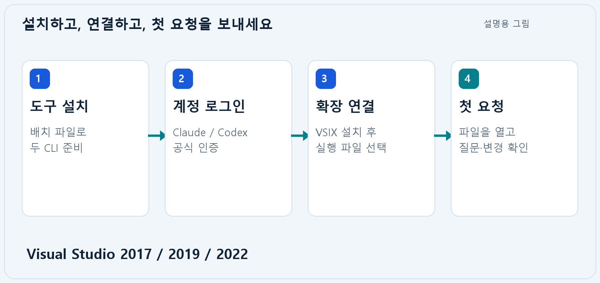

받으신 **InstallCLI.bat**로 AI 도구를 준비하고, 사용 중인 Visual Studio 버전에 맞는 **VSIX**를 설치하세요. 이후 본인 계정으로 로그인하고 확장에서 연결을 확인하면 시작할 수 있습니다.

이 PDF와 **HowToInstallCLI.md**는 같은 내용과 이미지를 제공합니다. 그림 중 터미널·탐색기 도식은 설명용 예시이며, 제품 화면은 가상 예시 데이터를 사용한 화면입니다. 실제 계정·고객 자료를 표시하지 않습니다.

**빠르게 찾아보기**

| 필요한 안내 | 안내 장 |
|---|---|
| 처음 설치·로그인·실행 파일 확인 | 01~06 |
| 확장 연결과 첫 요청 | 07~09 |
| 작업 권한·모델·변경 검토·첨부 | 10~13 |
| 문제 해결·배치 옵션·수동 설치 | 14~16 |

문서 개정일: 2026-10-18

<!-- page -->

## 01. 받으신 파일과 준비 사항

**먼저 준비할 것:** 64비트 Windows 10(1809 이상) 또는 Windows 11 PC, 지원되는 Visual Studio, 인터넷 연결, 사용할 AI 서비스 계정입니다. Visual Studio 2017은 15.9 이상, 2019는 16.11, 2022는 17.x를 기준으로 안내합니다.

<!-- figure-height: 235 -->
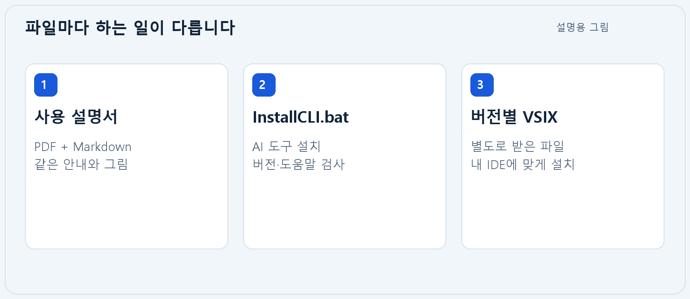

| 파일 | 역할 |
|---|---|
| InstallCLI.bat | 공식 Codex CLI와 Claude Code CLI 설치·검사 |
| 이 PDF / HowToInstallCLI.md | 같은 내용의 설치·시작 안내 |
| 버전별 .vsix | Visual Studio에 AI Assistant 확장 설치 |

설명서·배치 배포 ZIP에는 PDF, Markdown, 그림 파일, 배치가 들어 있습니다. **VSIX는 별도로 전달되는 구매 버전의 패키지**를 사용하세요. Node.js, npm, PowerShell 7은 이 배치의 필수 준비물이 아닙니다. 배치는 Visual Studio나 프로젝트의 빌드 도구를 설치하지 않습니다.

AI 이용 권한·사용량·요금은 각 서비스 계정에 따릅니다. 조직 계정을 사용한다면 해당 조직의 접근 권한도 확인하세요.

<!-- page -->

## 02. 내 Visual Studio에 맞는 VSIX 설치

**설치할 IDE 버전과 같은 이름의 패키지**를 선택합니다. 여러 Visual Studio를 사용하면 각 버전의 패키지를 따로 설치합니다.

<!-- figure-height: 260 -->
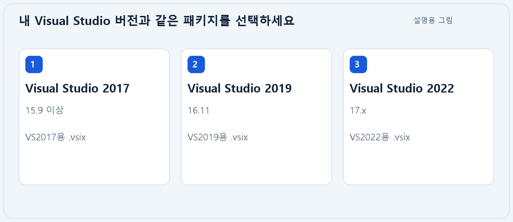

1. 작업 중인 파일을 저장하고 설치 대상 Visual Studio를 닫습니다.
2. 받은 파일 중 VS2017, VS2019 또는 VS2022용 `.vsix`를 실행합니다.
3. VSIX 설치 화면에서 대상 버전을 확인하고 설치를 완료합니다.
4. Visual Studio를 다시 열고 **도구 → AI Assistant** 메뉴를 확인합니다. 열린 도구 창의 제목은 **Claude · Codex**로 보일 수 있습니다.

원하는 IDE가 설치 대상에 나오지 않으면 패키지 버전과 Visual Studio 설치 상태를 확인하세요. 이 확장을 사용하기 위해 제공된 프로젝트 소스를 직접 빌드할 필요는 없습니다.

<!-- page -->

## 03. 배치 파일로 두 CLI 설치

**InstallCLI.bat를 일반 사용자로 실행**합니다. 두 AI를 위한 Windows 네이티브 실행 파일을 공식 설치기에서 내려받습니다.

<!-- figure-height: 260 -->
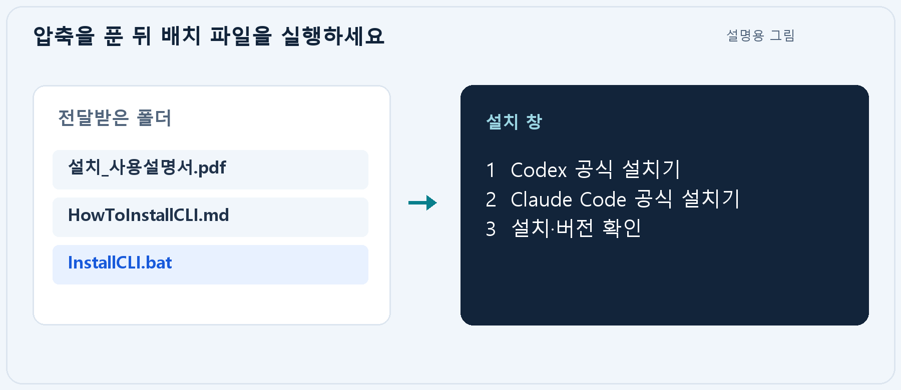

1. 전달받은 ZIP을 압축 해제하고 `InstallCLI.bat`를 더블클릭합니다.
2. Codex 설치가 끝나면 Claude Code 설치가 이어집니다. 다운로드 중에는 진행 표시가 잠시 없을 수 있습니다.
3. 마지막 결과를 확인합니다. 기본 실행은 결과를 읽을 수 있도록 키 입력을 기다립니다.
4. 설치가 끝나면 **터미널과 Visual Studio를 새로 실행**합니다.

기본 실행은 실행 시점의 공식 `latest` 배포본을 설치합니다. 기존 설치가 있으면 공식 설치기가 갱신·재확인할 수 있습니다. 배치는 누락된 CLI 폴더를 사용자 PATH에 추가하면서 기존 항목을 보존합니다.

<!-- page -->

## 04. 설치 성공 결과 확인

마지막에 **SUCCESS**가 표시되면 두 실행 파일의 `--version`과 `--help` 검사가 통과한 것입니다. 이 단계 다음에 계정 로그인을 진행합니다.

<!-- figure-height: 235 -->
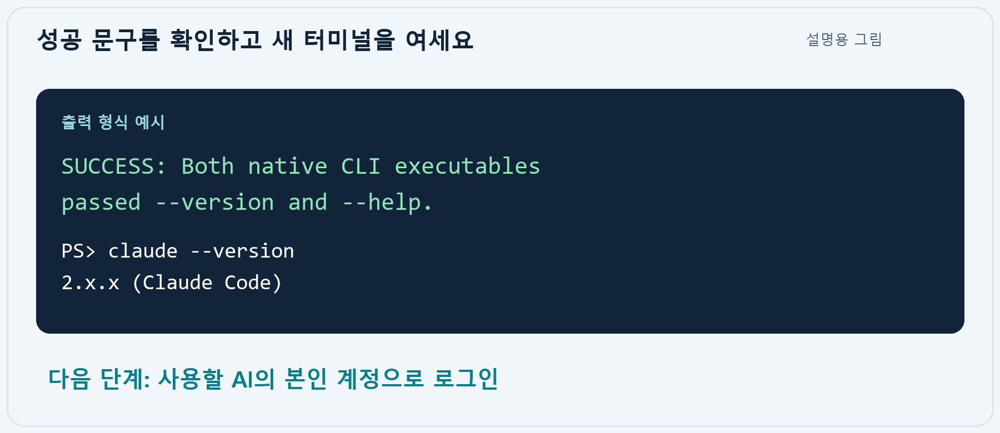

새 PowerShell에서 다음 명령으로 직접 확인할 수도 있습니다.

```powershell
codex --version
claude --version
Get-Command codex,claude | Select-Object Name,Source
```

| 확인 내용 | 기대 결과 |
|---|---|
| 버전 조회 | 각 도구의 버전 문자열 출력 |
| 명령 검색 | codex.exe와 claude.exe의 실제 위치 표시 |
| AI 사용 준비 | 다음 장에서 본인 계정으로 로그인 |

버전 숫자는 설치 시점에 따라 달라집니다. **FAILED**가 보이면 콘솔에 표시된 실패 항목과 로그 폴더를 확인하고 14장의 문제 해결 순서를 따르세요.

<!-- page -->

## 05. 본인 AI 계정으로 로그인

사용할 서비스에 로그인합니다. **Claude와 Codex의 계정은 각각 연결**하며, 한쪽 로그인으로 다른 쪽까지 연결되지는 않습니다.

<!-- figure-height: 195 -->
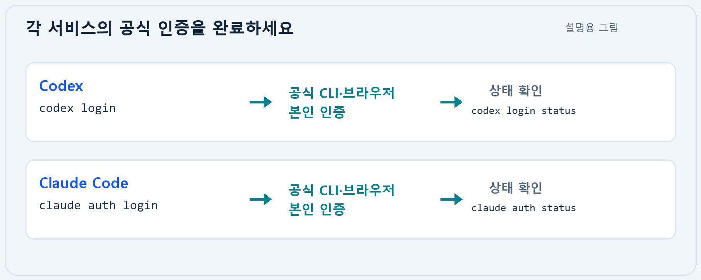

```powershell
# Codex: 로그인 후 상태 확인
codex login
codex login status

# Claude Code: 로그인 후 상태 확인
claude auth login
claude auth status
```

공식 CLI 또는 브라우저에 표시되는 절차를 본인이 완료합니다. 조직에서 지정한 Team·Enterprise 계정을 쓰는 경우 올바른 조직 계정으로 로그인하세요. 실제 모델과 사용량은 해당 계정의 권한에 따릅니다.

암호·인증 코드·API 키는 공식 인증 화면에만 입력합니다. 확장의 프롬프트, 공통 규칙, 오류 문의 내용에는 붙여넣지 않습니다. 회사가 별도 인증·접속 설정을 제공했다면 그 안내도 적용하세요.

이후 확장의 **계정 연결** 버튼으로도 공식 인증 절차를 열 수 있습니다. 로그인 후에는 반드시 **연결 확인** 결과를 읽으세요.

<!-- page -->

## 06. CLI 실행 파일 위치 확인

확장의 실행 파일 항목에는 **.exe 파일 경로**를 지정합니다. `InstallCLI.bat`, `.cmd` 래퍼 또는 로그인 명령 전체를 넣지 않습니다.

<!-- figure-height: 210 -->
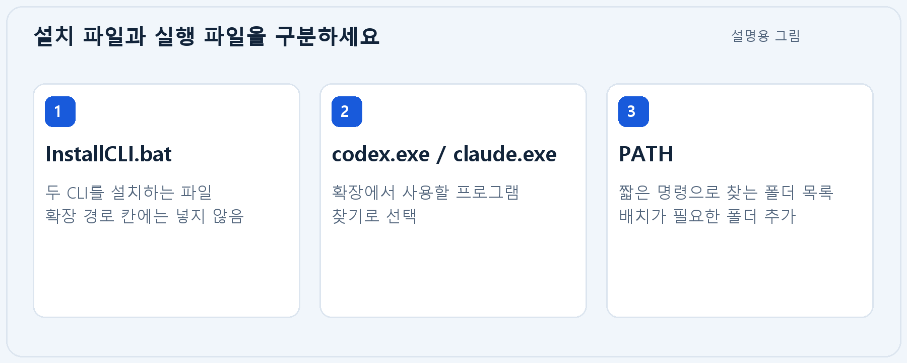

이번 배치의 기본 설치 위치는 다음과 같습니다. `%LOCALAPPDATA%`와 `%USERPROFILE%`은 사용자의 Windows 폴더를 뜻합니다.

```text
Codex
%LOCALAPPDATA%\Programs\OpenAI\Codex\bin\codex.exe

Claude Code
%USERPROFILE%\.local\bin\claude.exe
```

정확한 경로는 새 PowerShell에서 확인합니다.

```powershell
Get-Command codex,claude | Select-Object Name,Source
```

설정 창에서는 **찾기**로 실제 파일을 고르는 방법이 편리합니다. PATH에서 올바른 실행 파일을 찾을 수 있다면 경로를 비워 사용할 수도 있습니다. 여러 설치본이 있으면 원하는 `.exe`를 명시하세요.

<!-- page -->

## 07. AI Assistant 화면 살펴보기

**도구 → AI Assistant**를 열고 상단에서 **Claude** 또는 **Codex**를 선택합니다. 왼쪽은 대화 목록, 오른쪽은 메시지와 요청 입력 영역입니다.

<!-- figure-height: 550 -->
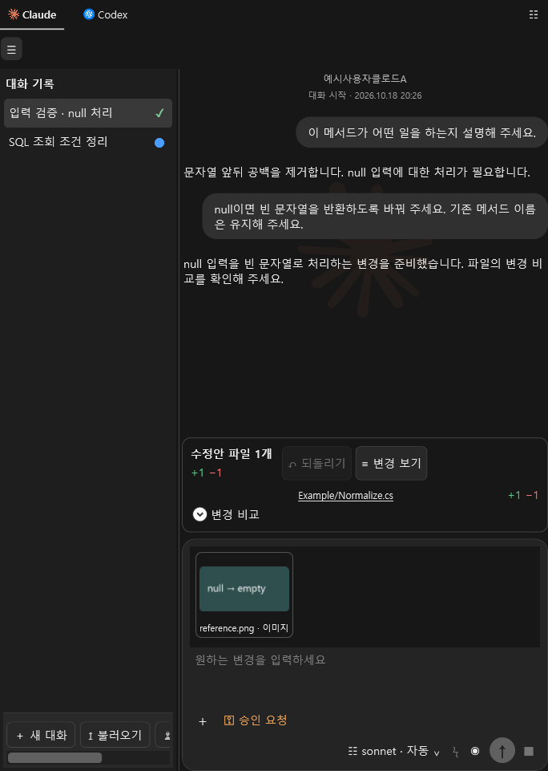

선택한 AI별로 실행 파일·로그인·모델 설정을 확인합니다. 화면의 계정 이름과 대화 내용은 고객의 실제 계정을 뜻하지 않는 예시입니다.

<!-- page -->

## 08. 실행 파일 설정과 계정 연결

**설정에서 현재 AI를 먼저 확인**합니다. 오른쪽 위 메뉴의 **설정** 또는 창의 **우클릭 → 설정**으로 엽니다.

<!-- figure-height: 390 -->
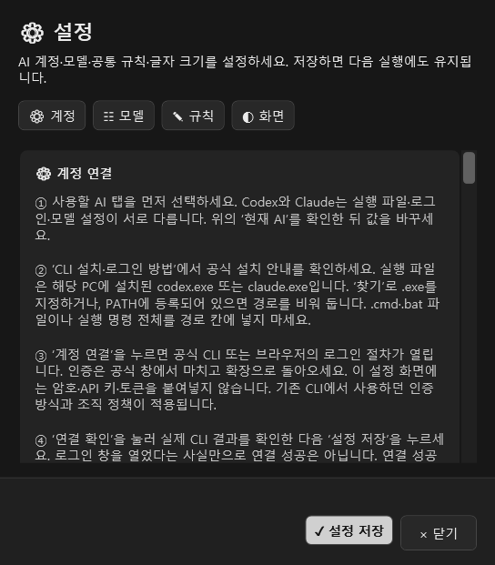

1. 현재 AI에 맞는 `claude.exe` 또는 `codex.exe`를 **찾기**로 지정합니다.
2. 아직 로그인하지 않았다면 **계정 연결**로 공식 인증을 마칩니다.
3. 확장으로 돌아와 **연결 확인**을 누르고 실제 결과를 읽습니다.
4. 성공 결과를 확인한 뒤 **설정 저장**을 누릅니다. 다른 AI도 사용할 경우 해당 탭에서 반복합니다.

설정 내용이 화면 아래에 있으면 설정 본문을 스크롤하세요. 로그인 창을 열거나 닫았다는 사실만으로 연결이 완료되지는 않습니다.

<!-- page -->

## 09. 첫 요청 보내기

**대상 소스를 열고, 원하는 작업을 구체적으로 입력**하세요. 처음에는 파일 설명처럼 결과를 확인하기 쉬운 요청으로 시작합니다.

<!-- figure-height: 340 -->
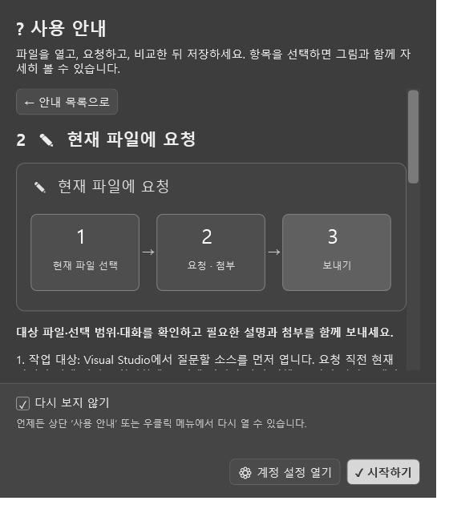

1. 솔루션과 소스 파일을 열고, 필요하면 관련 코드를 선택합니다. 새 파일은 먼저 저장합니다.
2. 요청할 AI와 대화를 선택하고 입력란에 원하는 내용을 적습니다.
3. **Enter** 또는 보내기 버튼으로 보냅니다. 줄바꿈은 **Ctrl+Enter**입니다.

```text
선택한 메서드의 동작과 예외가 발생할 수 있는 조건을 설명해 주세요.
파일은 아직 수정하지 마세요.
```

답변을 읽고 같은 대화에서 후속 질문을 이어갈 수 있습니다. 처리 중에는 진행 상태를 확인하고, 필요하면 **중지** 버튼을 누릅니다.

<!-- page -->

## 10. 작업 권한 선택

입력란 왼쪽 권한 메뉴에서 작업 방식을 선택합니다. **처음 코드를 바꿀 때는 승인 요청으로 변경 내용을 확인**하는 방법을 권장합니다.

<!-- figure-height: 320 -->
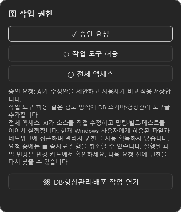

| 모드 | 사용 방식 |
|---|---|
| 승인 요청 | 수정안을 비교하고 승인한 뒤 편집기에 적용·저장 |
| 작업 도구 허용 | 수정안 검토와 확장의 DB·형상관리 등 작업 도구 사용 |
| 전체 액세스 | 네이티브 CLI가 파일·명령·테스트를 직접 실행 |

전체 액세스를 사용하기 전에는 열린 파일을 모두 저장하고 대상 폴더를 확인하세요. 현재 Windows 사용자 권한으로 작업하며 관리자 권한을 자동으로 얻지 않습니다. 중지해도 이미 실행된 파일·서버 변경은 남을 수 있으므로 종료 후 실제 결과를 확인합니다.

<!-- page -->

## 11. 모델과 응답 방식 선택

입력란 오른쪽 모델 메뉴에서 **모델·생각 강도·속도**를 확인합니다. 연결한 CLI가 제공하는 목록과 지원 기능이 표시됩니다.

<!-- figure-height: 370 -->
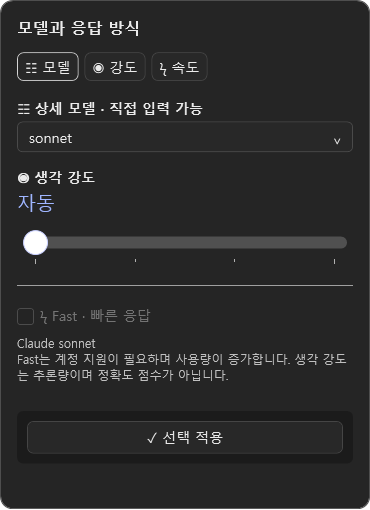

1. 특별한 이유가 없으면 기본 모델로 시작합니다.
2. 사용할 모델과 강도를 선택하고 **선택 적용**을 누릅니다.
3. Fast 항목은 지원이 확인되고 계정에서 사용할 수 있을 때 선택합니다.

목록에 모델이 보여도 계정의 실제 이용 권한은 AI 서비스가 판정합니다. CLI를 업데이트한 뒤 다시 연결하면 새 목록을 조회할 수 있습니다. 예시 화면의 모델 이름은 선택 가능한 전체 목록이나 특정 요금제의 보장 목록을 뜻하지 않습니다.

<!-- page -->

## 12. 변경 비교·승인·저장

수정안 검토 모드에서는 **원본과 변경안을 비교한 뒤 승인**합니다. 초록색은 추가, 빨간색은 삭제 내용을 나타냅니다.

<!-- figure-height: 525 -->
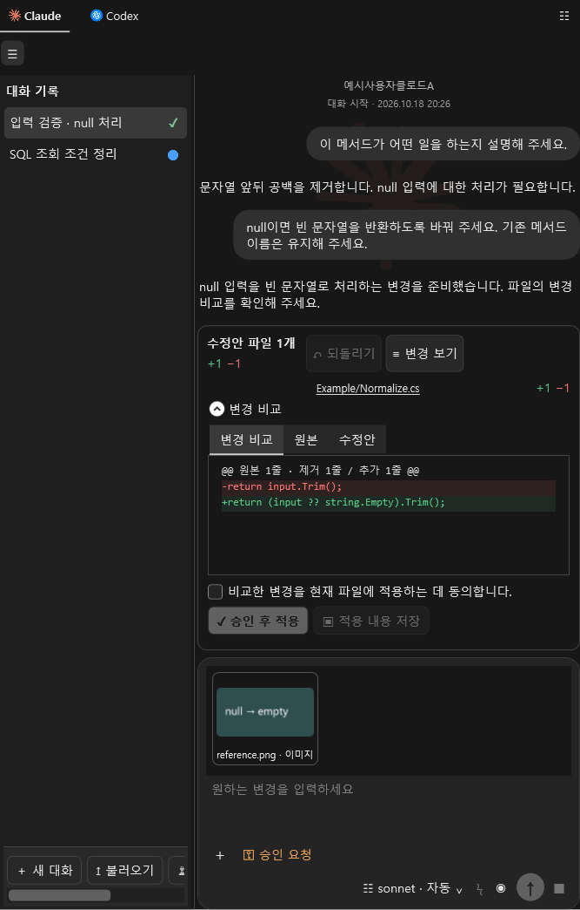

1. 변경 카드의 파일과 **변경 비교**를 확인합니다.
2. 동의 체크 후 **승인 후 적용**을 누르고 편집기 내용을 확인합니다.
3. **적용 내용 저장** 또는 소스 편집기의 **Ctrl+S**로 저장합니다.

전체 액세스는 AI가 직접 파일을 변경하므로 승인 요청 모드와 처리 순서가 다릅니다. 완료 후 변경 카드·실제 파일·테스트 결과를 함께 확인하세요.

<!-- page -->

## 13. 이미지와 문서를 함께 보내기

오류 화면이나 참고 자료를 입력란에 첨부하면 요청을 설명하는 데 도움이 됩니다. **첨부가 추가된 것을 확인한 뒤 보내기**를 누릅니다.

<!-- figure-height: 225 -->
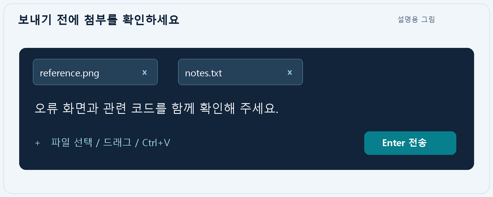

| 방법 | 동작 |
|---|---|
| 입력란 왼쪽 + | 파일 선택 |
| 파일 드래그 | 탐색기 파일을 AI 창으로 끌어 놓기 |
| Ctrl+V | 클립보드 이미지·파일 또는 텍스트 붙여넣기 |
| 첨부의 × | 보내기 전에 해당 첨부 제거 |

한 번에 최대 4개를 첨부합니다. 이미지는 PNG/JPEG 각 2MB, 문서는 원본 16MB 이내를 기준으로 합니다. 문서는 텍스트 본문을 추출하며, PDF·구형 Office 문서는 PC의 읽기 필터에 따라 지원 여부가 달라질 수 있습니다. 스캔 PDF는 텍스트 추출이 되지 않을 수 있습니다.

첨부는 제거할 때까지 다음 요청에도 포함됩니다. 원본을 변경했다면 기존 첨부를 제거하고 다시 추가하세요. 보내기 전에 공유 가능한 자료인지 확인합니다.

<!-- page -->

## 14. 문제가 생겼을 때 확인 순서

**실행 파일 → 로그인 → 확장 연결 → 요청 결과** 순서로 확인하면 문제를 구분하기 쉽습니다.

<!-- figure-height: 190 -->
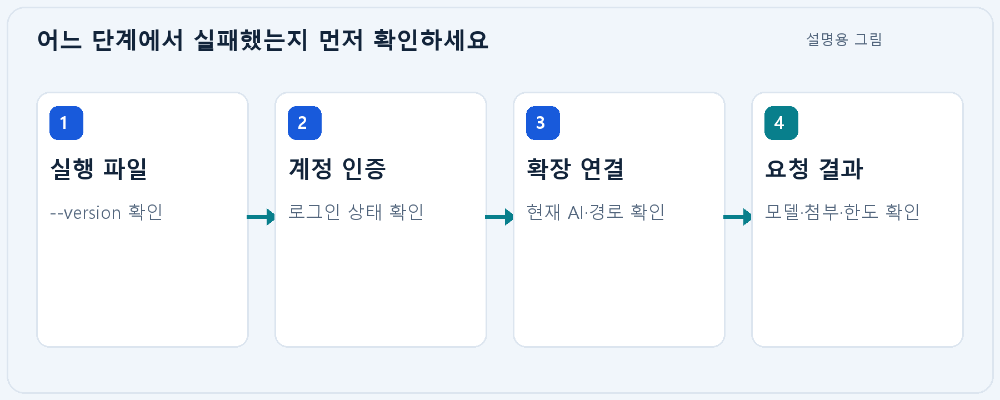

| 증상 | 먼저 할 일 |
|---|---|
| CLI를 찾을 수 없음 | 새 터미널과 Visual Studio 실행 후 .exe 경로 확인 |
| 버전은 나오지만 미로그인 | 해당 서비스의 공식 로그인 진행 |
| 확장에서 연결 실패 | 현재 AI·실행 파일·연결 확인 결과 확인 |
| 모델·사용량 오류 | 계정 권한·한도 확인 후 기본 모델로 재시도 |
| 첨부를 읽지 못함 | 파일 형식·크기·텍스트 유무와 PC 읽기 필터 확인 |

배치 파일이 있는 폴더의 새 PowerShell에서 설치 상태만 검사할 수 있습니다.

```powershell
.\InstallCLI.bat /check /nopause
```

문의할 때는 제품·Visual Studio·CLI 버전, 오류 문구, 재현 순서를 준비합니다. 로그·캡처를 보내기 전 계정명, 이메일, 개인 경로, 인증정보와 실제 고객 자료를 가리세요.

<!-- page -->

## 15. 배치 옵션과 로그

기본 실행이면 일반 설치가 가능합니다. 아래 옵션은 버전 지정, 설치 상태 확인 또는 자동 실행이 필요할 때 사용합니다.

<!-- figure-height: 185 -->
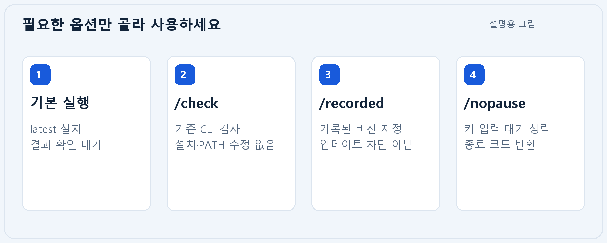

| 실행 방법 | 의미 |
|---|---|
| InstallCLI.bat | 공식 latest 설치 후 결과 화면에서 대기 |
| InstallCLI.bat /check /nopause | 설치·사용자 PATH 변경 없이 기존 CLI 검사 |
| InstallCLI.bat /recorded | Codex 0.163.0 / Claude Code 2.1.302 지정 설치 |
| InstallCLI.bat /nopause | 설치·검사 후 키 입력 대기 없이 종료 |
| InstallCLI.bat /help | 옵션 안내 |

`/recorded`는 문서 작성 시 확인한 버전을 선택합니다. 해당 버전이 공식 서버에 있어야 설치할 수 있으며, 이후 자동 업데이트까지 영구적으로 막는 옵션은 아닙니다.

설치기 종료 코드 **0은 성공, 1은 설치·검사 실패, 2는 잘못된 옵션**입니다. 한 CLI가 실패해도 다른 CLI를 검사한 뒤 전체 실패를 알립니다. 실행별 로그 폴더는 콘솔에 표시되며, `install.log`, 공급자별 설치 로그, 도움말 결과와 설치 스크립트가 저장됩니다. `/check`도 검사 로그를 만듭니다.

<!-- page -->

## 16. 수동 설치와 업데이트

배치 없이 설치하려면 새 PowerShell에서 각 공급자의 공식 명령을 실행합니다. 이 방법도 Windows 네이티브 CLI를 설치합니다.

```powershell
# Codex 공식 Windows 설치·업데이트
powershell -ExecutionPolicy ByPass -c "irm https://chatgpt.com/codex/install.ps1 | iex"

# Claude Code 공식 Windows 설치
irm https://claude.ai/install.ps1 | iex

# Claude Code 수동 업데이트
claude update
```

<!-- figure-height: 185 -->
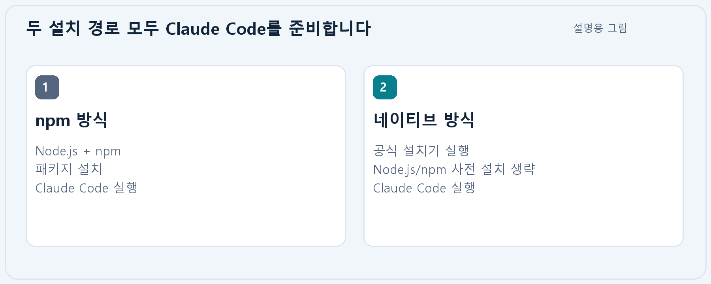

Node.js와 npm을 먼저 설치하는 안내를 받았더라도, 이 배치의 네이티브 설치 방식으로 Claude Code를 준비할 수 있습니다. Anthropic은 현재 npm과 독립 설치기가 같은 네이티브 실행 파일을 설치한다고 안내합니다. CLI 설치를 위해 npm 환경 변수를 따로 만들 필요는 없습니다.

Visual Studio 개발자 명령 프롬프트는 프로젝트를 빌드할 때 유용합니다. CLI 설치 자체에는 필수가 아니며, 설치 후 그 창에서도 `claude`와 `codex`를 실행할 수 있습니다. 업데이트 후에는 버전·실행 파일 경로·확장 연결을 다시 확인하세요.

공식 안내: [Codex 설치](https://learn.chatgpt.com/docs/codex/cli) · [Claude Code 설치](https://code.claude.com/docs/en/setup)

<!-- page -->

## 17. 시작 전 마지막 확인

아래 항목을 모두 확인했다면 소스 파일을 열고 첫 요청을 보내세요.

<!-- figure-height: 195 -->
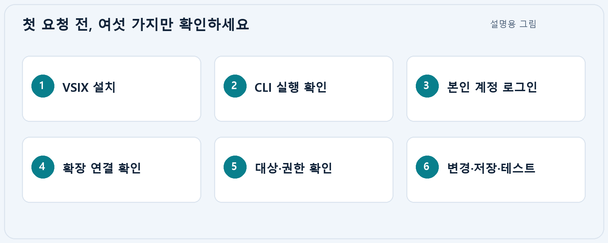

1. 내 Visual Studio 버전에 맞는 VSIX를 설치했습니다.
2. 사용할 CLI의 버전과 실제 `.exe` 위치를 확인했습니다.
3. 본인 또는 조직에서 허용한 AI 계정으로 로그인했습니다.
4. 현재 AI의 **연결 확인**에 성공하고 설정을 저장했습니다.
5. 대상 파일과 작업 권한을 확인하고 필요한 자료만 첨부했습니다.
6. 응답·변경 내용을 확인하고 필요한 경우 적용·저장·테스트를 진행합니다.

**공식 도움말**

- [OpenAI Codex CLI 설치·업데이트](https://learn.chatgpt.com/docs/codex/cli)
- [OpenAI 계정 인증](https://learn.chatgpt.com/docs/auth)
- [Anthropic Claude Code 설치·업데이트](https://code.claude.com/docs/en/setup)
- [Anthropic 계정 인증](https://code.claude.com/docs/en/authentication)
- [Anthropic 설치 문제 해결](https://code.claude.com/docs/en/troubleshoot-install)

이 설명서는 CLI 설치와 AI Assistant의 첫 사용을 다룹니다. 실제 화면·모델 목록은 제품·CLI 업데이트에 따라 달라질 수 있습니다. 설치 성공 표시만으로 로그인·AI 응답·프로젝트 테스트 성공이 보장되지는 않으므로 각 단계의 실제 결과를 확인하세요.
