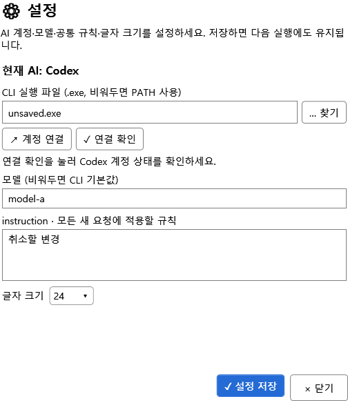
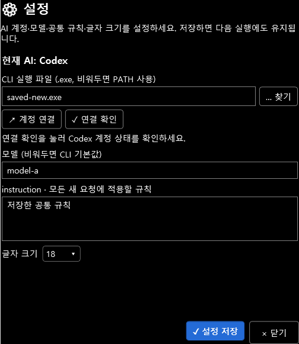

# TASK-010 — 중앙 설정·일관된 UI·처음 사용 안내

- 담당: CodexOrig
- 시작: 2026-10-18 11:28:35 KST. 로컬 검증/최종 배포 종료 시각과 소요는 Update_History.md에 기록한다.
- 요청: 최신 Role.md 프로젝트8~11번 및 참고 image-1.png 반영.
- 제품: v0.4.0 / .NET Framework 4.6.2 / C# 7.0 / VS2017 15.9.

## 구현

상단 **⚙ 설정**과 우클릭 **설정**은 같은 화면 중앙 모달 팝업을 연다. 현재 AI의 경로·계정 연결/확인·모델과 공통 instruction·글자 크기를 제공한다. **설정 저장** 성공 시 닫히며 닫기·Esc·X는 팝업에서 바꾼 값을 복원한다. 저장 실패는 창 안에 표시하고 원본 설정 파일을 보존한다. 공식 CLI에서 이미 수행한 로그인은 설정 입력 취소와 별개다.

Chat·설정·사용 안내·메뉴·글자 크기 선택은 공통 AssistantTheme.xaml과 동적 VS 브러시를 사용한다. 버튼에 기호와 행동 이름을 함께 표시하고, Chat에 파일 선택→요청→비교/승인→저장 순서와 입력 예시를 넣었다. 텍스트 메뉴의 Cut/Copy/Paste/SelectAll 및 이미지 Ctrl+V 처리도 유지했다. 대화 DataTemplate의 TextBox는 Loaded를 직접 연결해 복사·설정 메뉴를 제공한다.

처음 실제로 표시되는 Chat은 참고 포스터처럼 네 개의 번호/기호/행동 카드를 보여준다. **다시 보지 않기**는 이전 버전에 없던 HideWelcome 항목으로 저장한다. 안내 선택만 바꿀 때는 기존 저장 파일을 읽고 이 항목만 변경하므로 경로·모델·규칙·크기를 덮어쓰지 않는다. 상단/우클릭 **사용 안내**로 언제든 다시 열고 선택을 해제할 수 있다.

## 변경 경로

- src/VS2017.AIAssistant/Views/AssistantControl.xaml·AssistantControl.Chat.cs·AssistantControl.xaml.cs
- src/VS2017.AIAssistant/Views/AssistantControl.Dialogs.cs·AssistantDialogs.cs·AssistantTheme.xaml
- src/VS2017.AIAssistant/Chat/ChatWorkspace.cs, 프로젝트 포함 항목·AssemblyInfo·VSIX 매니페스트
- tests/ux/DialogChecks.cs, 기존 tests/editing·ide 실행 경로
- docs/UX_TESTS.md·DEVELOPMENT.md·IDE_TESTS.md·SOURCE_EDITING.md, Project_Plan.md
- releases/v0.4.0/VS2017.AIAssistant-0.4.0.vsix·README.md·SHA256SUMS.txt

클래스/메서드 주석은 기존 name/desc/author/create date/update date의 줄바꿈·콜론 열 형식을 사용했다. 기존 작성자 기록을 보존하고 수정한 메서드에 update date를 추가했다.

## 검증

| 경로 | 결과 |
|---|---|
| VS2017 MSBuild15 Debug/Release | 경고0·오류0 |
| 편집·Chat·팝업 UX 회귀 | 86/86 PASS (기존71 + UX15) |
| Foundation 패키지/밝은·어두운/320·200폭 | 33/33 PASS |
| 호환성 도구 회귀 | 44/44 PASS |
| 고정 VSIX 실제 VS2017 | 50/50 PASS (기존35 + UX15, 실제 Codex 포함) |
| 독립 첫 사용 여정, 최종 DLL | TASK-011 28/28 PASS |

독립 회귀 합계163개와 실제 IDE50개는 실행 환경별로 구분한다. 실제 IDE 검사는 별도 RootSuffix CodexCodeTestc82238c7의 합성 프로젝트만 사용했다. 실제 Codex가 return1→2 수정안을 만들고 승인 전 원본을 유지하며 승인 후 실제 EnvDTE 적용·저장까지 통과했다. 새 UX는 실제 WPF 창의 Loaded·Click·CenterScreen 좌표·저장/취소를 검사했다. IDE 안에서 격리된 제품 컨트롤을 생성해 첫 실행을 재현하며 물리 마우스 동작을 자동화했다고 보고하지 않는다.

근거: [검증 JSON](CodexOrig_TASK-010_Validation.json), [실제 IDE50개](CodexOrig_TASK-010_IDE.json), [독립 사용자 여정](CodexCode_TASK-011_Journey.json), [재현 절차](../docs/UX_TESTS.md).

밝은/어두운 팝업을 직접 열어 확인했다. 아래는 테스트 전용 경로/규칙을 넣은 실제 제품 렌더이며 사용자 계정 정보가 아니다.

## 패키지와 협업

- VSIX SHA-256: `2DD768237916AD7671B1829C279977D8BAC65684B59DFD3DC85DAD3C99523C53`
- DLL SHA-256: `109221E7B9B79D658A5C03E238493FCE762AF05F7FF263A9C38D056B1C367654`
- 고정 인계 이후 제품 소스 변경 없음. 기존 v0.2/v0.3 릴리스 보존.
- TASK-011 CodexCode는 README·USER_GUIDE·사용자 화면·독립 검토/검증을 담당했다. 해당 파일은 직접 중복 편집하지 않았다. TASK-011 완료를 확인한 후 CodexOrig가 GitHub 반영하며 결과를 별도 완료 기록에 남긴다.

현재 패키지는 VS2017용이다. VS2019/2022 확장 패키지와 실제 Claude 계정 호출, 다중 모니터/DPI·스크린리더·모든 실제 마우스/키보드 제스처 검증은 후속 범위다. 세 IDE가 설치된 테스트 환경은 기존 작업에서 유지한다.
