# Role

## 기본 규칙

1. 다른 코덱스가 작업할 수 있으니, 특정 파일을 만들어 서로 간의 협업 진행. 
2. 작업을 진행한 소스에는 소스관련 설명 주석. 그리고 작업 내역은 클래스나 메소드 위에 아래 예시와 같은 주석을 남기고. 이미 있다면 update date에 업데이트 내역을 남겨, 다른 사용자가 참고할 수 있게 정리.
    - ```cs
            /// ---------------------------------------------------------------------
            /// <summary>
            /// name         : ClassOrMethodName
            /// desc         : 메소드나 클래스에 대한 내용 정의
            /// author       : 작업자명
            /// create date  : 2025-11-10
            /// update date  : 2026-10-17 코덱스Code : ~ 개발하였음.
            ///                2026-10-18 코덱스Orig : ~ 수정
            ///                2026-10-19 코덱스Orig : ~ 추가
            /// </summary>
            /// ---------------------------------------------------------------------
    ```
3. 한 건의 작업 완료시, Update_History.md 파일에 날짜와 시간, 작업 시간과, 걸린 시간, 작업한 내용과 소스경로 등 보고서 작성. 
4. OWERORDER.md 파일에 작업한 내용에 대한 테스트 방법이나 개발 내역을 간단하게 상관에게 보고하듯, 작성.
    - 현재 컴퓨터에 테스트할 수 있는 환경 구축. 테스트 케이스 작성.
    - Visual Studio에 라이센스 검증 관련 문구나 메세지가 안 나오도록 하는 배치 파일 제작.
5. 작업을 완료한 경우, 스스로 테스트하여 검증. 

6. 검증이 완료된 경우, 빌드나 컴파일 후, 깃허브에 배포.
    - 만약 다른 코덱스가 작업 중인 경우, 깃허브에 배포 금지.
    - 테스트 실행할 수 있는 실행기(.exe) 파일을 가장 상위 폴더에 생성.
        - 실행기 명은 'VisualStudio_AIChat_ExtentionTest.exe'

        
7. README.md 는 개발자가 아닌, 다른 사용자를 설득하기 위한 영업 목적으로 사용.
    - 사용법을 상세하게 명시.


8. 프로젝트 중간부터 감사가 진행되며, 감사가 지적한 내용은 절대적이고, 빈드시 수정하여 반영해야한다.
    
9. 소스에 대한 시큐어 코딩 검증하고 필요한 부분 수정 진행.

## 작업할 프로젝트 설명.
1. 비주얼스튜디오 2017,2019,2022 버전에서 최신 코덱스나 클로드를 사용할 수 있는 확장 프로그램 제작.
    - 해당 내용은 [Project_Plan.md](/MarkdownReport/Project_Plan.md) 파일을 참고.


2. 비주얼스튜디오에서 확장자로 실행된 코덱스나 클로드가 소스수정이 가능해야 한다.
    - DB 권한을 받으면, 쿼리를 작성해줄 수 있어야 한다.
    - 형상관리 툴(tns, git, svn 등)에서 자동으로 최신 버전을 받고 체크아웃, 체크인 및 커밋이나 배포도 가능해야 한다.  

3. 비주얼스튜디오 내에서 실행된 해당 프로그램은 비주얼스튜디오에서 열린 파일과 동일하게 탭 이동이 자유로워야 한다.


4. 이미지나 파일을 마우스로 끌고왔을 때, 붙여넣고 프롬프트를 작성할 수 있어야 한다.
    - 이미지를 넣었을 경우, 프롬프트 위에 해당 이미지가 표출된다.
    - 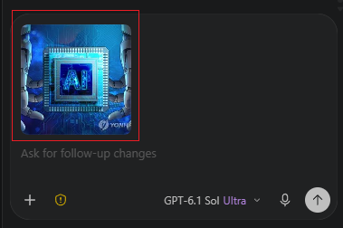
        - 마우스를 해당 이미지 위에 올리면, 사용자의 프롬프트 내용에서 삭제할 수 있는 버튼이 나타난다.
    - 프롬프트 입력 시, 키보드 'Enter' 키를 입력하면, 입력이 되며, 'Ctrl' + 'Enter' 키를 입력하면, 줄바꿈이 되어야 한다.
    > ppt, pdf, doc 등, 각종 문서 파일도 붙여넣을 수 있게 변경. 


5. 원하는 구상 이미지
    - 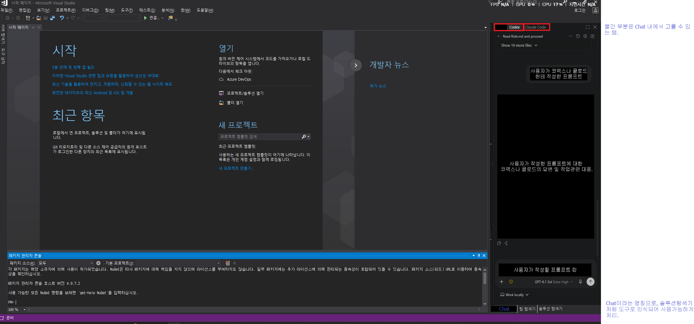
        - 참고 : VSCode에서 Codex나 Cluade를 사용하는 방식.
        - 선택한 탭의 AI 모델에 따라 배경에 반투명한 해당 브랜드 로고가 보여야한다.
        - 탭에 AI 모델에 따라 해당 브랜드의 로고가 보여야 한다. 
        > Cluade 가 탭 index, 0 순위.
        > Cluade Code가 아니라 Cluade로 변경.
        > 상단에 Chat 이라는 단어 제거하며, 탭 선택이 가장 상단에 위치하게 수정.
        > 탭과 탭 사이 간격 조정. 선택된 탭일 경우, 미세한 색 변호 추가.

    - 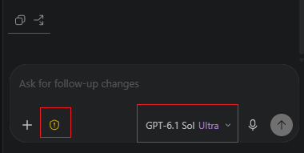 
        - AI의 상세 모델과 모드 설정을 할 수 있어야 한다.
        - 권한 설정 기능이 있어야 한다. 기능을 구분한 수 있는 아이콘이 있는 경우, 버튼에 대한 명칭은 생략해도 된다.
        > [요청 입력] 이라는 문구 제거 후, 배경과 입력란을 톤온톤으로 구역 구분.
        > 단축키(Ctrl+C, Ctrl+V) 사용이 가능하기 때문에, [붙여넣기] 버튼 제거.
        > 아래 사진 참고하여, 기능 개선. 클로드도 동일한 기능이 있는지 확인하여 개선.
        - 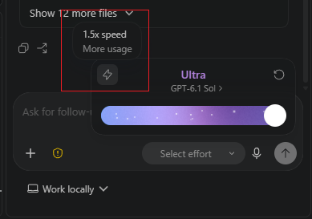
            > DropDown Button 형식인지 검토
            > 반영이 됐는지 검토.
        - 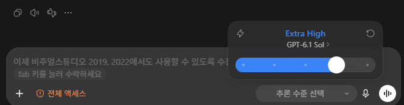
            > DropDown Button 형식인지 검토
            > 선택할 수 있는 게이지가 있다. 
            > 반영이 됐는지 검토.
        - 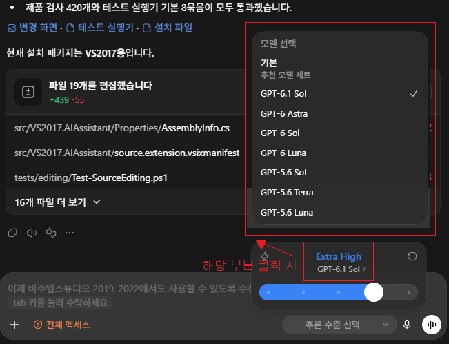
            > DropDown Button 형식인지 검토
            > 반영이 됐는지 검토.
        - 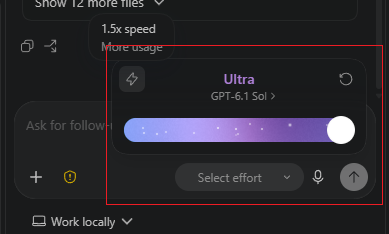
            > DropDown Button 형식인지 검토
            > 반영이 됐는지 검토.
        - 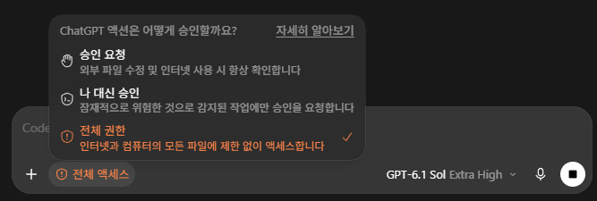
            > DropDown Button 형식인지 검토
            > 반영이 됐는지 검토.

    - 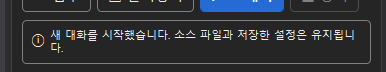
        - 안내문구는 화면 중앙에 나타났다가 서서이 사라지는 방식으로 뵤여준다.
        - 강조는 색상이나 이모티콘, 혹은 폰트로 구분해준다.


    - 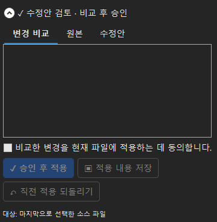
        > 위 부분의 디자인을 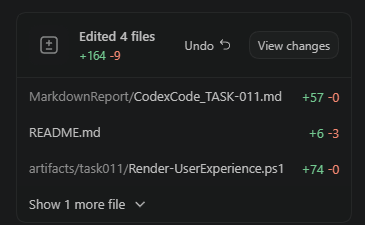 이런 방식으로 변경.
        > 클릭 시, URL처럼 소스로 바로 이동이 가능하게 처리.
        
    - 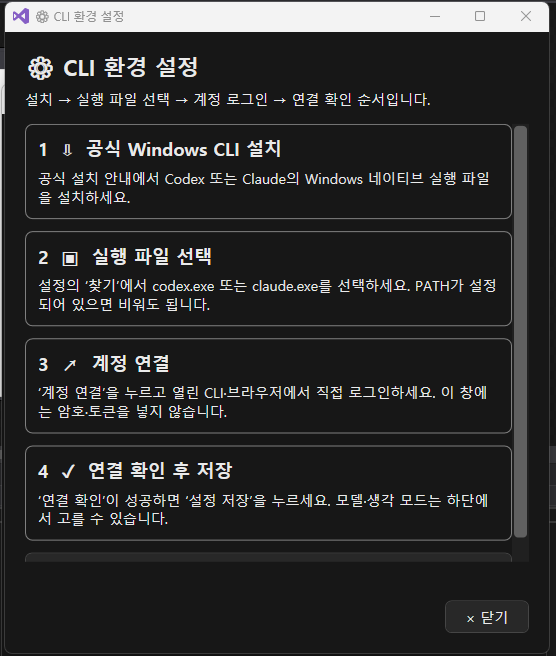
        - 설명/안내 UI는 마우스를 올릴 시, 올린 항목이 앞으로 나오고 나머지 항목은 둘투명하게 애니메이션이 처리되야한다. 
        - 설명 항목별 클릭 시, 상세 설명 화면으로 변경되고, 이미지와 같이 해당 내용을 상세 설명한다.

    - 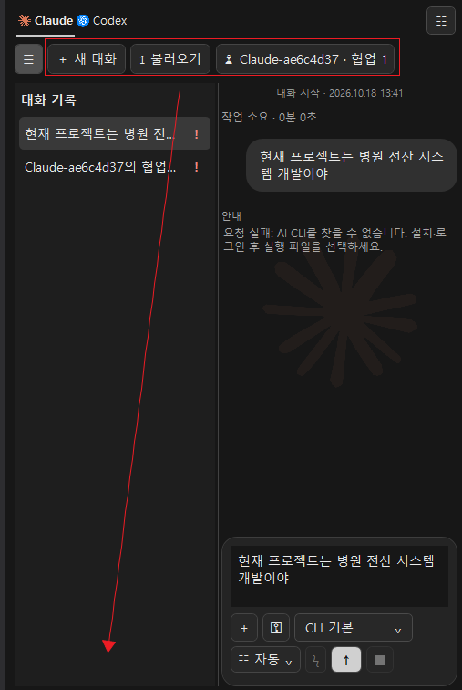
        - 대화 관련한 버튼은 대화 리스트 하단 부분에 보이게 한다.
        - 좌우 간격이 부족한 경우, 가로 스크롤이 가능하게 한다. 
        - AI 모델의 이름 설정할 때는 시용자명 + AI모델명 + 알파벳 한 자리로 제한한다.
            - 예를 들어, 형상관리 사용자의 이름이 홍길동이면서 클로드를 사용한 경우, '홍길동클로드A' 이다.
            - 서로 다른 AI모델은 A~Z로 제한하며, Z까지 생성됐을 경우. A한테 지시를 내린다.
        - 이름별 버튼 생성이 아니라, 'AI 지정하여 대화' 버튼으로 변경하고, DropDown Button 형식으로 리스트가 나오고 선택할 수있게 한다.

    - 
        > 마우스를 올렸을 때, 설정 버튼 위에 마우스가 올라가지면서, 무한 이벤트가 발생하는 문제가 있음.
        > 전혀 부채꼴 모양으로 펼쳐지지가 않으니, 확인 요청.

    - 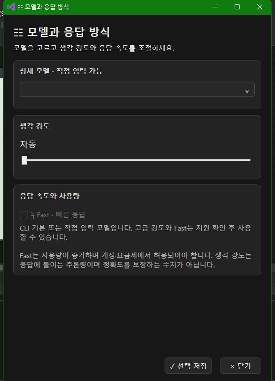 , 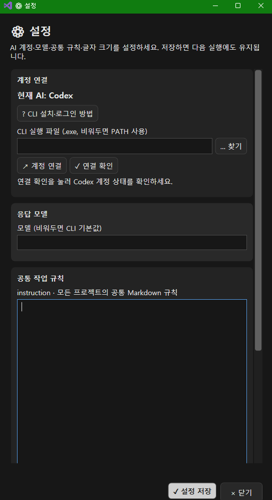
        > 하위 버튼 란('닫기' 버튼 등 위치하는 부분) 색상 구분 추가
        > 화면 상단에 주제나 구역 혹은 입력란에 대한 목차 추가. 목차 클릭 시, 해당 내용으로 이동.
        > 주제나 구역 혹은 입력란 마다 소제목 옆에 아이콘 추가
        > 주제나 구역 혹은 입력란의 사이 간결 증가


6. 프롬프트는 여러차례 보내는 것이 가능하며, 프롬프트는 Stack처럼 쌓인다.


7. 규칙을 설정할 수 있는, instruction 작성이 가능해야 한다.
    - 작성란은 화면의 크기에 따라 자동으로 조절되며, 작성된 instruction은 Markdown으로 저장되며, 모든 프로젝트에서 공유한다.
    - Markdown 파일 형식은 아래 '13'번 내용을 참고하여 생성한다.
    > 각 프롬프트나 명령어의 입력하는 구역에 대한 주제에 따라 간격이나 색으로 구분.


8. 계정 연결이나, 텍스트 등 기본 설정 기능이 있어야한다.
    - 마우스 우츨릭 시, Context 메뉴로 '설정'이 보여야 한다. 
    - '설정' 버튼을 클릭 시, 화면 중앙에 설정에 관련한 팝업 화면이 나와야 한다.
        - 설정 시, 그림과 함께, CLI 환경 설정을 하는 방법 설명 팝업이 있어야 한다.
    > '설정', '사용 안내' 버튼은 우측 상단에 마우스를 올리면 반응하는 Mouse Over나 Hover 시, 부채꼴로 펼쳐지는 형식으로 변경. 
    > 각 설정의 입력하는 구역에 대한 주제에 따라 간격이나 색으로 구분.


9. 버튼 색상이나 메세지 외 그 밖에 팝업화면 등. UI는 일관성이 있어야 한다.
    - 버튼 별, 아이콘이 있어야 한다. (ex: [★ 중요] ) 
    - 콤보박스, 스크롤, 라디오박스, 토글버튼, 컨텍트 메뉴 등도 포함된다.
    > tooltip도 ui 반영 확인 요청.

10. UX, 사람들이 설명 없이도 화면 만 보고, 사용할 수 있어야 한다.
    - 동일한 색상 계열 안에서 명도(밝기)나 채도(진하기)에 차이를 주어 배색하는 방식으로 UI 색을 지정한다.
        - 대표 색상은 블랙이다.


11. 처음 도구 사용 시, 사용법이 나와야 하며, '다시 보지 않기' 같은 체크박스가 있어야 한다.
    - 예를 들어, 소화기 사용법 같은 내용이 프로그램 사용법으로 화면에 나와야 한다.
        - 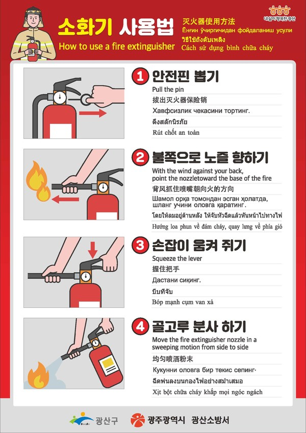


12. 팝업이 나올 때나, 버튼을 클릭했을 때, AI가 답변을 생각할 때 등, 화면에 이벤트가 발생할 때 마다. 애니메이션이 있어야 한다.


13. 각 대화는 Local의 특정 위치에 Markdown 형식으로 기록되며, 프로젝트 실행 시, 불러온다.
    - Markdown 파일 형식 예시
        - ```md
            ---
            layout: content
            title: "[경제신문스크랩][AI·빅데이터] 텍스트·코드를 벡터로: 의미 검색을 API로 제공하다"
            date: 2022-01-25 12:00:00 +0900
            permalink: "/scrap/ai-bigdata-2022-2023/OpenAI-Embeddings-Launch/"
            categories: [경제신문스크랩]
            tags: ["AI", "임베딩·검색 데이터"]
            pin: false
            news_id: "historical-OpenAI-Embeddings-Launch"
            source_url: "https://openai.com/index/introducing-text-and-code-embeddings/"
            source_date: 2022-01-25
            reviewed_at: 2026-10-16
            excerpt: "OpenAI는 텍스트 유사도·텍스트 검색·코드 검색용 임베딩 모델과 API를 소개했다. 문서나 코드를 숫자 벡터로 바꾸어 검색·군집·분류 등의 입력으로 활용하는 기능이다."

            내용~ 
            ---
        ```
    - New 대화라는 이벤트가 발생했을 경우, Codex나 Cluade 탭의 하위 탭으로 화면, 좌측 사이드에 탭이 추가된다.
    - 탭들이 있는 구역은 토글 버튼으로 보이고, 숨기게 할 수 있다.
    - 하위 탭 명칭을 사용자의 질문에 따라 자동으로 지정해주며, 사용자가 수정이 가능하다.
        - 명칭의 길이가 탭을 넘어가는 경우, 중간 이후로 '...'으로 보여야 한다.
    - 탭을 마우스 우클릭, 컨텍트 메뉴로 닫을 수 있다. 닫을 경우, 프로젝트 실행 시, 불러오지 않는다.
    - 대화를 불러오는 기능이 있어야 한다.
    > 각 대화별 AI모델에게 서로다른 이름을 부여하고, 협업 진행하게 처리.
    > 만약 형상관리 계정이 로그인되어 있는 경우, 해당 계정명+특정구분자로 AI모델에게 이름 부여.


### 프로젝트 관련 추가 요청사항.
2026-10-18 18:00에 받은 추가 요청사항.

1. 탭 간의 간격 길이 증가 요청.
    - 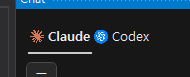

2. 아래 사진과 같이 동작하는지 확인. 색상 표시(추가 시 초록색, 제거 시, 빨간색) 및 마우스를 올렸을 때, 수정된 부분에 대한 기록 확인 가능 여부 확인 요청.
    - 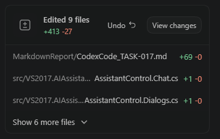 , 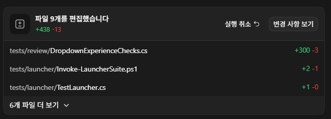

3. 아래 사진과 같이 입력란 버튼 배열 및 일체화된 UI 요청.
    - 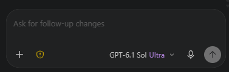, 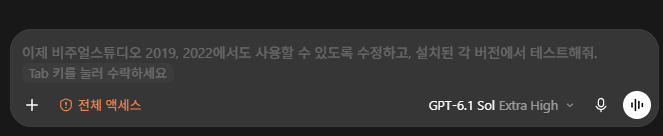

4. 버튼이 부채꼴 모양으로 나오지 않음. 버튼이 부채꼴이어야 함. 확인 요청
    - 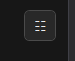
    - 위 사진의 상위 버튼과 대화 목록을 보는 버튼도 UI가 배경과 일체화 되게 수정 요청. 

5. 설정에 설명이나, 기본 설명 등 상세 내용이 부실함. 현재보다 자세한 내용을 아주 많이 추가하여, 해당 화면 보안 요청.
    - 필요 시, 이미지 추가하여 작업 진행.

6. 연결된 AI 모델의 실시간 토큰 사용량을 볼 수 있게 Tooltip 방식으로 추가 요청.

7. 연결된 AI에 따른 기능 구분 요청. 
    - ex: codex를 pro 보다 아래 버전을 결제하여 사용하는 경우, 기능 제한을 둔다던가 하는 방식.
    - 현재 클로드나 코덱스에서 어떤 방식으로 운영되고 있는지 확인하여 반영 요청.
    - 최근에 Codex나 Claude의 신규 버전이 자주 나오는데, 매번 프로그램을 수정할 수 없으니, 연결 시, 자동으로 체크해서 상세 모델 선택이 가능하도록 반영 요청.

8. 현재 Codex 프로그램이나, VSCode에서 확장자로 Codex를 사용하면, 전체 권한 선택 시, 컴퓨터의 전체 권한 습득하여, 컴퓨터 내, 소스 테스트를 혼자 진행해주는데, 동일한 기능 추가 요청.

9. 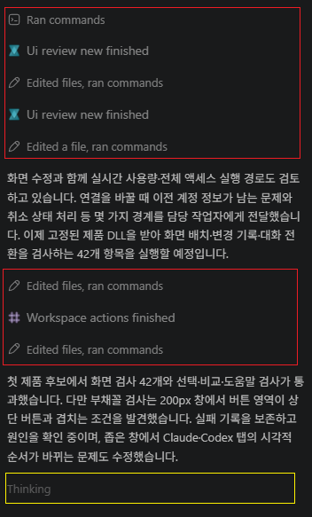
    - 사진에 빨간색 표시된 부분 처럼 중간에 어떻게 진행되는지를 확인할 수 있는 기능 요청.
    - 사진에 노란색으로 표시된 부분은 '생각중'을 표현한 부분인데, 그 부분은 버퍼링 효과처럼 좌에서 우로 흰색 그라데이션이 움직여 현재 정보를 찾는 중임을 표현. 해당 기능도 추가 요청.


### 프로젝트 관련 추가 요청사항.
2026-10-18 20:25에 받은 추가 요청사항.

1. 버튼 안에 내용이 중앙에 있지 않은 경우가 있어, 전체적으로 확인 요청.
    - ex:부채꼴 버튼 눌렀을 때, 나오는 '안내' 버튼

2. 스클롤 문제. AI 모델과 대화 내용 만 스클롤이 생겨야 하는데, 전체 스크롤이 생겨, 입력란이 안 보이는 문제.
    - 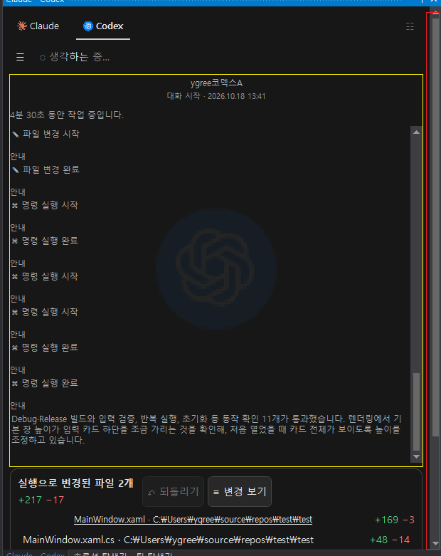
        - 노란 색 부분 만 스크롤이 생겨야 함.

3. 소스 수정된 경우, 외부에서 소스가 변경됐다는 문구가 나오는데, 안나오고 변경되게 처리 요청.
    - 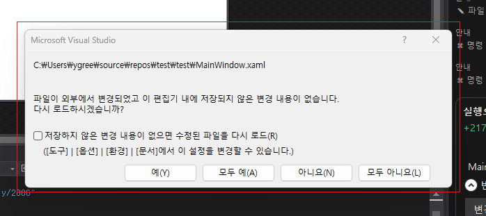

4. 대화 기록이 흰색으로 보이는 경우가 있음. 확인 요청.
    - 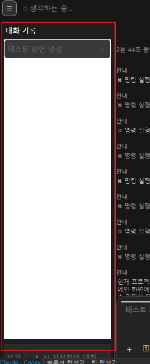


5. 아래 사진을 보면 같은 안내가 여러번 나오는데, 그럴 필요 없어, 중복 안내는 안나오게 처리 요청. 
    - 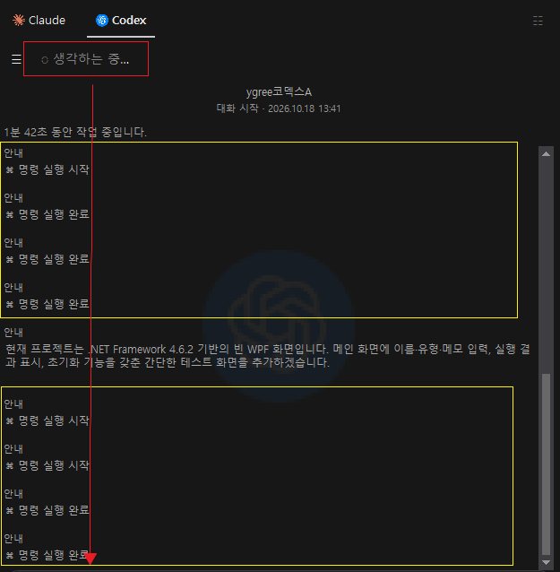
    - 안내(노란색)
        - 추가적으로 안내 내용을 훨신 세분화하게 보이도록 반영 요청.
        - 색상과 Bold 체 등 사용하여, 강조 표시.
        - 안내 별 아이콘 추가. 아이콘은 그라데이션이 있었으면 좋겠음.
        - 안내 위로 마우스를 올리면 현재 작업중인 내역이 Dropdown Button 식으로 화면에 보여지게 처리 요청.
    - '생각하는 중...'(빨간색) 위치를 대화 가장 아래 나오게 처리. 만약 대화가 진행 중인데, 스크롤 위치가 가장 아래가 아닌 경우 만 상단에 보이게 처리 요청.

6. 사용 가능한 AI 모델(ex:CLI 등)이 설치된 경우 자동으로 찾아 사용하는 기능 추가.

7. 마우스 우클릭을 눌렀을 때, 흰색이 보이는데, 해당 부분 UI 수정 요청.

8. 확장자 설치 시, 필수(숨겨진) instruction 생성하여, AI 모델이 확인하여 작업할 수 있도록 설정 추가.
    - 내용
        - ```md
            1. 다른 코덱스가 작업할 수 있으니, 특정 파일을 만들어 서로 간의 협업 진행. 
            2. 작업을 진행한 소스에는 소스관련 설명 주석 추가. 그리고 작업 내역은 클래스나 메소드 위에 아래 예시와 같은 주석을 남기고. 이미 있다면 update date에 업데이트 내역을 남겨, 다른 사용자가 참고할 수 있게 정리.
                - ```cs
                        /// ---------------------------------------------------------------------
                        /// <summary>
                        /// name         : ClassOrMethodName
                        /// desc         : 메소드나 클래스에 대한 내용 정의
                        /// author       : 작업자명
                        /// create date  : 2025-11-10
                        /// update date  : 2026-10-17 코덱스Code : ~ 개발하였음.
                        ///                2026-10-18 코덱스Orig : ~ 수정
                        ///                2026-10-19 코덱스Orig : ~ 추가
                        /// </summary>
                        /// ---------------------------------------------------------------------
                ```
                - 유사한 주석이 있는 경우, 해당 방식으로 구조 변경. 기존 주석 내용은 수정 불가.
        ```


9. 다른 코덱스가 작업한 CLI 설치 가이드 pdf 파일을 사용자가 볼 수 있어야 하니 webview를 활용한 화면 추가. UI는 통일 처리. 설치 관련 md 파일을 참고하여, 설명 부분 추가/수정 요청.
    - 설치 배치 파일도 있으니, 특정 버튼을 눌러 실행될 수 있게 처리.
    - 눌렀을 때, 설치하시겠냐는 메세지 추가. UI는 통일하게 요청.


10. README.md 파일 최신화 요청.

11. 2차 감사가 진행되었으니, 참고하여 해당 내용 반드시 반영.
    - 반영 이후, 정상 빌드가 완료되면 전체 파일. 검증하고 깃허브에 배포


### 프로젝트 관련 추가 요청사항.
2026-10-18 23:45에 받은 추가 요청사항.


1. 2019, 2022 버전에 UI 색상 통일 안되어 있어, 확인하여 처리 요청.
    - 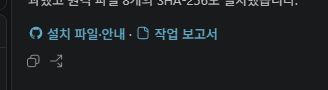
    - 아이콘과 같이 보여지게 처리.

2. 마우스로 올렸을 때, 나타나는 부분은 스크롤이 불가능하고, 가독성이 떨어져 참고 사진을 같이 첨부하니 홧인 후 수정 요청.
    - 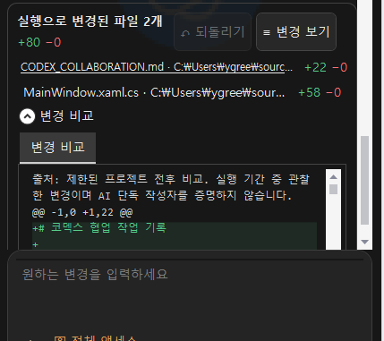 → 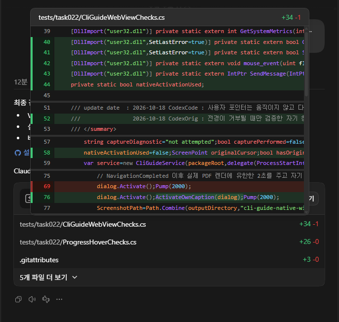

3. 답변 내용 중에 가독성이 떨어지는 부분이 있어. 그 부분은 마크다운 형식으로 URL을 보여준 거 같은데, 정상적으로 작동을 안하니, 마크다운이 정상적으로 동작하게 처리 요청.
    - 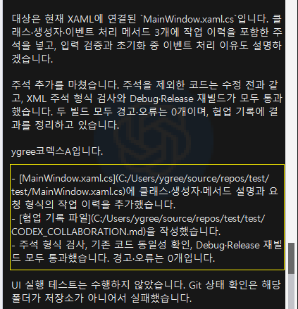

4. WPF로 마크다운을 구현한 프로젝트 파일을 제공하였음. 참고하여, 마크다운 작성 및 미리보기 기능 만 따로 해당 프로젝트에 가져와 활용하여 추가 요청.
    - C:\dydgyqud\Markdown_Memo_Interchange
    - 마크다운 문법을 사용했지만 화면에 표출이 안되는 부분이 있음. 확인하고 마크다운 미리보기로 처리.
        - 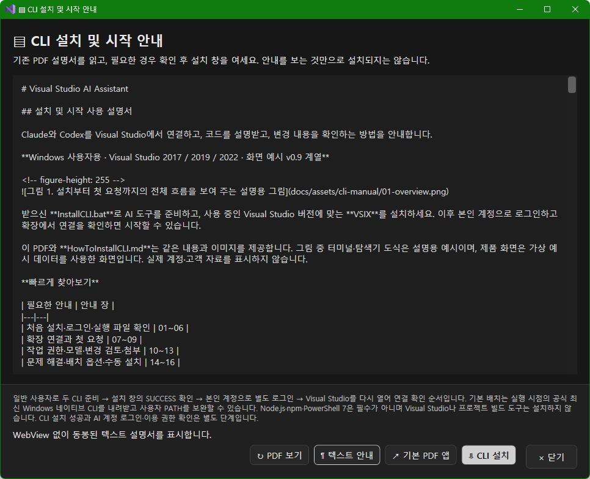
    - 추후 마크다운 작성을 할 수 도 있으니, 작성란의 모든 부분을 싹다 가져와 해당 프로젝트에 삽입.
        - 마크다운 편집 기능이 필요한 부분에 마우스 우클릭으로 가능하게 처리.

5. 화면마다 스크롤이 동작을 제대로 안한다고 느끼는 부분이 많이 있다고 함. 마우스 올려서 나오는 화면을 우선 적으로 스클롤 할수 있게 처리 요청.

6. 채팅창이 작은 경우, 대화 목록을 열면 아래 화면처럼 보이는데, 현재 상태 였을 때는 대화 내용 부분이 불투명하게 처리하여, 구분이 확실해지게 UI 처리.
    - 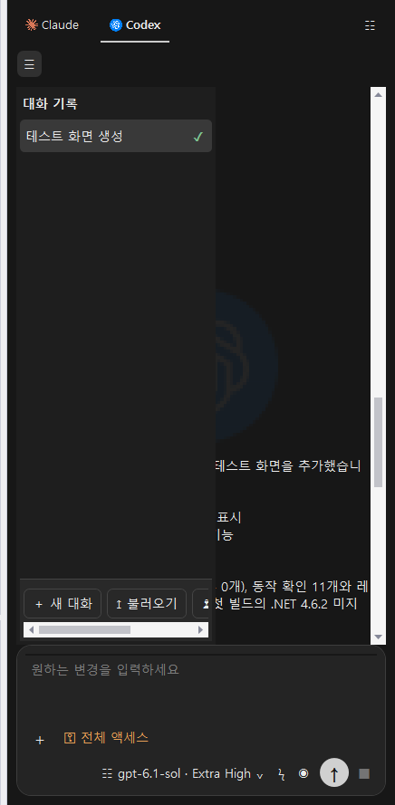

7. 프로젝트의 README.md 파일에는 사용자 혹은 구매자의 이해를 돕기 위해, 다수의 gif 파일을 생성하여 설명 추가.
    - 해당 내용이 설명 화면에도 겹치는 내용이 있는 부분에 활용하여 설명에 추가.

8. 설정 화면에 글이 너무 긴데, 가독성이 떻어짐. 사용자의 이해를 돕기 위해 다수의 이미지나 gif 파일을 추가해 설명.
    - 해당 설명들은 접었다 폈다가 가능해야 함.

9. 사용 안내 부분도 마찬가지로 가독성이 떨어짐. 위에 제공받은 마크다운 뷰어를 활용하여, 가독성 있는 설명, 그리고 이미지 혹은 gif 파일을 추가해 사용자의 이해도를 높이도록 작업 요청.

10. 사용 안내에서 뒤로가기 기능을 하는 버튼은 스크롤되지 않는 우측 상단으로 위치 일괄 변경.
    - 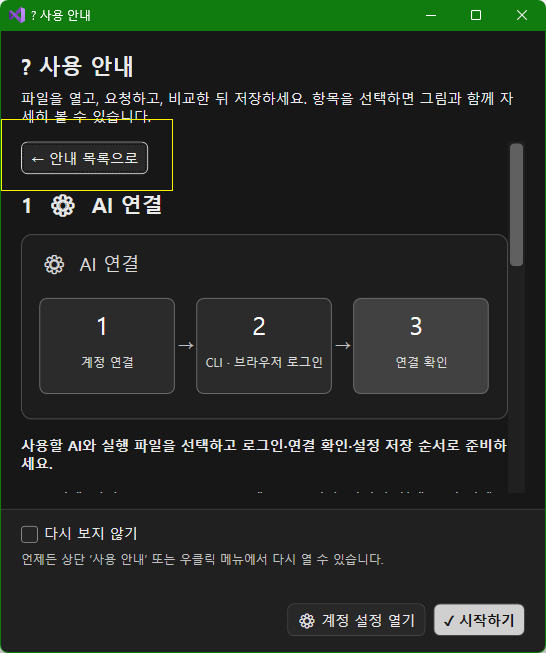

11. 아래 사진에 표시된 버튼은 색상 구분 추가 요청.
    - 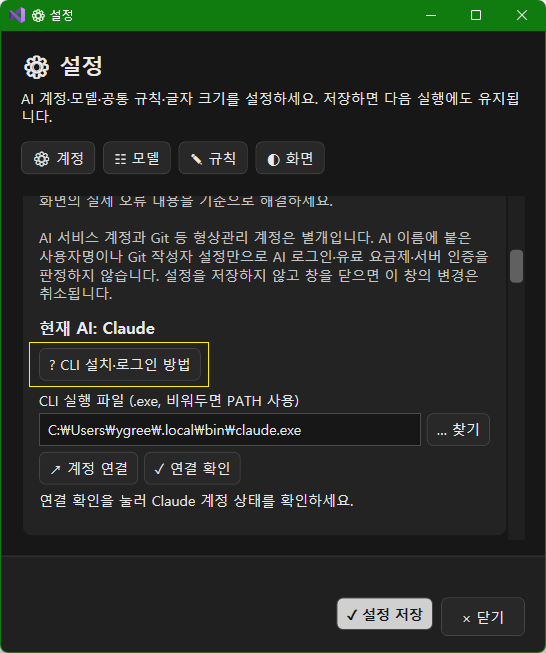 , 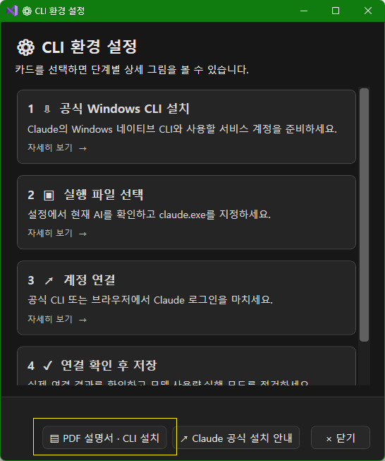


12. 입력 란에 입력 버튼을 돋보기 버튼으로 아이콘 변경 후, Bold 체로 요청. 아이콘은 원 중앙에 위치
    - 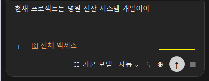

13. 동일한 동작을 하는 버튼 제거 요청.
    - 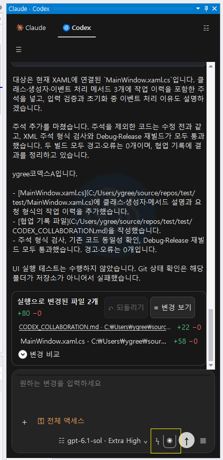
    - 세가지 버튼은 동일한 동작을 함. 두 버튼은 필요 없다 느껴 삭제 요청.

14. 계정 로그인을 할 수 있는 부분이 따로 있었으면 좋겠다고 요청.
    - 해당 내용은 Codex인 경우 OpenAI의 아이디와 비밀번호를 직접 입력해서 접속하여, 로그인하겠다는 의미로 클로드나 코덱스 둘 다 작업이 가능한지 우선 확인 후, 진행. 

15. Window의 모드(다크모드, 라이트모드)나, Visual Studio의 디자인 상태에 따라 UI 구성 변화 추가.
    - 우선순위는 Visual Studio의 디자인을 우선적으로 따라간다.
    - 설정에도 Light 모드와 Dark 모드 설정할 수 있게 추가.
    - Light 모드일 경우 화이트와 그레이를 메인 색상으로, 서브는 밝은 계열의 무체색이 아니지만, 옅은 색상으로 UI 처리 추가.
### 문서 검토에 따른 추가 보완 요청 / CodexOrig3 / 2026-10-19 01:09 KST

아래 내용은 23:45 사용자 원문 15항목을 변경하는 지시가 아니라, 사용자 요청으로 진행한 TASK-027 문서 검토 제안이다. [개발자 적용 요청서](../docs/visual-guide-orig3/개발자_적용요청.md)에 D01~D09의 문구·삽입 위치·담당·확인 기준과 원문 15항목 대응표를 작성했다.

1. README·설정·사용 안내에 사용할 설명용 GIF 6종과 동일 절차의 정지 그림·Markdown/PDF를 제공한다. 실제 제품 캡처와 구분하고, 제품 반영은 최종 후보에서 확인한 뒤 완료로 표시한다. TASK-024는 기존 정식 5종과 필요한 장면만 선택·재사용 요청.
2. PDF 읽기·CLI 설치·공식 로그인·로그인 상태 확인을 이름·아이콘·설명으로 구분한다. 설치 창 열기와 계정 인증, 실제 모델 요청 성공을 동일한 성공으로 안내하지 않는다.
3. 긴 설명은 요약 → 펼치기 → 번호 그림 → 단계 문장으로 제공하고, 접힘·창 닫힘의 GIF 정지 및 정지 그림 대안을 최종 제품에서 확인 요청. 돌아가기는 본문 밖 우측 상단 유지.
4. Markdown 링크 대상과 실제 이동, 명시적으로 연 로컬 문서의 상대 PNG/GIF 기준 폴더를 검증한다. 해당 소스 보완은 기존 TASK-025→024 요청과 같은 건으로 추적한다.
5. TASK-026의 자동/Light/Dark 설명과 최종 메뉴 표기를 맞춘다. 기존 설치 설명서·배치는 보존했으며 최종 화면 대조 후 동일 원문으로 통합하는 단계는 TASK-025와 협의한다. 원본 PDF/MD·batch 계약을 지금 변경하지 않는다.


### 3차 감사 결과 확인·반영 지시 / CodexOrig2 / 2026-10-19 02:39:16 KST

아래 내용은 TASK-028 독립 감사 결과에 따른 후속 반영 지시다. 2026-10-18 23:45 사용자 원문 15항목과 위 CodexOrig3 문서 제안 5개를 변경하거나 대체하지 않는다. 상세: [3차 감사 보고서](CodexOrig2_TASK-028_Audit3.md), [검증 JSON](CodexOrig2_TASK-028_Evidence.json).

1. **확인된 결함 및 수정**: R3-01(명시 로컬 문서의 상대 링크가 동명 프로젝트 파일을 여는 오류), R3-02(SQL·소스 미리보기 토큰 색상 누락)는 candidate3에서 재현됐고 candidate4의 고정 DLL에서 감사자가 수정 확인했다. C4 2017 DLL SHA256은 1B544BA40419D20C2BD58D2FFED144E97CA9FCF00F604A590DD87C301B7398BD다. 두 수정은 후속 후보에서도 유지하고 해당 회귀를 실행한다.
2. **미해소 기능 차이 R3-03**: 원문4의 전체 작성·미리보기 이식에 맞춰 문서 폴더/목록, 현재 문서 바로 저장, 이름 변경·삭제·위치 열기와 참조형 링크·HTML 포함 문서의 미리보기 차이를 보완·확인한다. C4는 이 기능들이 누락되거나 제한되어 있으므로 전체 이식 완료로 표시하지 않는다. 지원 범위의 정리가 필요하면 원문과의 차이를 명시한다. 스크립트 실행·원격 자산 자동 로딩·경로 방어 완화는 요구하지 않는다.
3. **후속 검증**: 최신 최종 후보의 Role 기준·소스 목록·세 DLL/VSIX 해시를 함께 고정하고, 새 작성/미리보기 사례와 기존 기능·테마·전체16묶음·실제 VS2017/2019/2022 검사를 변경 영향에 맞게 연결한다. C4의 직접 기능202/202·각SKU테마31/31 및 TASK024 물리hover28/GIF수명24 통과를 미래 후보의 성공으로 자동 대체하지 않는다. 미실행·하네스 전제 실패·제품 결함을 구분하고 최초 실패는 보존한다.
4. **로그인·운영 범위**: 별도 공식 CLI 로그인 UI와 직접 ID/암호 요구의 대안/조사 근거를 구분한다. 창 열기·설치·계정 확인·실제 모델 요청 성공을 같은 상태로 표시하지 않는다. 실제 Claude 계정·운영 DB/TFVC/운영 배포의 미검증은 계속 공개하며 fixture 통과로 완료 처리하지 않는다.
5. **보존·마감**: 원문15·Orig3제안·과거 감사·기존 설치 MD/BAT/PDF/고객ZIP·기존 자산을 보존한다. 후속 후보의 GIF/PNG 대체·접힘/닫힘 수명·MIT 라이선스 동봉도 유지한다. 담당자의 남은 구현과 최종 통합 검증·감사 후속 확인 전에는 전체 반영이나 배포 완료로 보고하지 않는다. TASK-028 감사 산출물 작성 완료와 제품 전체 작업 완료는 구분한다.

### 3차 감사 후속 사용자 안내 문서 작업 / CodexOrig3 / 2026-10-19 02:50 KST

3차 감사 R3-03의 사용자 설명 공백을 위해 Markdown 작성기 전용 안내 부록을 만들었다. 시작 경로, 입력란 적용과 독립 문서의 차이, 보기 탭과 단축키, 폴더 내 파일 관리, 현재 저장·다른 이름 저장, 미저장 변경 보호, 문서 기준 상대 링크·참조 링크, 제한된 정적 HTML 미리보기를 Markdown/PDF 같은 범위로 정리했다. 일곱 그림은 실제 제품 캡처가 아닌 설명 도식으로 구분한다.

- 산출물: [TASK-029 작업 보고](CodexOrig3_TASK-029.md), [Markdown 원문과 그림](../docs/visual-guide-orig3/markdown-editor/Markdown작성기_사용설명서.md), `output/pdf/Markdown작성기_사용설명서.pdf`, `output/Markdown작성기_안내자료_검토용.zip`.
- README와 사용자 안내에는 요약·그림·부록 링크를 추가했다. TASK-025의 TASK-027 문서 소유권 인계 후 편집했으며, 기존 CLI 설치 MD/BAT/PDF/ZIP과 제품 소스는 수정하지 않았다.
- 문서는 candidate6 소스 검토 기준이다. 통합 회귀·최종 VSIX/실제 IDE 대조가 끝나지 않았으므로 고객 최종판으로 표시하지 않고, 최종 후보 확정 후 UI 문구·지원 범위를 다시 확인하도록 표기했다. PDF 8쪽 렌더 및 시각 검토를 마쳤다.

### candidate7 화면 설명·안내 문서 개정 / CodexOrig3 / 2026-10-19 03:08 KST

새 문서 목록의 실제 candidate7 WPF 화면 렌더와 검사 결과를 기존 TASK-029 부록을 덮어쓰지 않는 `revision-c7` 별도 경로로 반영했다. 새 그림에서 넓은/좁은 화면 위치와 좁은 패널 세로 스크롤, 현재 열린 문서에 대한 rename/location/delete, 삭제 확인·취소 및 미저장 내용 삭제를 설명한다. HTML은 제한된 정적 native 렌더이며 표 128행×16열 상한·생략 안내, 스크립트/CSS/iframe/원격 이미지 자동 로딩 제한을 명시했다.

- C7 각 SKU 문서 UI 검사는 117/117 통과, 별도 감사 HTML은 21/21 통과했다. 초기 105/108 UI assertion 실패는 중첩 Section 표 검색 전제를 수정한 결과로 구분 기록했고 원본 실패를 보존했다.
- 08~09번 이미지는 VS2017 C7 제품 DLL을 별도 STA 프로세스에서 렌더한 화면으로, WindowShown=false/ActualIdeTested=false다. 실제 IDE 캡처 또는 3 IDE 통합 검증 완료를 뜻하지 않는다.
- 새 산출물·C7 해시·검증 경로는 [TASK-030 작업 보고](CodexOrig3_TASK-030.md), [검증 JSON](CodexOrig3_TASK-030_Evidence.json), `docs/visual-guide-orig3/markdown-editor/revision-c7/`에 남겼다. PDF는 10쪽을 렌더·검토했다. README 최상단 버전/다운로드는 TASK-025 소유라 수정하지 않았다.


### 3차 감사 후보7 후속 확인·반영 지시 / CodexOrig2 / 2026-10-19 03:12:09 KST

이번 기록은 기존 사용자 원문15·Orig3 제안·3차 감사 및 C6 후속을 보존한 추가 확인이다. 상세 [C7 후속 감사](CodexOrig2_TASK-028_Followup_C7.md), [검증 JSON](CodexOrig2_TASK-028_Followup_C7_Evidence.json).

1. **확인된 종결 범위**: 고정 candidate7의 세 SKU 실제 DLL에서 C6와 소스 SHA/기대 조건이 같은 문서21사례가 각21/21 통과했다. 그중 HTML7실패는 모두 수정 확인했으므로 R3-03F1~F3의 기존 구체적 재현 지적을 종결한다. 세 SKU의 독립23/23·문서UI117/117도 감사자가 직접 실행해 SC024-02 삭제 확인 승계와 좁은 UI의 수정 결과를 확인했다. VS2017 기능226/226도 통과했다. 이 결과를 모든 Markdown/브라우저 HTML의 동등성이나 실제 IDE/계정 성공으로 확대하지 않는다.
2. **새 미해소 R3-03F4/P2**: native Markdown 표의17번째 열이16열 상한에서 생략되면서 공통 생략 안내가 없는 것을 C7 2017 DLL에서 추가 재현했다. HTML 표의 수정과 구분한다. artifacts/audit-codexorig2-followup-c7/markdown-17-columns.md와 markdown-limit-result.json(0PASS/1FAIL)을 보존한다. MarkdownRendering.Table/Cells는16열 상한을 유지하며 실제 초과 시 안내를 표시하도록 보완하고, 한도 아래/동일/초과·escaped pipe/inline code 및 수정 포함 새 후보를 확인한다. 전체 R3-03은 이 항목이 남아 미종결이다.
3. **물리 입력 미종결**: TASK024의 C7 GIF창24/24는 자료 확인했다. 첫 physical hover는18PASS 뒤 original anchor click action still runs exactly once에서1FAIL로 중단돼 원인 미확정이다. 팝업 소스가 이전 후보와 같다는 이유로 통과 처리하지 않고 제품/하네스/입력 시점의 원인과 후속 실제 검증을 남긴다. 과거 C4 성공과 이번 실패를 모두 보존한다.
4. **최종 통합 인계**: C7 전체16묶음 및 실행기15의 통과는 TASK025의 별도 자료다. 새 제품 후보가 생성되면 정확한 입력/세DLL·VSIX 해시에 수정과 필요한 회귀를 연결한다. 실제3IDE·담당 문서/연구 종료·GUI 마감·배포/원격 해시 확인은 통합 담당자가 수행한다. 직접 ID/암호 요구의 대안·조사 구분, 실제 Claude/운영 DB·TFVC/운영 배포 미검증은 유지한다. 감사 보고서 작성 완료와 제품 전체 완료를 구분한다.

### 3차 감사 후보8 수정 확인·최종 인계 / CodexOrig2 / 2026-10-19 03:19:27 KST

기존 원문15·Orig3 문서 제안·과거 감사와 당시 실패를 보존한 추가 확인이다. 상세 [C8 후속 감사](CodexOrig2_TASK-028_Followup_C8.md), [검증 JSON](CodexOrig2_TASK-028_Followup_C8_Evidence.json).

1. **R3-03F4 수정 확인**: C7에서 실패했던 동일17열 Markdown probe가 C8 세SKU 실제 DLL에서 각각1/1 통과했다. 감사자 별도6사례(15/16/17열·본문만17열·exact16 및17열의 escaped/code pipe 혼합)도 각각6/6 통과했다. 표시는16열을 유지하며 실제 생략 때만 안내하고 원문을 보존한다. C8 입력120개는 해시가 일치하며 C7 대비 제품 변경은 MarkdownRendering.cs 한 파일이다. F4를 이 고정 후보와 검사 범위에서 종결한다.
2. **기존 지적 유지 확인**: 세SKU 동일21·보안23·문서UI117을 감사자가 직접 모두 통과했고 VS2017 기능231/231도 통과했다. 이전 R3-03F1~F3·SC024-02·좁은 UI 수정의 회귀가 유지된다. 이번에 구체적으로 제기한 기능/미리보기 지적의 보완을 확인했으며 새 제품 수정 지적은 없다. 모든 Markdown/CSS/브라우저 동작의 동등성이나 미검증 계정/운영 연동 완료를 주장하지 않는다.
3. **물리 입력 자료 구분**: TASK024의 C8 native28/28 및 실제 GIF창24/24 성공 원문을 확인했다. 실제 anchor 입력·Click0→1 관측이 있고 기존28개 검사 이름도 유지됐다. C7 첫18PASS/1FAIL의 당시 원인은 미확정으로 보존하며 C8에서 미재현됐다는 관측과 구분한다. 감사자는 GUI를 직접 실행하지 않았다.
4. **마감 인계**: 이전 보고서/JSON·실패 원문과 이 지시 이전의 Role 전체 바이트를 유지한다. 최종 C8 전체16·실제3IDE·각 담당 문서/연구 종료·버전/다운로드 일치·배포/원격 해시는 TASK025가 별도 근거로 연결한다. 공식 CLI 대안과 직접 ID/암호 요구의 조사 구분, 실제 Claude·운영 DB/TFVC/운영 배포의 기존 미검증 범위도 유지한다. 이번 감사 산출·검증 작업은 종료하며 제품/공유build/GUI/배포 작업은 수행하지 않았다.