# Visual Studio AI Assistant

**Visual Studio에서 Claude·Codex와 대화하고, 코드를 고치고, 테스트까지 이어 가세요.**

오류 화면과 참고 문서를 보여 주고 자연어로 작업을 요청하세요. 바뀔 코드를 먼저 비교해 승인하거나, **전체 액세스**를 선택해 AI가 직접 파일 수정과 명령·테스트를 수행하게 할 수 있습니다. 대화와 공통 규칙은 내 PC의 Markdown에 남습니다.

**v0.14.0-preview.1 설치·사용 안내** · [릴리스 및 다운로드 자산](https://github.com/Grokeen/VisualStudio2017_Codex_Claude_Extension/releases/tag/v0.14.0-preview.1) · [상세 사용자 안내](docs/USER_GUIDE.md)

v0.14.0-preview.1에는 아래 설치 묶음과 44쪽 사용자 PDF를 제공합니다. 계정 로그인과 실제 원격 AI 응답은 사용 중인 CLI와 서비스 계정에서 별도로 준비합니다.

| 다운로드 | 파일 |
|---|---|
| [CLI 포함 전체 오프라인 ZIP](https://github.com/Grokeen/VisualStudio2017_Codex_Claude_Extension/releases/download/v0.14.0-preview.1/VisualStudio_AI_Assistant-0.14.0-Preview1-FullOffline-win-x64.zip) | `VisualStudio_AI_Assistant-0.14.0-Preview1-FullOffline-win-x64.zip` |
| [설치·사용 PDF · 44쪽](https://github.com/Grokeen/VisualStudio2017_Codex_Claude_Extension/releases/download/v0.14.0-preview.1/VisualStudio_AI_Assistant-0.14.0-Preview-UserGuide.pdf) | `VisualStudio_AI_Assistant-0.14.0-Preview-UserGuide.pdf` |
| [오프라인 IDE 확장·테마 설치기](https://github.com/Grokeen/VisualStudio2017_Codex_Claude_Extension/releases/download/v0.14.0-preview.1/Grokeen-AI-Theme-Offline-Installer-0.14.0.exe) | `Grokeen-AI-Theme-Offline-Installer-0.14.0.exe` |
| [간단 ZIP](https://github.com/Grokeen/VisualStudio2017_Codex_Claude_Extension/releases/download/v0.14.0-preview.1/VisualStudio_AI_Assistant-0.14.0.zip) | `VisualStudio_AI_Assistant-0.14.0.zip` |

배포 첨부와 로컬 `releases` 폴더에는 현재 v0.14.0과 직전 v0.13.0을 보존합니다. 새 버전의 파일·체크섬이 게시된 뒤 v0.12.1의 Release 첨부와 로컬 패키지만 정리하며 태그, 이력, 개발·감사 기록은 유지합니다.

| 사용 중인 Visual Studio | 설치 파일 |
|---|---|
| 2017 15.7·15.8 · x86 IDE | [VS2017 15.7용 VSIX](https://github.com/Grokeen/VisualStudio2017_Codex_Claude_Extension/releases/download/v0.14.0-preview.1/VS2017.15.7.AIAssistant-0.14.0.vsix) |
| 2017 15.9 이상 · x86 IDE | [VS2017용 VSIX](https://github.com/Grokeen/VisualStudio2017_Codex_Claude_Extension/releases/download/v0.14.0-preview.1/VS2017.AIAssistant-0.14.0.vsix) |
| 2019 16.11 · x86 IDE | [VS2019용 VSIX](https://github.com/Grokeen/VisualStudio2017_Codex_Claude_Extension/releases/download/v0.14.0-preview.1/VS2019.AIAssistant-0.14.0.vsix) |
| 2022 17.x · x64 IDE | [VS2022용 VSIX](https://github.com/Grokeen/VisualStudio2017_Codex_Claude_Extension/releases/download/v0.14.0-preview.1/VS2022.AIAssistant-0.14.0.vsix) |

## 공통 사용 안내와 직전 버전의 화면 예시

아래 그림은 v0.12.1에서 도입한 공통 화면의 합성 WPF 렌더이며 실제 Visual Studio/Windows 바탕 화면 캡처나 GIF가 아닙니다. v0.13.0 이전 기능 예시와 v0.14.0 새 기능을 구분해 설명합니다.

아래 예시는 WPF `RenderTargetBitmap`으로 별도 렌더한 합성 화면입니다. 실제 Visual Studio IDE·Windows 바탕 화면 캡처가 아니며, 화면 구성을 이해하기 위한 참고 그림입니다.

| 밝은 팝업 | 어두운 팝업 |
|---|---|
| 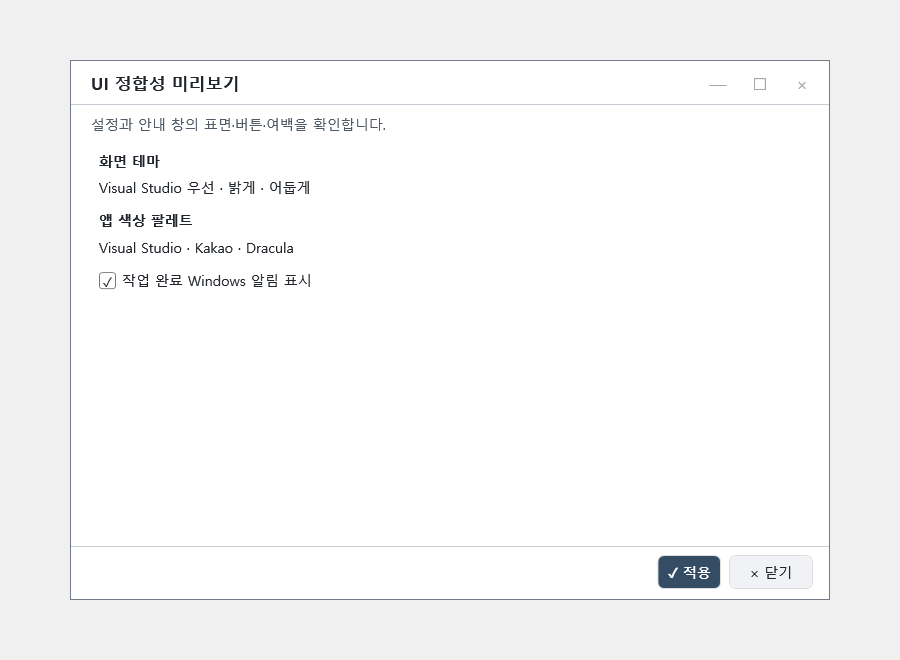 | 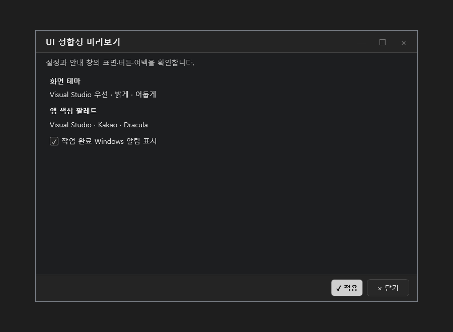 |

| 어두운 팝업 제목 표시줄 | 공통 버튼과 간결한 아래쪽 동작 영역 |
|---|---|
|  |  |

| Markdown 작성기 | 좁은 패널의 Claude/Codex 탭 |
|---|---|
| 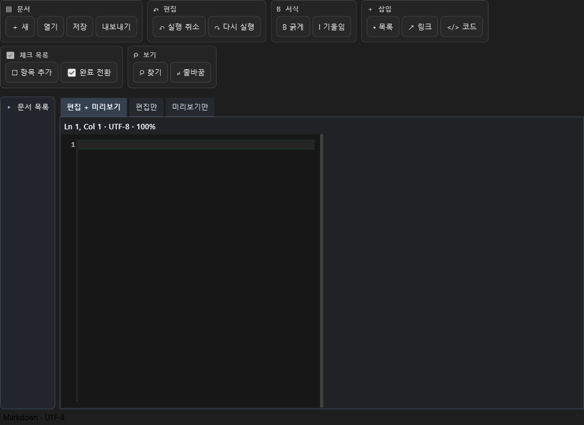 | 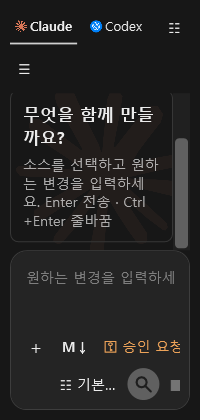 |

다음 두 그림은 입력 말풍선과 IDE 테마 설정 UI를 보여 주는 합성 WPF 렌더이며 실제 Visual Studio/Windows 캡처가 아닙니다. 말풍선 문장은 가상 예시입니다. 실제 VS2017 15.9, VS2019 16.11, VS2022 17.14의 IDE 통합 시험에서 Kakao·Dracula 테마 선택 ID, 대표 환경 색상 적용, 보류 상태 소비와 임시 파일 정리를 확인했습니다. 설치 관리자 버튼의 실제 물리 클릭과 완료, 재시작을 포함한 고객 사용 흐름은 별도 확인이 필요합니다.

| 요청 메시지 말풍선 | Visual Studio 테마 설치 UI |
|---|---|
| 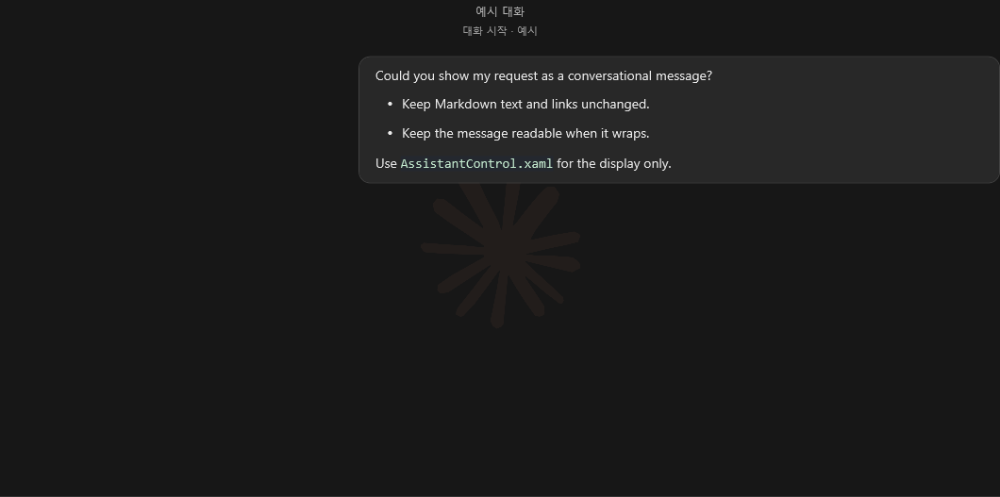 | 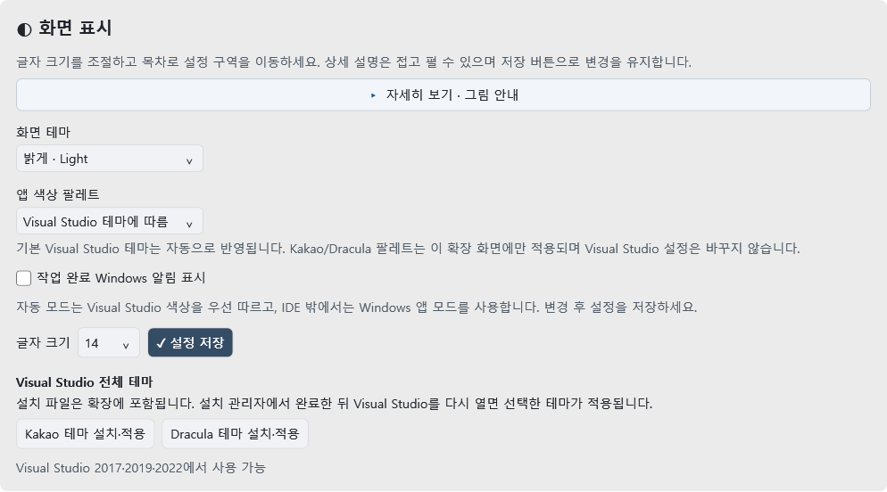 |

- 요청을 실행하는 동안 다음 요청을 계속 입력할 수 있습니다. 현재 요청 뒤 최대 8개까지 FIFO 순서로 대기하며, 앞 요청이 끝나면 순서대로 실행합니다. 실패·취소·중지 뒤 남은 요청은 자동 실행하지 않습니다.
- 성공 알림은 Claude/Codex 브랜드와 고정된 결과 유형(질문 답변·수정안 준비·파일 작업·실행/조회 작업), 보고된 완료 건수를 표시합니다. 요청 제목·원문과 답변 문장은 넣지 않습니다. Windows 알림 설정에 따라 표시되지 않을 수 있습니다.
- AI 답변을 우클릭해 답변 전체 또는 완결된 단일 코드 블록을 새 로컬 파일로 저장할 수 있습니다. 기존 파일은 덮어쓰지 않으며 PDF·XLSX·실행 파일 내보내기는 지원하지 않습니다.
- Claude 검사는 로그인 없이 CLI 버전·비인증 초기화·합성 프로토콜/오류/취소만 확인했습니다. 실제 Claude 계정 로그인과 실제 AI 답변을 검증한 결과는 아닙니다.
- 설정에서 **Kakao 테마 설치·적용** 또는 **Dracula 테마 설치·적용**을 선택하고 VSIX 설치를 완료한 뒤 모든 Visual Studio 창을 닫고 같은 IDE를 다시 여세요. 시작 시 선택한 IDE 테마를 적용합니다. **도구 → 옵션 → 환경 → 일반 → 색 테마**에서 결과를 확인할 수 있습니다. 세 IDE의 통합 시험에서 선택 ID와 대표 색상(Kakao `#FFD9DDE3`, Dracula `#FF282A36`) 적용을 확인했으며, 설치 버튼의 물리 클릭과 고객 PC의 전체 흐름은 별도 검증 범위입니다.

[공개 Release 자산의 사용자 안내 PDF](https://github.com/Grokeen/VisualStudio2017_Codex_Claude_Extension/releases) · [자세한 사용자 안내](docs/USER_GUIDE.md)

각 버전에 맞는 설치 파일을 사용하세요. Windows 네이티브 `codex.exe` 또는 `claude.exe`와 해당 서비스 계정이 필요합니다. 확장을 직접 빌드할 필요는 없습니다.

**VS2017 15.7.1에서 업데이트 없이 설치:** 위의 **VS2017 15.7용**을 선택하세요. 15.7 당시 SDK로 별도로 컴파일한 패키지이며, 기존 15.9 이상용의 설치 하한만 바꾼 파일이 아닙니다. Community·Professional·Enterprise를 지원합니다. 현재 실제 IDE 검사는 VS2017 15.9에서 수행했으며, 고객의 15.7.1 PC 실행 결과는 별도 확인이 필요합니다.

설치 묶음 ZIP을 모두 풀고 **InstallAIAssistant.bat**를 실행하면 설치된 IDE의 버전·패키지 무결성을 검사하고 해당 버전용 설치기를 엽니다. 여러 IDE가 있으면 설치할 대상을 선택합니다. [설치 오류 해결과 진단 방법](docs/INSTALL_TROUBLESHOOTING.md)을 함께 제공합니다.

**설치할 때 인터넷이 없다면:** GitHub Releases에서 CLI 포함 완성 오프라인 ZIP을 선택해 USB로 옮기고, 압축을 모두 해제한 뒤 **VerifyOfflineSetup.bat**을 실행하세요. CLI를 다시 내려받아 묶음을 준비할 필요가 없습니다. [오프라인 설치 안내](docs/OFFLINE_INSTALL.md)와 [현재 공개 사용자 PDF](https://github.com/Grokeen/VisualStudio2017_Codex_Claude_Extension/releases)를 참고하세요. 로그인과 AI 사용은 연결 가능한 시점에 진행합니다.

설치된 확장만 제거하려면 VS2017에서 **도구 → 확장 및 업데이트 → 설치됨**, VS2019·2022에서 **확장 → 확장 관리 → 설치됨**을 여세요. 목록에서 해당 버전의 AI Assistant 항목을 **제거**한 뒤 모든 Visual Studio 창을 닫습니다. 잠시 끄기만 하려면 **사용 안 함**을 선택하고 Visual Studio를 다시 여세요. 버전별 실제 항목 이름과 데이터 보존 안내는 [사용자 안내서](docs/USER_GUIDE.md#visual-studio-ai-assistant-확장-제거)를 참조하세요.

확장을 처음 열면 협업과 소스 주석 규칙을 담은 숨김 필수 지침을 생성합니다. 직접 작성한 공통 지침은 별도로 보존하며, 두 지침을 AI 요청에 함께 전달합니다.

## 이전 v0.13.0-preview.1의 기능 기록

v0.13.0의 기능 기록입니다. 당시 배포된 오프라인 ZIP은 `VisualStudio_AI_Assistant-0.13.0-Preview1-FullOffline-win-x64.zip`이며, [이전 34쪽 PDF](output/pdf/VisualStudio_AI_Assistant_%EC%84%A4%EC%B9%98_%EC%82%AC%EC%9A%A9%EC%84%A4%EB%AA%85%EC%84%9C_v0.13.0_%EB%AF%B8%EB%A6%AC%EB%B3%B4%EA%B8%B0.pdf)는 v0.13.0 설명을 보존합니다. 현재 기능과 설치 파일은 위의 v0.14.0-preview.1 자료를 기준으로 확인하세요.

| 기능 | 사용 방법 |
|---|---|
| 대화별 독립 실행 | 응답 중 다른 방으로 이동해 별도 작업을 실행합니다. 방마다 실행 하나와 대기 여덟 개를 두며 초안·역할·진행·사용량·취소를 분리합니다. |
| 시간별 대화 기록 | UTC 시간 구간별로 보관하고 위로 스크롤하면 백그라운드에서 추가로 읽습니다. 전체 백업에는 메인 Markdown과 같은 ID의 `.history` 폴더가 모두 필요합니다. 구형 기록의 실제 발화 시각은 복원할 수 없습니다. |
| 좁은 화면의 대화 목록 | 폭 460픽셀 미만에서 대화 항목을 더블클릭하면 목록을 접습니다. |
| AI 선택 질문 | 보기를 선택하면 입력 초안에 들어갑니다. 내용을 확인한 뒤 직접 전송합니다. |
| 필수 작업 지침 | 첫 사용 때 숨김 필수 지침을 준비하고 기존 패턴 확인·최소 수정·작업 기록·완료 후 감사 요청을 AI 문맥에 포함합니다. 사용자 지침은 보존합니다. |

담당 AI를 다시 선택해도 미승인 수정안과 비교 화면을 복원합니다. 원래 읽기 전용인 문서는 다른 방이 실행 중이어도 수정 요청을 거절하고 입력을 보존합니다. 미승인 수정안 뒤의 요청은 승인·적용 또는 명시적 건너뛰기 전에는 실행하지 않습니다.

이전 `UserDistribution/v0.13.0` 패키지의 구성 기록입니다. v0.14.0에는 VSIX 네 종, IDE 테마, CLI 런타임, 설치·검증 도구, checksums/manifest와 44쪽 PDF가 포함된 새 묶음을 사용하세요. 고객용 ZIP에는 프로젝트 소스·PDB·테스트·개발 증거·Git 자료·계정·사용자 기록을 포함하지 않습니다.

네 종류 Release 빌드 오류·경고 0, 기본 회귀 20/20, 동시 대화 120/120을 확인했습니다. [검증 보고서](MarkdownReport/CodexOrig_TASK-068_Validation.md)와 [독립 감사](MarkdownReport/CodexOrig2_TASK-068_C6_Audit.md)에 실제 IDE·설치·패키지 검증 범위를 구분해 기록합니다. 합성 UI 이미지는 실제 IDE·포인터·키보드 포커스 검사와 구분합니다. Claude 로그인·실제 AI 답변과 고객 VS2017 Professional 15.7.1/제한망 PC 설치는 확인 범위 밖입니다.

## v0.14.0-preview.1의 기능 안내

이 절과 [44쪽 PDF](https://github.com/Grokeen/VisualStudio2017_Codex_Claude_Extension/releases/download/v0.14.0-preview.1/VisualStudio_AI_Assistant-0.14.0-Preview-UserGuide.pdf)는 v0.14.0-preview.1 설치 묶음과 함께 제공됩니다. 배포 파일은 [릴리스 자산](https://github.com/Grokeen/VisualStudio2017_Codex_Claude_Extension/releases/tag/v0.14.0-preview.1)에서 확인하세요. v0.14.0과 직전 v0.13.0을 보존하고 더 오래된 v0.12.1 패키지 첨부는 정리 대상입니다.

| 기능 | 사용 흐름 |
|---|---|
| AI 간 메시지 전달 | A의 답변을 우클릭해 구조화 초안을 만들고 수신자·본문을 확인해 승인합니다. Pending은 전달 대기 상태입니다. B 대화의 역할 설정에서 메시지 센터를 열어 받은 메시지를 직접 선택하고 읽기 전용으로 응답합니다. A는 보낸 편지함에서 Replied 회신을 확인하고, Delivered 뒤 새 요청에 포함할 수 있습니다. 자동 재전송이나 무한 대화는 하지 않습니다. |
| 설정값과 실제 요청 | 화면에서 선택한 제공자·모델·생각 모드가 선택된 CLI 요청에 전달됩니다. 표시값은 계정 로그인이나 실제 모델 응답을 보증하지 않습니다. |
| 작업 기록 | 작업 카드의 상세 기록은 클릭하거나 키보드로 열고 닫습니다. 마우스 오버만으로 펼치지 않습니다. |
| Markdown 사용 범위 | 제목·목록·인용·표·코드·링크·로컬 이미지와 작성기 편집 기능을 제공합니다. CommonMark/GFM 전체 호환이나 Obsidian 전용 문법을 보장하지 않으므로 공유 전 미리보기를 확인하세요. |
| 다시 연 Markdown 문서 | 같은 세션에서 입력과 팔레트가 바뀌지 않으면 기존 렌더를 재사용해 다시 표시할 때의 처리 부담을 줄입니다. 실제 PC의 지연 시간은 환경에 따라 다릅니다. |
| 여러 TXT 첨부 | 최대 네 개(파일당 100KB)의 텍스트 파일을 요청과 함께 보냅니다. TXT 표시, 전체 파일명 툴팁, 파일별 글자 수·UTF-8 크기를 확인합니다. 읽기나 전송 준비에 실패하면 일부 파일만 보내지 않으며, 첨부는 제거할 때까지 다음 요청에도 유지됩니다. |
| 입력·중지 동작 | 대기 중에는 입력 아이콘 하나를, 요청 실행 중에는 중지 버튼 하나를 표시합니다. 실행 중 Enter로 새 요청을 대기시킵니다. 등록이 실패하면 초안은 작성란에 남습니다. |
| 대화 색 구분 | 사용자의 말풍선은 입력 영역과 같은 배경을 쓰고 AI 답변은 조금 더 진한 배경으로 나눕니다. 대화 폭에 따라 좌우 12~20px 여백을 두어 가장자리와 본문을 구분합니다. |
| 대화 머리글 | 대화 이름과 시작 시각은 메시지 스크롤 영역 위에 고정됩니다. 긴 이름은 줄바꿈되며 전체 이름을 툴팁으로 확인할 수 있습니다. |
| 디버깅 정보 초안 | 디버거 중단 중 `DBG`를 눌러 현재 파일명·줄·함수, 열린 문서의 앞뒤 최대 3줄, 호출 스택 함수명 최대 3개를 요청 초안에 추가합니다. 전송 전 직접 확인해야 하며 변수 값은 수집하지 않습니다. 격리된 Visual Studio 2017 통합 시험에서 실제 중단 프레임 연결을 확인했습니다. |
| 텍스트 줄끝 | 수정된 UTF 텍스트의 줄끝만 정규화해 비교하고 원자적으로 반영합니다. 줄끝만 달라진 파일 때문에 정규화 확인 대화상자를 반복해서 띄우지 않습니다. |
| 화면 테마 | Visual Studio의 메뉴·편집기 색 리소스를 확인했습니다. 물리적 우클릭 hover와 편집기 오류/중단점 표식의 실제 렌더링은 확인하지 않아 환경별 표시를 보증하지 않습니다. |
| 오프라인 확장·테마 설치 | `Grokeen-AI-Theme-Offline-Installer-0.14.0.exe`가 설치된 Visual Studio를 찾아 확장과 IDE 테마를 설치합니다. 인터넷 다운로드가 필요하지 않으며, 설치 전 실행 중인 IDE는 사용자가 직접 닫아야 합니다. Codex·Claude CLI 준비와 로그인은 별도 절차입니다. |
| 필수 지침 관리 | 설치/업데이트 때 공식 필수 지침의 구형 1–5 규칙을 최신 1–8로 갱신하고 별도 사용자 지침·사용자 수정 사본은 보존합니다. 협업 파일을 SCM에 자동 commit/push하지 않습니다. |
| TFS/TFVC | 프로젝트 작업에서 `get`, `checkout`, `checkin`을 선택해 승인된 작업만 실행합니다. Visual Studio 설치에 포함된 `tf.exe`를 PATH 밖에서도 찾을 수 있습니다. |

디버깅 도우미 예시는 v0.14.0-preview.1 제품 DLL을 합성 중단 프레임에 연결한 화면 밖 WPF 렌더이며 실제 Visual Studio 캡처가 아닙니다. 별도 격리 Visual Studio 2017 통합 시험에서 실제 중단 프레임 연결을 확인했습니다.

| 중단 상태 | 문맥을 초안에 추가 | 기존 초안 보존 오류 상태 |
|---|---|---|
| 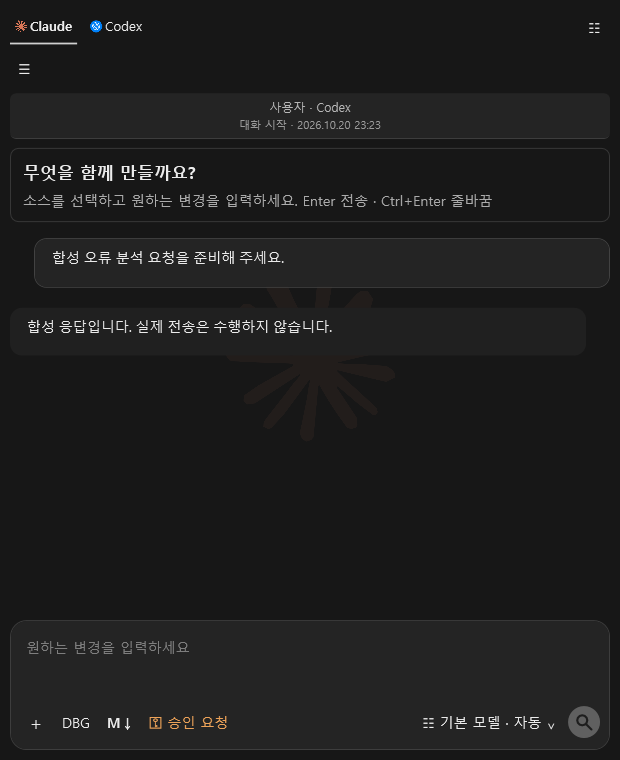 | 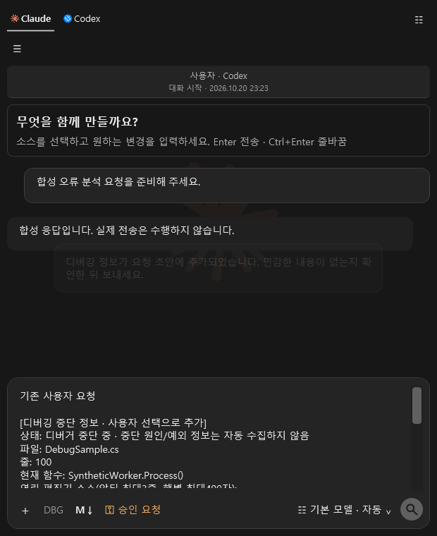 | 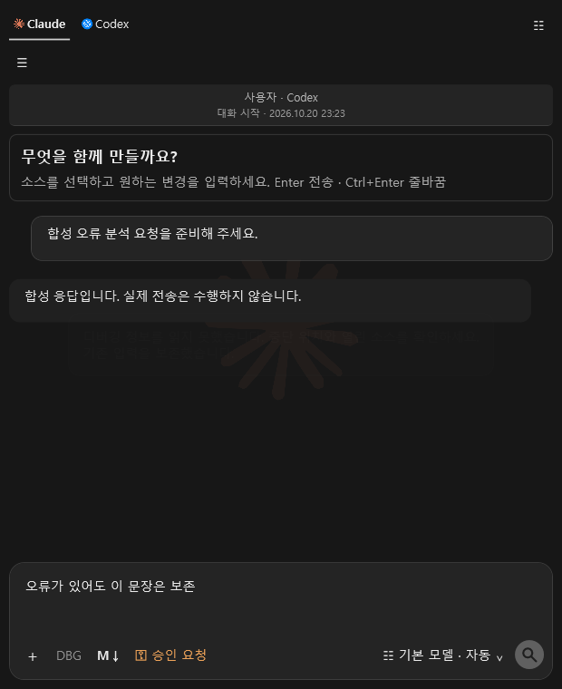 |

작업 기록은 마우스 오버만으로 펼쳐지지 않습니다. 아래 그림은 후보3 제품 DLL에서 화면 밖으로 렌더한 WPF 예시이며 실제 Visual Studio 캡처가 아닙니다. 클릭 또는 Enter로 상세를 열고 닫습니다.

| Dracula | 밝은 화면 |
|---|---|
| 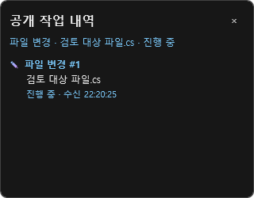 | 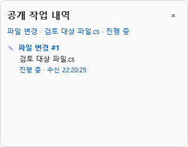 |

후보5의 대화 그림은 익명 합성 데이터로 만든 화면 밖 WPF 렌더이며 실제 Visual Studio 캡처가 아닙니다. 대화 이름과 시작 시각이 스크롤 바깥에 고정되고, 사용자 말풍선은 작성란과 같은 표면색, AI 답변은 조금 더 진한 표면색을 사용합니다.

| 넓은 어두운 화면 | 좁은 밝은 화면 |
|---|---|
| 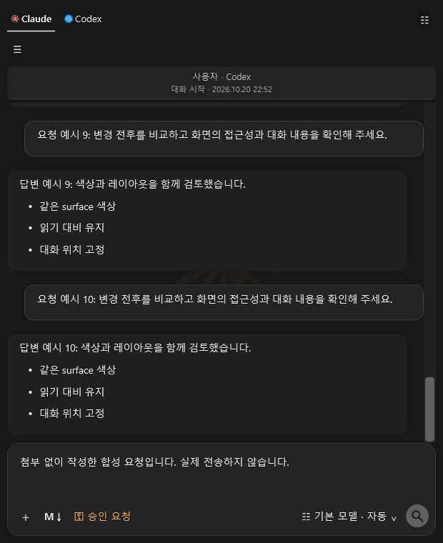 | 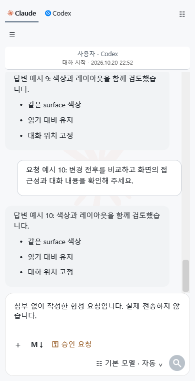 |

현재 대화에 실행·대기 요청이 모두 없는 유휴 상태에서는 돋보기 보내기 버튼만 보이고, 현재 대화에 실행 중이거나 대기 중인 요청이 있으면 중지 버튼만 보입니다. 다른 대화가 실행 중이어도 현재 대화가 유휴 상태라면 보내기 버튼을 유지합니다.

| 실행·대기 요청 없음(유휴) | 현재 대화의 실행·대기 요청 있음 |
|---|---|
|  | 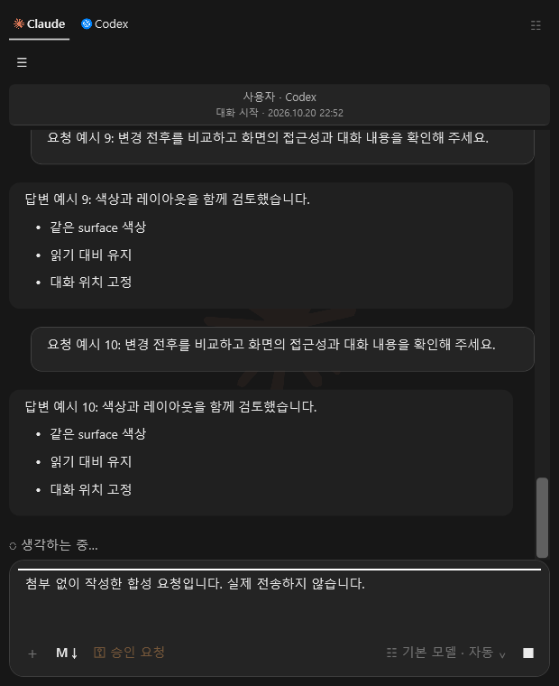 |

네 개의 TXT 파일을 붙인 익명 합성 화면은 다음과 같습니다. 전체 파일명과 파일별 문자 수·UTF-8 크기는 첨부 항목에서 확인하며, 파일을 읽지 못하거나 전송 준비에 실패하면 일부만 보내지 않습니다.

| 넓은 어두운 화면 | 좁은 밝은 화면 |
|---|---|
| 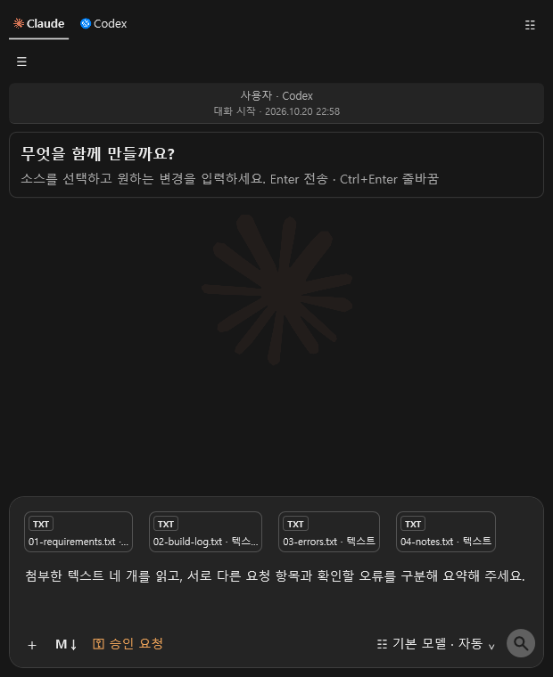 | 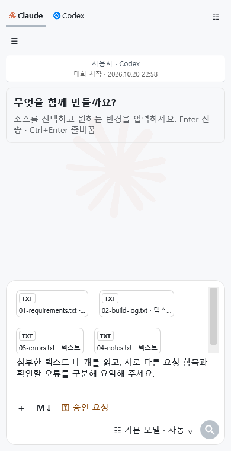 |

AI 메시지는 수신자와 내용을 사용자가 확인하고 승인해야 전달됩니다. 수신 AI의 응답은 제안이며 발신자의 요청을 자동 실행하거나 코드에 적용하지 않습니다. Claude 실제 로그인과 실제 AI 응답, 실제 TFS 서버 연결, 고객 VS2017 Professional 15.7.1 및 별도 오프라인 PC의 최종 설치·사용은 확인 범위에 포함되지 않습니다. 멈춤 사고의 원인도 확정되지 않았으므로 문제가 반복되면 Visual Studio 버전, 발생 시각, 수행 중이던 작업과 오류 문구를 기록해 지원에 전달하고 토큰이나 실제 소스 내용을 공유하지 마세요.

협업 규칙은 연결된 SCM과 두 명 이상의 참여자가 확인된 경우에만 오래되고 수정되지 않은 위치에 교차 기기 공유 폴더를 만들도록 합니다. 필수 협업 파일은 기본적으로 사용자에게 노출하지 않지만 사용자가 파일 공유를 명시적으로 요청하면 예외입니다. 이 공간은 제안과 문제 해결 기록을 공유하기 위한 것이며, 확장이 SCM에 자동 업로드하거나 변경을 commit/push하지 않습니다.

## v0.12.0 공개 미리보기 UI

이번 미리보기에는 완료 알림, 최근 대화의 단계별 불러오기, 설정 페이지 탐색, Markdown 도구 그룹, 앱 전용 Kakao·Dracula 색상 팔레트와 독립 Visual Studio 테마 패키지를 포함합니다. 공통 팝업은 OS의 녹색 제목 표시줄 대신 확장 화면과 어울리는 제목 표시줄을 사용하며, 창 이동과 최소화·최대화·닫기를 제공합니다. 아래 그림은 별도 WPF 렌더 이미지이며 실제 Visual Studio IDE 캡처가 아닙니다. 고객 오프라인 PC의 설치 결과는 별도로 확인해야 합니다.

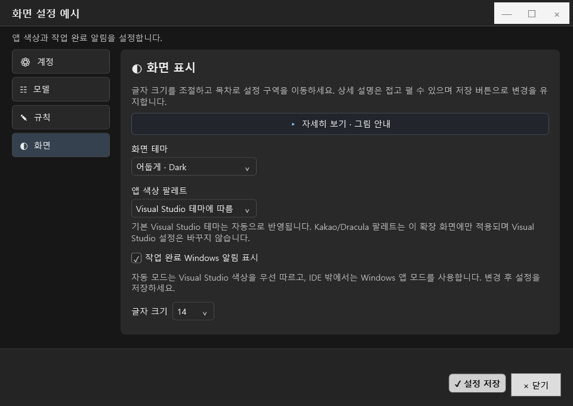

- 성공으로 끝난 작업에만 Windows 작업 표시줄 알림을 한 번 표시합니다. 알림은 작업 표시줄 balloon이며 Windows의 WinRT toast나 클릭 후 IDE 복귀 동작은 아닙니다.
- 이전 대화는 최신 20개 메시지를 먼저 보이고, 위로 스크롤하면 이전 메시지 20개를 추가로 표시합니다. 저장 한도는 대화당 100개와 파일 4MB로 유지되며 이미 한도를 넘어 사라진 메시지는 복원하지 않습니다.
- 설정 화면을 계정·모델·규칙·화면 페이지로 나누고, Claude·Codex 탭을 키보드로 이동할 수 있습니다. Markdown 작성기는 도구를 여섯 기능 그룹으로 묶고 URL 강조와 설명 정렬을 개선합니다.
- Kakao·Dracula 색상은 AI Assistant 확장 화면에만 적용합니다. 별도 Visual Studio 테마 패키지는 IDE 테마 설정에서 사용자가 선택하며, 설치만으로 현재 Visual Studio 설정을 바꾸지 않습니다.

[v0.12.0 사용 안내와 그림](docs/USER_GUIDE.md#v0120-화면-변경-미리보기) · [PDF 미리보기](output/pdf/VisualStudio_AI_Assistant_설치_사용설명서_v0.12.0_미리보기.pdf)

## 이런 일을 함께하세요

| 하고 싶은 일 | 사용하는 기능 |
|---|---|
| 오류를 설명하고 수정하기 | 소스 또는 일부 코드를 선택하고 오류 화면·참고 문서를 첨부 |
| 변경을 확인한 뒤 적용하기 | 추가는 초록색, 삭제는 빨간색으로 비교하고 승인·적용·저장 |
| 수정과 테스트까지 맡기기 | 전체 액세스로 요청하고 실제 명령·진행·변경 결과 확인 |
| 긴 작업의 진행 상황 보기 | 빌드·테스트·파일·조회별 상태 카드, 마우스 오버 상세, 움직이는 ‘생각 중’ 표시, 토큰 툴팁 |
| 지난 대화에 이어 작업하기 | AI별 대화 목록, 자동 제목·이름, 대화별 상태와 파란 읽지 않음 표시 |
| 코드와 대화 화면 넓게 쓰기 | 목록 경계 드래그·접기·복원, 대화만 스크롤하고 입력란은 항상 표시 |
| 문서를 참고해 개발하기 | 이미지·텍스트·PDF·Word·PowerPoint·Excel 본문 첨부 |
| 답변과 작업 규칙을 읽고 작성하기 | 서식 있는 Markdown 답변·소스 링크, 작성기·미리보기·문서 저장 |
| AI마다 역할 나누기 | A~Z 담당자, 역할·팀, 최대 3명 동료의 순차 검토 |
| DB 구조에 맞게 SQL 작성하기 | 명시적으로 허용한 SQL Server 스키마를 참고 자료로 공유 |
| 형상관리와 배포 실행하기 | 권한·대상·실행 계획을 확인한 뒤 Git·SVN·TFVC·배포 도구 실행 |

## 설치하고 첫 요청 보내기

1. 사용 중인 Visual Studio 버전에 맞는 VSIX를 내려받습니다. Visual Studio를 닫고 설치한 뒤 다시 엽니다.
2. **도구 → AI Assistant**를 엽니다. 첫 사용 안내에서 그림과 함께 연결·요청·결과 확인 순서를 볼 수 있습니다.
3. 맨 위에서 **Claude** 또는 **Codex**를 선택합니다. 설치된 네이티브 CLI를 자동으로 찾습니다. 다른 경로를 사용하려면 오른쪽 위 부채꼴 메뉴나 **우클릭 → 설정**에서 `.exe`를 지정합니다.
4. 설정의 **계정 로그인 화면**에서 Claude·Codex를 골라 **공식 로그인 열기**로 인증한 뒤 **연결 확인**을 누릅니다. 아이디와 비밀번호는 제공자의 공식 창에 입력합니다.
5. 소스를 열거나 필요한 코드를 선택합니다. 입력란 왼쪽 **+** 또는 파일 드롭으로 참고 자료를 붙입니다.
6. 오른쪽 모델 메뉴에서 상세 모델·생각 강도·Fast를 선택하고, 왼쪽 권한 메뉴에서 작업 방식을 고릅니다.
7. 요청을 입력하고 **Enter** 또는 원형 **돋보기 버튼**으로 보냅니다. **Ctrl+Enter**는 줄바꿈입니다.

설치부터 시작까지의 [그림 설명서](HowToInstallCLI.md), [PDF 설명서](output/pdf/VisualStudio_AI_Assistant_설치_사용설명서.pdf), [설명서·설치 스크립트 ZIP](output/VisualStudio_AI_Assistant_고객전달용.zip)을 함께 제공합니다. ZIP에는 설명서와 설치 스크립트가 있으며 확장은 위의 버전별 VSIX로 따로 설치합니다. 확장의 **CLI 환경 설정 → PDF 설명서 · CLI 설치**에서도 동봉 PDF를 볼 수 있습니다. **CLI 설치** 버튼은 실행 내용을 확인하는 창을 거쳐 동봉 [InstallCLI.bat](InstallCLI.bat)를 일반 사용자 권한으로 실행합니다. 설치 후에는 본인 계정으로 CLI 로그인을 진행하세요.

### 화면으로 익히는 다섯 가지 사용 흐름

다음 GIF는 제품 화면에 합성 예제를 넣어 사용 순서를 보여 줍니다. 실제 계정 로그인·AI 요청·설치를 실행한 기록은 아닙니다. 같은 그림을 확장의 설정 상세 설명과 사용 안내에서도 볼 수 있습니다.

**① 계정 연결 — 안내를 펼치고, 공식 로그인 후 연결을 확인하세요.**

**② 요청 작성 — 원하는 변경과 유지할 조건을 적고 Markdown 미리보기로 확인하세요.**

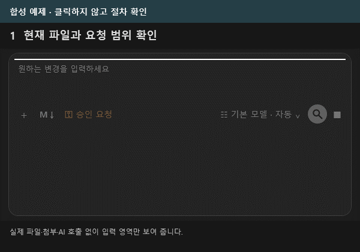

**③ 변경 검토 — 비교·원본·수정안을 살펴보고 적용 범위를 결정하세요.**

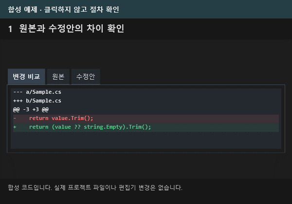

**④ 사용 안내 — 카드를 선택해 자세히 읽고 우측 상단의 돌아가기로 이동하세요.**

**⑤ 설치 설명 — PDF 또는 Markdown 설명서를 읽고 설치 실행 전에 내용을 확인하세요.**

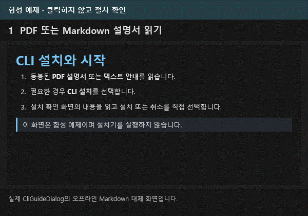

GIF가 재생되지 않는 환경에서는 [연결](docs/assets/guide-media/01-connect.png) · [요청](docs/assets/guide-media/02-request.png) · [검토](docs/assets/guide-media/03-review.png) · [안내](docs/assets/guide-media/04-guide.png) · [설치](docs/assets/guide-media/05-install.png)의 정지 그림을 볼 수 있습니다.

별도의 설명용 도식으로 살펴보려면 [화면 안내 보완 가이드](docs/visual-guide-orig3/화면안내_보완가이드.md), [보완 PDF](output/pdf/화면안내_보완가이드.pdf), [정지·재생을 선택하는 갤러리](docs/visual-guide-orig3/gallery.html)를 이용하세요. 이 자료의 그림은 제품을 촬영한 화면과 구분한 설명용 도식입니다.

### 원하는 방식으로 코드를 바꾸세요

| 권한 메뉴 | AI 작업 방식 |
|---|---|
| **승인 요청** | 원본을 보존한 수정안을 만듭니다. 비교 → 승인 체크 → 편집기에 적용 → 저장 순서로 진행합니다. |
| **작업 도구 허용** | 수정안 검토 방식에 더해 확장의 DB·형상관리·배포 작업 창을 사용할 수 있습니다. 해당 작업은 정확한 실행 계획을 별도로 확인합니다. |
| **전체 액세스** | 네이티브 CLI가 직접 파일을 바꾸고 명령·테스트를 실행합니다. 실행 전에 열린 미저장 파일을 저장하세요. |

전체 액세스는 현재 Windows 사용자에게 허용된 컴퓨터 자원에 접근하는 모드입니다. 관리자 권한을 자동으로 얻는 기능은 아닙니다. 직접 실행한 파일·서버 변경은 수정안의 ‘직전 적용 되돌리기’로 일괄 복구되지 않으며, 중지 후에도 이미 실행한 결과는 남을 수 있습니다.

변경 카드에서 파일을 선택해 비교하고, 파일 링크로 해당 소스 위치에 이동하세요. 변경 카드의 파일 항목으로 내용을 비교하고, 진행 카드를 클릭해 작업 기록을 볼 수 있습니다. 전후 diff가 제공되지 않은 파일은 줄 수를 ‘미제공’으로 표시합니다.

## 작업 중에도 흐름을 확인하세요

사용자 요청은 오른쪽에 작성란과 같은 배경색으로 표시하고, AI 답변은 왼쪽에 조금 더 진한 배경으로 구분합니다. 대화 이름과 시각은 위에 고정되고 입력란을 남겨 두고 본문만 스크롤합니다. 공개된 명령 실행·파일 변경·도구 상태는 한 카드에서 갱신하며, 카드를 클릭해 작업별 상세를 확인할 수 있습니다. ‘생각 중’에는 흰색 빛이 왼쪽에서 오른쪽으로 흐르고, 이전 내용을 읽는 동안에는 진행 표시를 상단으로 옮깁니다.

입력란의 **모델·생각 강도** 버튼에 마우스를 올리면 실제 보고된 입력·출력·캐시 토큰과 계정 한도를 확인할 수 있습니다. 같은 버튼을 눌러 상세 모델·생각 강도·응답 속도를 선택합니다. 전체 액세스의 Codex는 사용량 이벤트마다 갱신합니다. 일반 수정안의 Codex는 CLI가 완료 시 보고한 사용량을 표시합니다. 제공되지 않은 수치는 추정하지 않습니다.

연결할 때 CLI에서 모델 목록과 지원 강도·속도를 자동 조회합니다. CLI가 새 모델을 광고하면 다시 연결하여 선택할 수 있습니다. 요금제 이름으로 임의의 제한표를 만들지 않으며, 실제 이용 가능 여부는 연결된 계정과 서비스가 판정합니다.

## 나에게 맞는 작업 공간

대화 목록의 경계를 드래그해 폭을 조절하고 왼쪽 끝으로 접으세요. **☰**로 이전 폭을 복원합니다. 각 대화의 **작업 중·완료·실패·중지**와 파란 읽지 않음 표시가 기록에 남습니다. 닫은 대화도 Markdown을 보존하며 다시 불러올 수 있습니다.

목록 아래 **AI 지정하여 대화**에서 담당자를 고릅니다. 이름은 사용자명+AI명+A~Z 형식이고, 슬롯을 모두 사용하면 기존 A로 돌아갑니다. 역할·팀과 동료를 지정하면 실제 동료 검토를 받은 뒤 현재 AI가 결과를 종합합니다. 전체 액세스에서도 동료는 수정안을 검토하고 최종 담당자가 직접 실행합니다.

**v0.11.0부터** 같은 팀의 열린 Claude·Codex 대화를 서로 교차해 최대 3명까지 선택할 수 있습니다. Claude를 주 담당으로 두고 Codex를 동료로 두거나 그 반대로 구성할 수 있습니다. 전송을 누르면 각 동료의 저장된 CLI·모델·생각 강도·응답 속도를 사용해 순서대로 한 차례 검토하고, 현재 AI가 결과를 정리합니다. 요청·선택 소스·첨부가 선택한 각 AI 서비스에 공유되며 사용량과 시간이 추가됩니다. 재귀 자동 대화는 하지 않습니다. 실제 Claude CLI 계정 연결은 별도 로그인이 필요하며, 격리 검사를 실제 계정 성공으로 해석하지 않습니다. [협업 사용 안내](docs/USER_GUIDE.md#대화-ai-이름과-협업).

공통 규칙은 `%LOCALAPPDATA%\VS2017AIAssistant\workspace\instructions.md`, 대화는 같은 위치의 AI별 Markdown에 보관합니다. 공통 규칙은 모든 프로젝트에서 공유합니다. 첨부 원본은 대화에 저장하지 않으므로 다시 연 대화에서 필요하면 새로 첨부하세요.

AI 답변은 제목·강조·목록·표·코드·링크를 Markdown으로 표시합니다. 소스 링크를 선택하면 Visual Studio의 해당 텍스트 파일과 행으로 이동합니다. 요청 입력란의 **M↓** 또는 입력란·공통 규칙의 **우클릭 → Markdown 작성 · 미리보기**에서 작성기를 여세요. 원래 입력란을 바꾸려면 **입력란에 적용**을 누릅니다.

별도 문서는 **우클릭 → Markdown 문서 작성**으로 시작합니다. 줄 번호와 구문 색상, 검색, Undo·Redo, 편집·미리보기·분할 보기, 자동 줄바꿈과 확대·축소를 사용할 수 있습니다. **Ctrl+B/I/K**는 서식·링크, **Ctrl+Shift+C**는 체크 목록, **Ctrl+Enter**는 체크 전환, **Ctrl+F**는 검색입니다. 작성기의 단축키는 대화 입력란의 전송 단축키와 구분됩니다. 명시적으로 불러온 Markdown 문서는 같은 폴더의 로컬 이미지·GIF도 미리보기로 확인할 수 있으며, UTF-8로 저장합니다.

**저장/Ctrl+S**는 현재 문서에, **다른 이름으로 저장/Ctrl+Shift+S**는 새 경로에 저장합니다. 접이식 문서 목록은 넓은 창에서 왼쪽, 좁은 창에서 탭 위에 나타나며 안쪽에서 스크롤할 수 있습니다. 목록에서 문서를 열고 이름 변경·파일 위치를 확인할 수 있고, 삭제는 현재 열려 있는 문서와 저장하지 않은 내용까지 지우므로 확인 단계를 거칩니다. 참조형 링크와 제한된 정적 HTML을 미리보기에서 지원합니다. 일반 Markdown 표는 최대 16열, 정적 HTML 표는 최대 128행·16열까지 표시하며 한도를 넘긴 내용이 있으면 생략 안내를 표시합니다. 스크립트·스타일시트·iframe 실행이나 원격 자료 자동 로딩은 하지 않습니다. [Markdown 작성기 그림 사용 설명서 C8 검토판](docs/visual-guide-orig3/markdown-editor/revision-c8/Markdown%EC%9E%91%EC%84%B1%EA%B8%B0_%EC%82%AC%EC%9A%A9%EC%84%A4%EB%AA%85%EC%84%9C_C8.md) · [PDF](output/pdf/Markdown%EC%9E%91%EC%84%B1%EA%B8%B0_%EC%82%AC%EC%9A%A9%EC%84%A4%EB%AA%85%EC%84%9C_C8.pdf).

**설정 → 화면 테마**의 기본값은 **자동 · Visual Studio 우선**입니다. IDE 밖에서는 Windows 앱 모드를 따릅니다. 밝게·어둡게를 직접 고르고 설정을 저장할 수도 있습니다. 설정의 상세 설명은 필요할 때 펼치고, 작은 창에서는 대화 목록 뒤의 화면을 흐리게 구분해 읽을 수 있습니다.

## 도입 전에 확인하세요

AI 사용량과 비용은 각 계정에 따릅니다. PDF 등 문서 추출은 PC에 설치된 필터에 따라 달라집니다. 스캔 문서는 자동 OCR 대상이 아니므로 이미지로 첨부할 수 있습니다.

프로젝트 전후 비교는 작은 텍스트 소스의 변경을 보완합니다. 비교 한도와 제외 폴더가 있으며, 다른 프로세스의 동시 변경도 포함될 수 있습니다. [사용 안내](docs/USER_GUIDE.md)의 추적 범위를 확인하세요.

[최신 설치 호환성 검증 기록](MarkdownReport/CodexOrig_TASK-036.md)에서 버전별 IDE·격리 협업 검사와 실제 Claude 계정·운영 DB·TFVC·운영 배포의 미검증 범위를 구분합니다. 테스트 재현에는 최상위 [검사 실행기](VisualStudio_AIChat_ExtentionTest.exe?raw=true)를 사용하세요. 현재 실행기는 기본 검사 27개와 직접 선택 검사 2개를 표시합니다. 기본 검사에서 실제 IDE 실행과 실시간 Codex 대화는 시작하지 않으며, 각 항목의 통과 여부는 최신 후보 검증 보고서에서 확인하세요. 기본 검사는 유료 AI 호출과 운영 서버 접속을 자동 실행하지 않습니다.

[상세 사용법](docs/USER_GUIDE.md) · [테스트 환경](docs/TEST_ENVIRONMENT.md) · [실제 IDE 검사](docs/IDE_TESTS.md) · [빌드·라이선스 안내](docs/BUILD_AND_LICENSE.md) · [개발 안내](docs/DEVELOPMENT.md)
