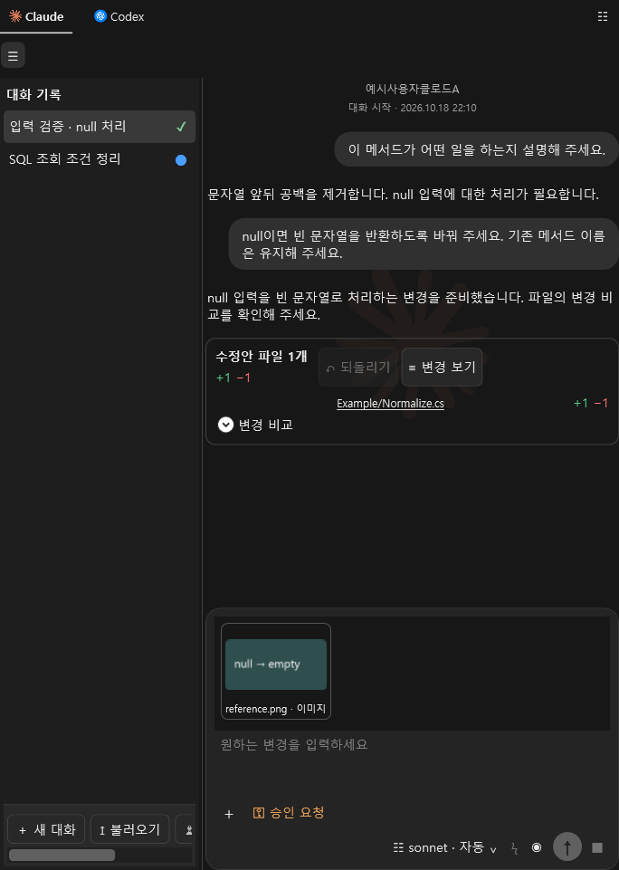

# Visual Studio AI Assistant

**Visual Studio에서 Claude·Codex와 대화하고, 코드를 고치고, 테스트까지 이어 가세요.**

오류 화면과 참고 문서를 보여 주고 자연어로 작업을 요청하세요. 바뀔 코드를 먼저 비교해 승인하거나, **전체 액세스**를 선택해 AI가 직접 파일 수정과 명령·테스트를 수행하게 할 수 있습니다. 대화와 공통 규칙은 내 PC의 Markdown에 남습니다.

**v0.9.0** · [설치 패키지 안내](releases/v0.9.0/README.md) · [자세한 사용법](docs/USER_GUIDE.md)

| 사용 중인 Visual Studio | 설치 파일 |
|---|---|
| 2017 15.9 이상 · x86 IDE | [VS2017용 다운로드](releases/v0.9.0/VS2017.AIAssistant-0.9.0.vsix?raw=true) |
| 2019 16.11 · x86 IDE | [VS2019용 다운로드](releases/v0.9.0/VS2019.AIAssistant-0.9.0.vsix?raw=true) |
| 2022 17.x · x64 IDE | [VS2022용 다운로드](releases/v0.9.0/VS2022.AIAssistant-0.9.0.vsix?raw=true) |

각 버전에 맞는 설치 파일을 사용하세요. Windows 네이티브 `codex.exe` 또는 `claude.exe`와 해당 서비스 계정이 필요합니다. 확장을 직접 빌드할 필요는 없습니다.

확장을 처음 열면 협업과 소스 주석 규칙을 담은 숨김 필수 지침을 생성합니다. 직접 작성한 공통 지침은 별도로 보존하며, 두 지침을 AI 요청에 함께 전달합니다.

## 이런 일을 함께하세요

| 하고 싶은 일 | 사용하는 기능 |
|---|---|
| 오류를 설명하고 수정하기 | 소스 또는 일부 코드를 선택하고 오류 화면·참고 문서를 첨부 |
| 변경을 확인한 뒤 적용하기 | 추가는 초록색, 삭제는 빨간색으로 비교하고 승인·적용·저장 |
| 수정과 테스트까지 맡기기 | 전체 액세스로 요청하고 실제 명령·진행·변경 결과 확인 |
| 긴 작업의 진행 상황 보기 | 빌드·테스트·파일·조회별 상태 카드, 마우스 오버 상세, 움직이는 ‘생각 중’ 표시, 토큰 툴팁 |
| 지난 대화에 이어 작업하기 | AI별 대화 목록, 자동 제목·이름, 대화별 상태와 파란 읽지 않음 표시 |
| 코드와 대화 화면 넓게 쓰기 | 목록 경계 드래그·접기·복원, 대화만 스크롤하고 입력란은 항상 표시 |
| 문서를 참고해 개발하기 | 이미지·텍스트·PDF·Word·PowerPoint·Excel 본문 첨부 |
| AI마다 역할 나누기 | A~Z 담당자, 역할·팀, 최대 3명 동료의 순차 검토 |
| DB 구조에 맞게 SQL 작성하기 | 명시적으로 허용한 SQL Server 스키마를 참고 자료로 공유 |
| 형상관리와 배포 실행하기 | 권한·대상·실행 계획을 확인한 뒤 Git·SVN·TFVC·배포 도구 실행 |

*제품에 합성 예제 대화를 표시한 화면입니다. 실제 계정 대화가 아닙니다.*

## 설치하고 첫 요청 보내기

1. 사용 중인 Visual Studio 버전에 맞는 VSIX를 내려받습니다. Visual Studio를 닫고 설치한 뒤 다시 엽니다.
2. **도구 → AI Assistant**를 엽니다. 첫 사용 안내에서 그림과 함께 연결·요청·결과 확인 순서를 볼 수 있습니다.
3. 맨 위에서 **Claude** 또는 **Codex**를 선택합니다. 설치된 네이티브 CLI를 자동으로 찾습니다. 다른 경로를 사용하려면 오른쪽 위 부채꼴 메뉴나 **우클릭 → 설정**에서 `.exe`를 지정합니다.
4. **계정 연결**로 공식 인증을 마친 뒤 **연결 확인**을 누릅니다. 인증정보는 공식 창에 입력합니다.
5. 소스를 열거나 필요한 코드를 선택합니다. 입력란 왼쪽 **+** 또는 파일 드롭으로 참고 자료를 붙입니다.
6. 오른쪽 모델 메뉴에서 상세 모델·생각 강도·Fast를 선택하고, 왼쪽 권한 메뉴에서 작업 방식을 고릅니다.
7. 요청을 입력하고 **Enter**로 보냅니다. **Ctrl+Enter**는 줄바꿈입니다.

설치부터 시작까지의 [그림 설명서](HowToInstallCLI.md), [PDF 설명서](output/pdf/VisualStudio_AI_Assistant_설치_사용설명서.pdf), [설명서·설치 스크립트 ZIP](output/VisualStudio_AI_Assistant_고객전달용.zip)을 함께 제공합니다. ZIP에는 설명서와 설치 스크립트가 있으며 확장은 위의 버전별 VSIX로 따로 설치합니다. 확장의 **CLI 환경 설정 → PDF 설명서 · CLI 설치**에서도 동봉 PDF를 볼 수 있습니다. **CLI 설치** 버튼은 실행 내용을 확인하는 창을 거쳐 동봉 [InstallCLI.bat](InstallCLI.bat)를 일반 사용자 권한으로 실행합니다. 설치 후에는 본인 계정으로 CLI 로그인을 진행하세요.

### 원하는 방식으로 코드를 바꾸세요

| 권한 메뉴 | AI 작업 방식 |
|---|---|
| **승인 요청** | 원본을 보존한 수정안을 만듭니다. 비교 → 승인 체크 → 편집기에 적용 → 저장 순서로 진행합니다. |
| **작업 도구 허용** | 수정안 검토 방식에 더해 확장의 DB·형상관리·배포 작업 창을 사용할 수 있습니다. 해당 작업은 정확한 실행 계획을 별도로 확인합니다. |
| **전체 액세스** | 네이티브 CLI가 직접 파일을 바꾸고 명령·테스트를 실행합니다. 실행 전에 열린 미저장 파일을 저장하세요. |

전체 액세스는 현재 Windows 사용자에게 허용된 컴퓨터 자원에 접근하는 모드입니다. 관리자 권한을 자동으로 얻는 기능은 아닙니다. 직접 실행한 파일·서버 변경은 수정안의 ‘직전 적용 되돌리기’로 일괄 복구되지 않으며, 중지 후에도 이미 실행한 결과는 남을 수 있습니다.

변경 카드에서 파일을 선택해 비교하고, 파일 링크로 해당 소스 위치에 이동하세요. 마우스를 올리면 변경 내용과 기록을 볼 수 있습니다. 전후 diff가 제공되지 않은 파일은 줄 수를 ‘미제공’으로 표시합니다.

## 작업 중에도 흐름을 확인하세요

사용자 요청은 오른쪽 말풍선, AI 답변은 왼쪽 본문에 표시합니다. 입력란을 남겨 두고 대화만 스크롤합니다. 공개된 명령 실행·파일 변경·도구 상태는 한 카드에서 갱신하며, 마우스를 올려 작업별 상세를 확인할 수 있습니다. ‘생각 중’에는 흰색 빛이 왼쪽에서 오른쪽으로 흐르고, 이전 내용을 읽는 동안에는 진행 표시를 상단으로 옮깁니다.

입력란의 토큰 아이콘에 마우스를 올리면 실제 보고된 입력·출력·캐시 토큰과 계정 한도를 확인할 수 있습니다. 전체 액세스의 Codex는 사용량 이벤트마다 갱신합니다. 일반 수정안의 Codex는 CLI가 완료 시 보고한 사용량을 표시합니다. 제공되지 않은 수치는 추정하지 않습니다.

연결할 때 CLI에서 모델 목록과 지원 강도·속도를 자동 조회합니다. CLI가 새 모델을 광고하면 다시 연결하여 선택할 수 있습니다. 요금제 이름으로 임의의 제한표를 만들지 않으며, 실제 이용 가능 여부는 연결된 계정과 서비스가 판정합니다.

## 나에게 맞는 작업 공간

대화 목록의 경계를 드래그해 폭을 조절하고 왼쪽 끝으로 접으세요. **☰**로 이전 폭을 복원합니다. 각 대화의 **작업 중·완료·실패·중지**와 파란 읽지 않음 표시가 기록에 남습니다. 닫은 대화도 Markdown을 보존하며 다시 불러올 수 있습니다.

목록 아래 **AI 지정하여 대화**에서 담당자를 고릅니다. 이름은 사용자명+AI명+A~Z 형식이고, 슬롯을 모두 사용하면 기존 A로 돌아갑니다. 역할·팀과 동료를 지정하면 실제 동료 검토를 받은 뒤 현재 AI가 결과를 종합합니다. 전체 액세스에서도 동료는 수정안을 검토하고 최종 담당자가 직접 실행합니다.

공통 규칙은 `%LOCALAPPDATA%\VS2017AIAssistant\workspace\instructions.md`, 대화는 같은 위치의 AI별 Markdown에 보관합니다. 공통 규칙은 모든 프로젝트에서 공유합니다. 첨부 원본은 대화에 저장하지 않으므로 다시 연 대화에서 필요하면 새로 첨부하세요.

## 도입 전에 확인하세요

AI 사용량과 비용은 각 계정에 따릅니다. PDF 등 문서 추출은 PC에 설치된 필터에 따라 달라집니다. 스캔 문서는 자동 OCR 대상이 아니므로 이미지로 첨부할 수 있습니다.

프로젝트 전후 비교는 작은 텍스트 소스의 변경을 보완합니다. 비교 한도와 제외 폴더가 있으며, 다른 프로세스의 동시 변경도 포함될 수 있습니다. [사용 안내](docs/USER_GUIDE.md)의 추적 범위를 확인하세요.

[최신 검증·감사 대응 기록](MarkdownReport/CodexOrig_TASK-020.md)에서 실제 Codex, 버전별 IDE, 로컬 SVN·배포 검사와 Claude·운영 DB·TFVC 인증 검증의 범위를 구분합니다. 테스트 재현에는 최상위 [검사 실행기](VisualStudio_AIChat_ExtentionTest.exe?raw=true)를 사용하세요. 기본 검사는 유료 AI 호출과 운영 서버 접속을 자동 실행하지 않습니다.

[상세 사용법](docs/USER_GUIDE.md) · [테스트 환경](docs/TEST_ENVIRONMENT.md) · [실제 IDE 검사](docs/IDE_TESTS.md) · [빌드·라이선스 안내](docs/BUILD_AND_LICENSE.md) · [개발 안내](docs/DEVELOPMENT.md)
