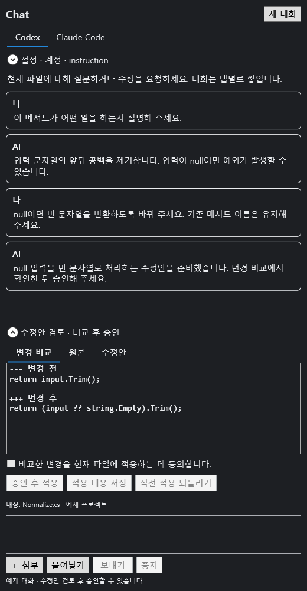

# VS2017 AI Assistant

**익숙한 Visual Studio에서, Codex·Claude와 대화하며 코드를 개선하세요.**

유지보수 중인 프로젝트와 편집기를 그대로 두고 AI에게 질문하고 수정안을 받을 수 있습니다. 오류 화면이나 참고 파일을 함께 보내고, 이전 답변에 이어 요청하세요. 바뀔 내용을 비교한 뒤 **내가 승인한 변경만** 편집기에 적용합니다.

**v0.3.0 · VS2017 15.9 이상** — [VSIX 다운로드](releases/v0.3.0/VS2017.AIAssistant-0.3.0.vsix?raw=true) · [설치 패키지 안내](releases/v0.3.0/README.md) · [전체 사용 안내](docs/USER_GUIDE.md)

## 작업 흐름이 이렇게 달라집니다

| 하고 싶은 일 | AI Assistant에서 하는 방법 |
|---|---|
| 오류를 설명하고 수정하고 싶을 때 | 소스를 열고 오류 메시지·화면을 첨부한 뒤 자연어로 요청 |
| AI 답변을 보며 계속 다듬고 싶을 때 | 같은 대화에 후속 프롬프트를 보내 요청·응답을 차곡차곡 누적 |
| Codex와 Claude를 바꿔 쓰고 싶을 때 | Chat 창 상단 탭으로 전환, AI별 대화와 작성 중 입력 구분 |
| 기존 프로젝트의 작성 규칙을 지키고 싶을 때 | instruction에 언어·프레임워크·코딩 규칙을 저장해 반복 요청에 반영 |
| 어떤 코드가 바뀌는지 먼저 보고 싶을 때 | 변경 비교·원본·수정안을 확인하고 승인 후 적용 |
| 작업 화면을 내 방식으로 배치하고 싶을 때 | Chat 창을 도킹·분리하거나 문서 탭 위치로 이동 |



*v0.3.0 제품 화면에 예제 대화를 표시한 미리보기입니다.*

## 시작하기

사용을 위해 이 프로젝트를 직접 빌드할 필요는 없습니다. **지원 버전의 Visual Studio**, **사용할 AI의 Windows 네이티브 CLI와 계정**, **VSIX 설치 파일**을 준비하세요. AI 이용 권한과 비용은 연결한 서비스·계정의 조건에 따릅니다.

| 항목 | 현재 범위 |
|---|---|
| Visual Studio | VS2017 15.9 이상. 실제 검증 환경은 Community 15.9.83 |
| 운영체제 | Windows |
| AI 연결 | Codex 또는 Claude Code의 `.exe` 실행 파일과 해당 CLI 로그인 |
| 코드 수정 | 이미 저장된 텍스트 파일 한 개의 현재 편집 내용 |
| VS2019·2022 | 패키지 지원은 후속 개발 대상. 현재 VSIX 설치 대상에 포함되지 않음 |

### 1. 확장 설치하기

1. [v0.3.0 VSIX 설치 파일](releases/v0.3.0/VS2017.AIAssistant-0.3.0.vsix?raw=true)을 내려받습니다. 설치 조건과 체크섬은 [패키지 안내](releases/v0.3.0/README.md)를 참고하세요.
2. 실행 중인 Visual Studio를 닫고 내려받은 `.vsix` 파일을 실행합니다.
3. 설치 대상에서 지원되는 VS2017을 선택해 설치합니다.
4. Visual Studio를 다시 열고 **도구 → AI Assistant**를 선택합니다.

### 2. 사용할 AI 연결하기

1. 사용할 도구를 공식 안내에 따라 설치합니다: [Codex 설치 안내](https://developers.openai.com/codex/cli), [Claude Code 설치 안내](https://code.claude.com/docs/en/setup).
2. Chat 창에서 **Codex** 또는 **Claude Code** 탭을 선택합니다.
3. 설정에서 해당 CLI의 `.exe` 실행 파일을 선택합니다. PATH에 등록되어 있으면 경로를 비워도 됩니다. `.cmd`·`.bat` 대신 네이티브 `.exe`가 필요합니다.
4. **계정 연결**을 눌러 열린 CLI·브라우저에서 본인 계정으로 인증한 뒤 **연결 확인**을 누릅니다. 이미 해당 CLI에 로그인했다면 연결 확인부터 진행합니다.
5. CLI 경로와 모델 등 변경한 설정은 **설정 저장**으로 보관합니다. 모델을 지정하지 않으면 CLI 기본값을 사용합니다.

확장 안에 암호나 API 키를 입력할 필요는 없습니다. 인증은 각 CLI가 처리합니다. 상세 단계와 연결 문제 해결은 [사용 안내](docs/USER_GUIDE.md)를 참고하세요.

### 3. 첫 수정 요청 보내기

1. 수정할 소스 파일을 편집기로 엽니다. 새 파일이라면 먼저 저장합니다.
2. Chat 입력란에 원하는 결과를 적습니다. 필요하면 참고 이미지·텍스트 파일을 첨부합니다.

   ```text
   현재 메서드에서 입력값이 비어 있을 때 발생하는 오류를 수정해 주세요.
   기존 반환 형식과 C# 7.0 문법은 유지하고, 변경 이유도 설명해 주세요.
   ```

3. 요청을 전송하고 답변을 확인합니다. 이어서 조건을 추가하거나 수정 방향을 다시 요청할 수 있습니다.
4. **변경 비교**, **원본**, **수정안**을 검토합니다.
5. 적용 동의에 체크하고 **승인 후 적용**을 누릅니다.
6. 편집기에서 결과를 확인한 뒤 **적용 내용 저장** 또는 **Ctrl+S**로 저장합니다.

**적용과 저장은 별도입니다.** 적용만 했다면 디스크 파일은 아직 바뀌지 않습니다. **직전 적용 되돌리기**나 편집기의 **Ctrl+Z**로 복구할 수 있습니다. 수정안 이후 소스를 직접 바꿨다면 새 수정안을 요청하세요. 원본과 충돌하는 변경은 적용을 거부합니다.

## 이미지·파일을 함께 보내기

파일 탐색기에서 이미지나 텍스트 파일을 Chat 영역으로 **끌어 놓거나**, **＋ 첨부** 버튼으로 선택하세요. 클립보드의 이미지는 입력란의 **Ctrl+V** 또는 **붙여넣기** 버튼으로 추가할 수 있습니다. 첨부 목록을 확인하고 원하지 않는 항목을 제거한 뒤 **보내기**를 누릅니다.

- 이미지: PNG·JPEG, 파일당 최대 2 MB 및 1,600만 픽셀.
- 텍스트: UTF-8 또는 BOM이 있는 Unicode, 파일당 최대 100 KB.
- 한 요청에 최대 4개. PDF·Word·압축·실행 파일은 지원하지 않습니다.

예: 오류 화면을 첨부한 뒤 “이 화면의 오류와 현재 소스를 함께 보고 수정해 주세요”라고 요청할 수 있습니다. 첨부한 파일은 참고 자료이며, 수정 대상은 요청 당시 선택된 소스 파일 한 개입니다.

## 대화와 규칙을 내 작업에 맞추기

요청이 끝나면 같은 입력란에서 후속 요청을 보낼 수 있습니다. Codex·Claude 탭마다 대화를 구분하고 최신 메시지는 아래에 쌓습니다. 현재 대화는 메모리에 유지되며, **새 대화**를 누르거나 IDE를 종료하면 정리됩니다. 재시작 후 이전 대화를 복원하는 기능은 포함하지 않습니다.

instruction에는 매번 반복하고 싶지 않은 규칙을 적고 저장하세요.

```text
설명은 한국어로 작성해 주세요.
이 프로젝트는 .NET Framework 4.6.2와 C# 7.0을 사용합니다.
공개 메서드 이름과 외부 호출 규약은 유지해 주세요.
```

설정에서 AI별 CLI 경로·모델과 instruction, 글자 크기를 조절할 수 있습니다. 대화 누적·첨부·창 이동·복구의 자세한 절차는 [전체 사용 안내](docs/USER_GUIDE.md)에 정리했습니다.

## 전송되는 내용과 현재 지원 범위

전송을 누르면 현재 파일의 **미저장 편집 내용 포함 전체 텍스트**, 얻을 수 있는 프로젝트 정보, 작성한 요청·instruction, 최근 대화와 첨부가 선택한 AI에 전달됩니다. 첨부 내용을 먼저 확인해 주세요. 확장 설정에는 계정 암호·토큰을 저장하지 않습니다.

현재 코드 수정은 **기존 텍스트 파일 한 개를 검토·승인해 적용하는 방식**입니다. 다중 파일 변경, 파일 생성·삭제, 무승인 자동 적용은 포함하지 않습니다. 실제 Codex의 이미지·텍스트·대화·규칙 전달은 [독립 검증 결과](MarkdownReport/CodexCode_TASK-009.md)에서 확인할 수 있습니다. Claude는 CLI 테스트 응답으로 검증했으며 실제 계정 호출은 남아 있습니다. VS2019·2022 지원과 추가 검증 범위는 [개발 문서](docs/DEVELOPMENT.md)에서 구분합니다.

개발·기여 자료: [빌드 방법](docs/DEVELOPMENT.md) · [배치 빌드와 로그인 안내](docs/BUILD_AND_LICENSE.md) · [작업 이력](MarkdownReport/Update_History.md).
