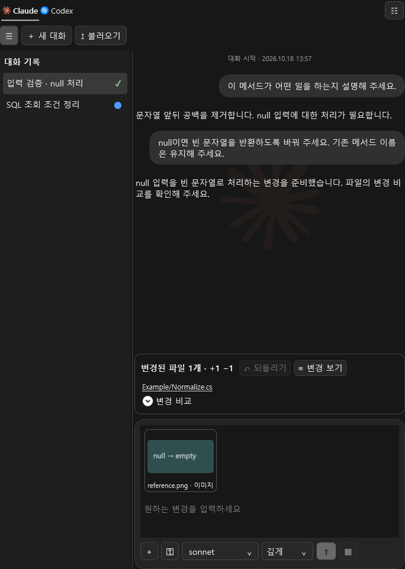

# VS2017 AI Assistant

**익숙한 Visual Studio에서, 어제의 AI 대화를 이어 오늘의 코드를 개선하세요.**

Claude·Codex에게 이미지와 참고 파일을 보여주고, 답변을 이어 가며 수정안을 다듬으세요. 바뀔 코드를 비교한 뒤 승인한 내용만 편집기에 적용합니다. 대화와 공통 작성 규칙은 내 PC의 Markdown에 남아 다음 작업에서도 이어집니다.

**v0.6.0 · VS2017 15.9 이상** — [VSIX 다운로드](releases/v0.6.0/VS2017.AIAssistant-0.6.0.vsix?raw=true) · [설치 패키지 안내](releases/v0.6.0/README.md) · [전체 사용 안내](docs/USER_GUIDE.md)

## 이런 작업에 사용하세요

| 하고 싶은 일 | AI Assistant에서 하는 방법 |
|---|---|
| 오류를 설명하고 수정하고 싶을 때 | 소스를 열고 오류 화면·참고 파일을 첨부한 뒤 자연어로 요청 |
| 이전 답변에 이어 작업하고 싶을 때 | AI별 대화 목록에서 기록을 다시 선택하고 후속 요청 |
| 기능별로 대화를 나누고 싶을 때 | 새 대화로 탭 추가, 질문에서 자동 생성된 이름을 직접 변경 |
| 코드와 대화 화면을 넓게 보고 싶을 때 | 대화 목록 경계를 드래그해 폭 조절, 왼쪽 끝으로 접고 ☰로 복원 |
| 응답이 왔는지 한눈에 알고 싶을 때 | 대화별 작업 중·완료·실패·중지 표시와 읽지 않은 응답의 파란 점 확인 |
| 코딩 규칙을 매번 적고 싶지 않을 때 | 모든 프로젝트에 공통인 instruction을 Markdown으로 저장 |
| 원하는 모델과 답변 방식을 고르고 싶을 때 | 입력 영역에서 모델·모드·권한 선택 |
| DB 구조에 맞는 쿼리가 필요할 때 | 허용한 SQL Server 스키마를 참고 자료로 불러와 SQL 작성 요청 |
| 형상관리·배포를 터미널 밖에서 하고 싶을 때 | 별도 권한을 켜고 작업 계획을 확인한 뒤 Git·SVN·TFVC 또는 배포 실행 |
| 바뀌는 파일로 바로 가고 싶을 때 | 변경 카드의 파일 링크로 소스 이동, 비교 후 적용·저장 |



*제품 화면에 합성 예제 대화를 표시한 미리보기입니다. 실제 계정 대화가 아닙니다.*

## 설치하고 첫 요청 보내기

프로젝트를 직접 빌드할 필요는 없습니다. **VS2017 15.9 이상**, 사용할 AI의 **Windows 네이티브 CLI .exe와 계정**, **VSIX 설치 파일**을 준비하세요. 현재 VSIX는 VS2019/2022 설치 대상에 포함되지 않습니다.

1. [설치 파일](releases/v0.6.0/VS2017.AIAssistant-0.6.0.vsix?raw=true)을 내려받고 Visual Studio를 닫은 뒤 실행합니다.
2. Visual Studio에서 **도구 → AI Assistant**를 엽니다. 첫 사용 안내에서 연결·요청·검토·저장 순서를 확인합니다.
3. 맨 위의 **Claude** 또는 **Codex** 탭을 고릅니다. 오른쪽 위 메뉴 또는 **우클릭 → 설정**에서 CLI 경로를 지정합니다.
4. **계정 연결 → 연결 확인**을 누르고 설정을 저장합니다. 이미 CLI에 로그인했다면 연결 확인부터 시작합니다. 설정의 CLI 안내도 참고할 수 있습니다.
5. 수정할 소스 파일을 연 뒤 AI 창으로 돌아옵니다. 원하는 결과를 입력하고 **Enter** 또는 보내기 버튼을 누릅니다. **Ctrl+Enter**는 줄바꿈입니다.
6. 답변의 변경 카드에서 파일과 변경을 확인합니다. 적용 동의 후 **승인 후 적용**, 이어 **적용 내용 저장**을 선택합니다.

```text
이 메서드에 null 검사를 추가해 주세요.
기존 메서드 이름과 매개변수, 들여쓰기는 유지해 주세요.
```

AI가 수정안을 만드는 동안 원본은 유지됩니다. 적용은 편집기 내용을 바꾸고, 저장은 별도 동작입니다. **직전 적용 되돌리기**와 Visual Studio의 **Ctrl+Z**도 사용할 수 있습니다. 요청 후 원본이 달라졌다면 변경을 다시 확인하도록 안내합니다.

공식 CLI 안내: [Codex](https://developers.openai.com/codex/cli), [Claude Code](https://code.claude.com/docs/en/setup). AI 이용 권한·모델 제공 여부·비용은 연결한 서비스와 계정에 따릅니다.

## 보여 주고, 이어 묻고, 다시 시작하세요

이미지·텍스트 파일은 창에 끌어 놓거나 **＋ 첨부**로 선택합니다. 클립보드의 이미지는 입력란에서 **Ctrl+V**로 붙입니다. 이미지는 프롬프트 위에 표시되고, 마우스를 올리면 제거 버튼이 나타납니다. 일반 텍스트의 Ctrl+C·Ctrl+V도 사용할 수 있습니다.

| 첨부 | 범위 |
|---|---|
| PNG/JPEG 이미지 | 각 2MB, 최대 1,600만 픽셀 |
| UTF-8 또는 BOM이 있는 Unicode 텍스트 | 각 100KB |
| 합계 | 최대 4개 |

대화 목록 오른쪽 경계를 드래그해 너비를 조절하세요. 왼쪽 끝으로 끌면 목록이 숨겨지고, **☰**로 펼치면 이전 폭으로 돌아옵니다. 폭과 표시 선택은 다음 실행에도 유지됩니다. 제목이 길면 현재 폭에 맞춰 줄임표로 표시합니다.

각 대화 옆에서 **◌ 작업 중 · ✓ 완료 · ! 실패 · ■ 중지**를 확인할 수 있습니다. 보지 않은 응답은 **파란 점**으로 알리고 대화를 선택하거나 본문을 확인하면 읽음 처리합니다. 상태와 읽지 않음은 대화별 Markdown에 보관하며, 비정상 종료 때 남은 작업 중 표시는 다음 실행에서 중단 상태로 바뀝니다.

**새 대화**는 기존 기록을 지우지 않고 새 항목을 만듭니다. 첫 질문으로 붙은 이름은 바꿀 수 있습니다. 항목의 **우클릭 → 닫기**는 다음 시작의 자동 복원에서 제외하며 Markdown 파일을 지우지는 않습니다. **대화 불러오기**로 보관한 대화를 다시 열 수 있습니다.

대화는 `%LOCALAPPDATA%\VS2017AIAssistant\workspace` 아래 AI별 Markdown으로 저장합니다. **instruction**은 같은 위치의 `instructions.md`로 저장해 모든 프로젝트에서 공유합니다. 대화 원문과 작성 중 요청이 로컬에 남습니다. 이미지·첨부 원본은 기록에 저장하지 않으므로 대화를 다시 연 뒤 필요하면 새로 첨부하세요.

## SQL·형상관리·배포도 필요한 권한으로

업무 작업에서 **DB 스키마 참조 권한**을 허용하고 SQL Server 연결 정보를 입력하면 테이블·열 정의를 참고 자료로 가져옵니다. 이 구조를 기준으로 SQL 작성을 요청할 수 있습니다. DB의 실제 행 데이터나 연결 암호를 AI에게 보내지 않으며, 생성한 SQL을 DB에서 실행하는 기능은 포함하지 않습니다.

Git의 fetch·최신 버전 받기·브랜치 전환·지정 파일 커밋·push, SVN의 checkout·update·commit, TFVC의 get·checkout·checkin을 작업 창에서 실행할 수 있습니다. 실행 전 폴더·명령·인수를 확인합니다. 형상관리 권한과 배포 권한은 별도이며, 각 CLI 설치와 저장소 인증은 해당 도구에서 준비합니다. 배포는 사용자가 지정한 실행 파일과 인수로 동작합니다.

AI 소스 수정 요청이 형상관리나 배포를 자동으로 승인하지는 않습니다. 자세한 작업별 절차는 [사용 안내](docs/USER_GUIDE.md)에 있습니다.

## 내 작업 화면에 맞추기

Claude를 첫 탭으로 배치하고 AI별 로고·반투명 배경 표시로 현재 선택을 구분합니다. 사용자 요청은 오른쪽 둥근 말풍선에, AI 답변은 왼쪽 본문에 표시합니다. 대화 시작 시각과 실제 작업 진행 시간을 구분해 읽을 수 있습니다. 입력 영역은 검정 계열의 밝기 차로 나누고, 설정·안내는 오른쪽 위 메뉴에서 엽니다. 알림은 화면 중앙에 나타난 뒤 사라지며 최근 알림에서도 확인할 수 있습니다. 대기·팝업·버튼에도 전환 효과를 적용했습니다.

창은 소스 탭 옆으로 이동하거나 도킹·분리할 수 있습니다. 설정에서 글자 크기와 공통 규칙을 바꾸세요. 처음 안내의 **다시 보지 않기**를 선택한 뒤에도 **사용 안내**로 다시 열 수 있습니다.

## 현재 지원 범위

- 현재 배포 패키지: **VS2017 15.9 이상**, Windows, 기존 텍스트 파일 한 개의 수정안 비교·승인·적용·저장.
- 선택한 AI로 전달되는 내용: 현재 파일 전체 텍스트(미저장 내용 포함), 프로젝트 정보, 요청·instruction, 최근 대화와 현재 첨부. DB 스키마를 가져왔다면 그 정의도 참고 자료로 포함됩니다.
- 실제 Codex와 테스트 CLI 검증을 구분해 보고합니다. 실제 Claude 계정·외부 SVN/TFVC 서버·운영 DB 및 운영 배포의 검증 범위는 [검증 보고](MarkdownReport/CodexOrig_TASK-014.md)를 확인하세요.
- 다중 파일 자동 수정·새 파일 생성/삭제·VS2019/2022 확장 패키지는 후속 범위입니다.

## 내 PC에서 테스트하기

저장소 전체를 받은 뒤 최상위 폴더의 [VisualStudio_AIChat_ExtentionTest.exe](VisualStudio_AIChat_ExtentionTest.exe)를 실행하세요. 검사할 항목을 선택하고 실행 결과와 로그를 확인할 수 있습니다. 로그는 `artifacts/tl/<실행 ID>/`에도 남습니다. 기본 전체 검사는 실제 IDE·AI 계정을 사용하지 않으며, 해당 검사는 직접 선택합니다. 검사별 준비 조건은 [개발 및 검증](docs/DEVELOPMENT.md)을 참고하세요.

[상세 사용 안내](docs/USER_GUIDE.md) · [개발 및 검증](docs/DEVELOPMENT.md) · [Visual Studio 로그인·빌드](docs/BUILD_AND_LICENSE.md)
