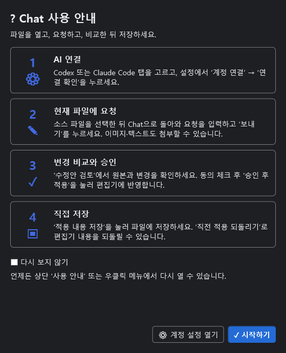

# AI Assistant 사용 안내

Visual Studio 안에서 Codex·Claude와 대화하고, 현재 파일의 변경을 검토해 적용하는 방법입니다. [v0.4.0 설치 파일과 지원 조건](../releases/v0.4.0/README.md)을 확인하고 시작하세요. 실제 Claude 계정 호출은 미검증이며 현재 패키지는 VS2017 15.9 이상용입니다.

## 설치와 계정 연결

1. 지원되는 VS2017 15.9 이상과 Windows용 Codex 또는 Claude Code 네이티브 CLI를 준비합니다. Visual Studio 확장 개발 워크로드나 이 저장소 소스 빌드는 사용에 필요하지 않습니다.
2. 배포한 VSIX를 내려받고 Visual Studio를 닫은 다음 설치합니다. 설치가 끝나면 Visual Studio를 다시 엽니다.
3. **도구 → AI Assistant**로 Chat 창을 엽니다.
4. 사용할 AI 탭을 선택하고 Chat의 **설정** 버튼 또는 **마우스 오른쪽 버튼 → 설정**으로 설정 창을 엽니다. 화면 중앙에 열린 창에서 해당 `.exe` 파일을 지정합니다. CLI가 PATH에 있으면 비워둘 수 있습니다. 실행 경로에 공백·한글이 있어도 선택할 수 있습니다.
5. **계정 연결** 버튼으로 해당 CLI의 인증 화면을 엽니다. 계정 인증은 열린 CLI·브라우저에서 직접 수행합니다. 확장은 암호·토큰을 수집하지 않습니다.
6. 인증을 마친 뒤 연결 확인을 누릅니다. 이미 CLI에 로그인한 계정이 있다면 그대로 사용할 수 있습니다.
7. 설정을 저장합니다. Codex와 Claude의 실행 경로·모델은 별도로 보관됩니다.

공식 설치·로그인 안내: [Codex CLI](https://developers.openai.com/codex/cli), [Codex 로그인 명령](https://developers.openai.com/codex/cli/reference), [Claude Code 설치](https://code.claude.com/docs/en/setup), [Claude 인증 명령](https://code.claude.com/docs/en/cli-reference). AI를 사용할 수 있는 계정·조직 권한과 비용은 각 서비스의 조건에 따릅니다.

## 처음 나타나는 사용 안내

Chat을 처음 열면 그림과 번호가 있는 안내에서 다음 순서를 확인할 수 있습니다.



*v0.4.0 제품 사용 안내의 WPF 화면입니다. IDE 창 테두리는 생략했습니다.*

| 순서 | 할 일 |
|---|---|
| 1. AI 연결 | Codex·Claude 탭을 고르고 설정에서 계정을 연결 |
| 2. 요청 작성 | 소스를 열고 원하는 결과 입력, 필요한 이미지·파일 첨부 |
| 3. 검토·승인 | 변경 비교와 전체 수정안을 읽고 적용 동의 후 적용 |
| 4. 저장 | 편집기에서 결과를 확인한 뒤 저장, 필요하면 되돌리기 |

안내에서 **계정 설정 열기**를 누르면 바로 연결 설정으로 이동할 수 있습니다. **시작하기**는 안내를 닫고 Chat으로 돌아갑니다.

**다시 보지 않기**를 선택하고 안내를 닫으면 이후 자동 표시를 생략합니다. 안내를 다시 보고 싶을 때는 Chat 상단이나 우클릭 메뉴의 **사용 안내**를 누릅니다. 자동 표시를 다시 켜려면 안내에서 체크를 해제하고 닫습니다. 안내를 닫아도 소스나 대화가 변경되지는 않습니다.

## 창을 원하는 곳에 두기

Chat은 Visual Studio 창 관리 기능으로 이동할 수 있습니다. 제목 표시줄이나 탭을 끌어 도킹 위치를 선택하거나 독립 창으로 분리합니다. 문서 탭 위치에 두면 열린 소스 탭과 오가며 사용할 수 있습니다. 문서 탭/도킹 전환은 창이 제공하는 이동 기능을 사용합니다. AI 선택은 Chat 내부의 Codex·Claude 탭에서 합니다.

소스 파일을 다른 탭에서 열어 놓고 Chat으로 돌아와 요청합니다. 요청이 시작된 뒤 다른 소스 탭으로 이동해도 이미 생성한 수정안은 처음 요청한 파일을 대상으로 합니다. 실제 대상 경로는 창의 대상 표시에서 확인할 수 있습니다.

## 요청과 후속 대화

1. 수정하거나 설명을 듣고 싶은 기존 텍스트 파일을 엽니다. 새 문서는 먼저 저장하세요.
2. 요청을 입력합니다. 바꾸고 싶은 결과, 유지할 조건, 오류 상황을 함께 적으면 검토하기 쉽습니다.
3. 필요하면 이미지·텍스트 파일을 첨부합니다.
4. **보내기**를 누르고 답변이 끝날 때까지 기다립니다. 요청 중에는 **중지** 버튼으로 취소할 수 있습니다.
5. 이어서 조건을 추가하거나 새 요청을 보냅니다. 이전 요청·응답은 위에 남고 새 메시지는 아래에 쌓입니다.

예를 들어 먼저 “이 메서드의 입력 검사를 보완해 주세요”라고 요청한 뒤 “예외를 새로 던지지 말고 기존 실패 반환값을 사용해 주세요”라고 이어 요청할 수 있습니다. 답변만 확인한 수정안은 자동 적용되지 않습니다. 후속 요청이 이전 변경의 적용을 뜻하지도 않습니다.

AI별 대화·첨부·작성 중 입력은 분리됩니다. 대화 화면은 최근 100개 메시지를 보관하고 다음 요청에는 최근 10개, 최대 24,000자까지의 대화가 포함됩니다. 더 이전 대화가 꼭 필요하면 요청에 조건을 다시 적어 주세요. **새 대화**를 누르면 선택한 AI의 대화 상태를 정리합니다. 대화는 디스크에 저장하지 않으며 IDE 종료 후 복원되지 않습니다. 도구 창을 숨겼다 다시 여는 동작은 새 대화 시작과 다릅니다.

## 이미지·텍스트 첨부

파일을 Chat 영역으로 끌어 놓거나 **＋ 첨부** 버튼을 사용합니다. 이미지가 복사되어 있으면 프롬프트 입력란의 **Ctrl+V** 또는 **붙여넣기** 버튼으로 첨부할 수 있습니다. 일반 텍스트 붙여넣기는 프롬프트 입력에 사용합니다.

| 항목 | 지원 범위 |
|---|---|
| 이미지 | PNG/JPEG, 파일당 2 MB, 최대 1,600만 픽셀 |
| 텍스트 파일 | UTF-8 또는 BOM이 있는 Unicode, 파일당 100 KB |
| 개수 | 한 요청에 최대 4개 |
| 미지원 | PDF·Word·Excel·압축·실행 파일, 폴더 전체 |

첨부 목록에서 파일명과 이미지 미리보기를 확인하고, 제거하려면 해당 항목의 **×**를 누릅니다. 파일을 끌어 놓는 동작만으로 AI에 전송되지는 않습니다. **보내기**를 누를 때 함께 전달됩니다. 목록에 남은 첨부는 다음 요청에도 다시 포함됩니다. 한 번만 보낼 자료라면 답변 뒤 제거하세요. 첨부 후 원본 파일을 고쳤다면 기존 첨부를 제거하고 다시 추가해야 새 내용이 반영됩니다.

이미지는 Codex에는 이미지 입력으로, Claude에는 이미지 메시지로 전달합니다. 텍스트 파일은 내용이 참고 자료로 포함됩니다. 첨부 파일을 AI의 수정 대상으로 바꾸거나, 첨부 경로로 파일 쓰기를 허용하지 않습니다.

## 변경을 확인하고 저장하기

1. 답변 후 **변경 비교**에서 변경 위치와 전/후 내용을 확인합니다.
2. **원본**과 **수정안**에서 전체 내용을 비교합니다.
3. 적용 동의에 체크한 뒤 **승인 후 적용**을 누릅니다.
4. 원래 소스 편집기로 돌아가 결과를 확인합니다.
5. **적용 내용 저장** 또는 편집기의 **Ctrl+S**로 파일을 저장합니다.

적용은 편집기 버퍼를 바꿉니다. 파일을 자동 저장하지 않습니다. 요청 당시 저장하지 않은 편집 내용도 원본으로 사용합니다. 요청 후 사용자가 수정했거나 디스크 파일이 외부에서 바뀌었으면 적용을 거부하고, 기존 내용을 보존합니다. 이때는 현재 상태로 새 요청을 보내세요.

한 번의 요청은 기존 텍스트 파일 한 개만 대상으로 합니다. 변경 비교 후 다른 파일을 열었더라도 적용 대상이 바뀌지 않습니다. 새 수정안은 이전 승인 상태를 사용하지 않습니다.

## 되돌리기와 중지

**직전 적용 되돌리기**는 마지막 AI 적용 이전 버퍼로 복구합니다. 복구 전 상태에 미저장 주석 등이 있었다면 그것도 함께 복원합니다. 복구 내용을 디스크에 저장하려면 편집기에서 Ctrl+S를 누릅니다.

**Ctrl+Z**는 Visual Studio의 실행 취소입니다. AI 적용은 하나의 실행 취소 그룹으로 처리됩니다. 적용 후 사용자가 직접 편집했거나 확장 밖에서 파일을 저장했다면 전용 복구 버튼이 충돌로 거부할 수 있습니다. 편집기에서 실행 취소 내역을 확인해 주세요.

요청 중 **중지**를 누르면 현재 AI 요청을 취소합니다. 수정안을 받기 전에는 소스가 변경되지 않습니다. 이미 승인해 적용한 변경을 중지 버튼이 복구하는 것은 아니므로, 그 경우에는 되돌리기나 Ctrl+Z를 사용하세요.

## instruction과 기본 설정

instruction은 다음 요청에 반복해서 사용할 규칙입니다. 설명 언어, 사용할 프레임워크, 유지할 API 규약 등을 적습니다. 최대 8,000자이며, 편집 승인과 충돌 검사 원칙은 그대로 적용됩니다.

```text
응답은 한국어로 작성해 주세요.
C# 7.0과 .NET Framework 4.6.2에서 빌드할 수 있어야 합니다.
기존 메서드 이름과 매개변수는 유지해 주세요.
새 패키지 추가가 필요하면 먼저 이유를 설명해 주세요.
```

Chat의 **설정** 버튼 또는 **마우스 오른쪽 버튼 → 설정**을 선택합니다. 중앙에 열린 설정 창에서 AI별 실행 파일·모델, 두 AI에 공통으로 사용할 instruction, 글자 크기(10~28)를 조절하고 **설정 저장**을 누릅니다. 모델을 모르거나 CLI 기본 모델을 사용하려면 모델 칸을 비워둡니다. 지정한 모델의 이용 가능 여부는 연결한 계정과 CLI가 결정합니다.

설정 창의 **현재 AI**를 확인하세요. 다른 AI를 설정하려면 창을 닫고 Chat에서 해당 AI 탭을 선택한 뒤 설정을 다시 엽니다. **설정 저장**에 성공하면 창이 닫힙니다. 저장 전에 **닫기**, 창의 닫기 버튼 또는 **Esc**를 누르면 이번 설정 변경을 취소합니다. 계정 연결로 이미 완료한 CLI 로그인은 설정 취소와 별개로 유지됩니다.

설정 파일은 기본적으로 `%LOCALAPPDATA%\VS2017AIAssistant\settings.json`입니다. 설정에는 실행 경로·모델·규칙·글자 크기·사용 안내 표시 선택이 들어갑니다. 계정 암호·토큰·소스·대화·첨부는 이 파일에 저장하지 않습니다. AI CLI 자체의 인증·진단 보관 정책은 해당 도구의 설정과 안내를 따릅니다.

## 자주 겪는 문제

| 증상 | 확인할 내용 |
|---|---|
| 설치 대상이 나오지 않음 | VS2017 15.9 이상인지 확인. 현재 VSIX는 VS2019/2022용이 아님 |
| AI 창을 찾을 수 없음 | Visual Studio 재시작 후 도구 → AI Assistant 선택 |
| CLI를 찾을 수 없음 | Windows 네이티브 `.exe` 선택. `.cmd`·`.bat` 경로는 사용할 수 없음 |
| 로그인·요청 실패 | 해당 AI의 연결 확인, CLI 업데이트, 계정 이용 권한·한도 확인 |
| 첨부가 거부됨 | 지원 형식·인코딩·파일 크기·픽셀 수·첨부 개수 확인 |
| 적용 버튼이 비활성 | 수정안이 실제 변경을 포함하는지 확인하고 적용 동의 체크 |
| 적용·저장·복구 충돌 | 현재 소스와 외부 변경을 확인한 뒤 수정안 재요청 |
| 답변이 이전 조건을 잊음 | 최근 대화 전송 제한을 확인하고 필요한 조건을 instruction 또는 새 요청에 명시 |
| 설정이 저장되지 않음 | 오류 안내와 로컬 설정 경로의 쓰기 권한 확인 |
| Visual Studio 라이선스 안내 | AI 계정과 별개. [Visual Studio 로그인 안내](BUILD_AND_LICENSE.md)에 따라 IDE 계정을 확인 |

문제 보고에는 사용한 IDE·확장·CLI 버전과 수행한 순서, 오류 문구를 포함하세요. 계정 비밀정보나 공개할 수 없는 소스는 제외해 주세요. 테스트와 상세 구현은 [개발 문서](DEVELOPMENT.md)를 참고할 수 있습니다.
