# AI Assistant 사용 안내

Claude·Codex와 대화를 이어 가고, 현재 파일의 수정안을 비교해 적용하는 방법입니다. [v0.14.2-preview.1 설치 파일과 릴리스 자산](https://github.com/Grokeen/VisualStudio2017_Codex_Claude_Extension/releases/tag/v0.14.2-preview.1)을 확인하세요. VS2017 15.7·15.8용, VS2017 15.9 이상용, VS2019용, VS2022 x64용을 제공합니다. [46쪽 안내 PDF](../output/pdf/VisualStudio_AI_Assistant_%EC%84%A4%EC%B9%98_%EC%82%AC%EC%9A%A9%EC%84%A4%EB%AA%85%EC%84%9C_v0.14.2-preview.1_%EB%AF%B8%EB%A6%AC%EB%B3%B4%EA%B8%B0.pdf)에는 현재 버전의 테마 설치와 Dracula 편집기 색상 변경을 정리했습니다.

## 설치와 AI 연결

설치 PC에 인터넷이 없으면 [오프라인 설치 안내](OFFLINE_INSTALL.md)에 따라 인터넷 PC에서 CLI 전체 런타임과 VSIX를 준비해 옮기세요. 오프라인 복사가 끝난 뒤 연결 가능한 시점에 공식 로그인과 실제 AI 요청을 확인합니다.

1. 사용 중인 Visual Studio 버전에 맞는 VSIX와 사용할 AI의 Windows 네이티브 CLI `.exe`를 준비합니다. 이 프로젝트를 빌드하거나 VS 확장 개발 도구를 설치할 필요는 없습니다.
2. VSIX를 내려받고 Visual Studio를 닫은 뒤 실행합니다. 설치 후 Visual Studio를 다시 엽니다.
3. **도구 → AI Assistant**를 엽니다. 맨 위의 첫 탭은 **Claude**, 다음은 **Codex**입니다. 로고와 반투명 배경으로 현재 AI를 구분할 수 있습니다.
4. 오른쪽 위 메뉴를 펼치거나 창에서 **우클릭 → 설정**을 선택합니다. 중앙 설정 창에서 현재 AI의 CLI `.exe` 경로를 지정합니다. PATH에 있으면 비워둘 수 있습니다.
5. **계정 로그인 화면**에서 Claude·Codex를 선택하고 **공식 로그인 열기**로 공식 CLI·브라우저 인증을 진행합니다. 돌아와 **로그인 상태 확인**을 누릅니다. 이미 CLI에 로그인했다면 상태 확인부터 사용할 수 있습니다.
6. 모델·공통 규칙·글자 크기·화면 모드를 조절하고 **설정 저장**을 누릅니다. 다른 AI는 해당 탭을 선택한 뒤 설정합니다. 로그인 정보 확인과 실제 모델 요청 성공은 각각 확인합니다.

설정 위쪽 목차에서 계정·모델·공통 규칙·표시 구역으로 바로 이동합니다. 먼저 짧은 요약을 읽고 **자세히 보기 · 그림 안내**를 펼쳐 전체 설명과 그림을 확인하세요. 저장·닫기는 본문과 다른 하단 영역에 고정됩니다. 메뉴·도구 설명·팝업은 선택한 화면 모드를 따릅니다. 안내 카드를 클릭하면 Markdown 상세 설명으로 바뀌며 본문 밖 **우측 상단의 돌아가기**로 목록에 복귀합니다. `.cmd`나 `.bat` 대신 네이티브 `.exe`가 필요합니다. 계정 ID·비밀번호는 제공자의 공식 창에 입력하며, 확장은 암호·토큰을 직접 수집·저장하지 않습니다. 실제 인증과 모델 이용 권한·비용은 해당 CLI와 서비스 계정에 따릅니다.

공식 안내: [Codex CLI](https://developers.openai.com/codex/cli), [Claude Code 설치](https://code.claude.com/docs/en/setup), [Claude CLI 옵션](https://code.claude.com/docs/en/cli-reference).

## Visual Studio AI Assistant 확장 제거

확장을 잠시 사용하지 않으려면 제거 대신 **사용 안 함**을 선택할 수 있습니다. 사용 안 함은 확장을 설치된 채로 유지하고, Visual Studio를 다시 열면 로드하지 않습니다. 완전히 제거하려면 해당 확장을 설치한 Visual Studio에서 확장 관리자를 엽니다. 여러 IDE에 설치했다면 각 IDE에서 따로 제거하세요.

| Visual Studio | 메뉴 경로 | 설치 목록에 표시되는 이름 |
|---|---|---|
| 2017 (15.7·15.8 전용) | **도구 → 확장 및 업데이트 → 설치됨** | `VS2017 AI Assistant (15.7+)` |
| 2017 (15.9 이상용) | **도구 → 확장 및 업데이트 → 설치됨** | `VS2017 AI Assistant` |
| 2019 (16.11) | **확장 → 확장 관리 → 설치됨** | `Visual Studio AI Assistant 2019` |
| 2022 (17.x) | **확장 → 확장 관리 → 설치됨** | `Visual Studio AI Assistant 2022` |

표에서 사용 중인 Visual Studio에 맞는 이름을 찾아 **제거**를 선택합니다. 제거 작업이 예약되면 해당 버전의 Visual Studio 창을 모두 닫아 완료하세요. 메뉴 이름이 다르면 IDE 검색에서 **Manage Extensions/확장 관리**를 찾으세요. 이 절차는 선택한 IDE의 확장만 제거하며 Visual Studio 자체나 Claude·Codex CLI는 제거하지 않습니다.

확장을 다시 설치하려면 [현재 버전별 설치 파일 안내](https://github.com/Grokeen/VisualStudio2017_Codex_Claude_Extension/releases)에서 사용 중인 IDE에 맞는 VSIX를 실행하세요. 대화와 설정은 기본적으로 `%LOCALAPPDATA%\VS2017AIAssistant` 아래에 별도로 저장되므로, 이전 기록을 보존하려면 이 폴더를 수동으로 삭제하지 마세요. 이 안내는 사용자 데이터 삭제 절차를 포함하지 않습니다.

Microsoft 공식 안내: [확장 찾기·관리·사용 안 함·제거](https://learn.microsoft.com/en-us/visualstudio/ide/finding-and-using-visual-studio-extensions?view=visualstudio) · [Visual Studio 2017 확장 및 업데이트](https://learn.microsoft.com/en-us/visualstudio/releases/2017/vs2017-relnotes-v15.0#modify-extensions-in-bulk).


이 페이지의 GIF는 제품 컨트롤에 예제 데이터를 넣어 만든 절차 안내입니다. 실제 계정 인증·설치·유료 AI 실행 결과를 촬영한 화면이 아닙니다. 움직임 없이 보려면 [정지 그림](assets/guide-media/01-connect.png)을 여세요.

## 처음 나타나는 사용 안내

처음 창을 열면 번호와 그림이 있는 안내에서 AI 연결 → 파일에 요청 → 변경 비교·승인 → 저장 순서를 확인합니다. **계정 설정 열기**는 연결 설정으로, **시작하기**는 대화 화면으로 이동합니다.


[정지 그림](assets/guide-media/04-guide.png) · [별도 그림·PDF 보완 안내](visual-guide-orig3/화면안내_보완가이드.md) · [설명용 도식 갤러리](visual-guide-orig3/gallery.html). 별도 도식은 사용 순서를 그린 자료이며 실제 제품 캡처와 구분합니다.

**다시 보지 않기**를 선택해 닫으면 다음 실행의 자동 안내를 생략합니다. 오른쪽 위 메뉴 또는 **우클릭 → 사용 안내**에서 언제든 다시 열 수 있습니다. 자동 표시를 다시 켜려면 그 화면에서 체크를 해제하고 닫으세요. 이 선택은 저장된 CLI 경로·모델·규칙을 보존합니다.

## 첫 요청과 키보드

1. 수정할 소스를 편집기에서 열거나 선택합니다. 새 문서는 먼저 파일로 저장합니다.
2. AI 창으로 돌아와 요청을 작성합니다. 마지막으로 선택한 소스 파일을 대상으로 합니다.
3. 필요하면 이미지·텍스트를 첨부하고 모델·모드를 고릅니다.
4. **Enter** 또는 원 안의 굵은 **돋보기 보내기 버튼**으로 요청합니다. 돋보기는 요청 전송 아이콘이며 줄바꿈은 **Ctrl+Enter**입니다.
5. 응답을 읽고 같은 대화에서 후속 요청을 계속 보냅니다.

| 키 | 동작 |
|---|---|
| Enter | 요청 보내기 |
| Ctrl+Enter | 프롬프트 줄바꿈 |
| Ctrl+C | 선택한 텍스트 복사 |
| Ctrl+V | 일반 텍스트 붙여넣기 또는 이미지·파일 첨부 |
| Ctrl+S | 소스 편집기에서 파일 저장 |

```text
이 메서드에 null 처리를 추가해 주세요.
기존 메서드 이름과 API는 유지해 주세요.
```

모델을 비워 두면 CLI 기본 모델을 사용합니다. 입력란 오른쪽 **모델·생각 강도** 버튼 하나에서 모델·강도·Fast를 선택하고 같은 버튼에 마우스를 올려 토큰 사용량을 봅니다. 연결된 CLI에서 모델 목록과 지원 기능을 자동 조회합니다. Codex는 app-server의 모델 목록, Claude는 SDK 초기화 응답을 사용합니다. 조회가 지원되지 않으면 기본값·직접 입력과 기존 로컬 모델 정보를 안내합니다. CLI를 업데이트한 뒤 다시 연결하면 새 목록을 조회합니다.

생각 강도는 해당 모델이 광고한 단계만 선택합니다. Fast도 지원이 확인된 모델에서 켤 수 있으며 계정과 CLI 버전 조건이 적용됩니다. 생각 강도는 정확도 점수가 아닙니다. 요금제 이름만으로 기능을 임의 제한하거나 모델 목록을 유료 이용 권한으로 해석하지 않습니다. 실제 요청은 해당 서비스가 승인하거나 거절합니다. 자세한 전달 방식은 [CLI 옵션](CLI_OPTIONS.md)을 참고하세요.

입력란 왼쪽 권한 메뉴의 **승인 요청**은 수정안 검토, **작업 도구 허용**은 검토 방식과 확장의 업무 작업 권한, **전체 액세스**는 네이티브 CLI의 직접 파일·명령·테스트 실행을 선택합니다. 세부 DB·형상관리·배포 체크박스는 확장 작업 창에 적용되는 권한입니다. 네이티브 전체 액세스는 별도의 직접 실행 모드이므로 보내기 전에 현재 모드와 작업 폴더를 확인하세요.

사용자 요청은 오른쪽에 작성란과 **같은 배경색**의 말풍선으로, AI 답변은 왼쪽에 같은 계열의 **더 어두운 배경색**의 말풍선으로 표시합니다. v0.14.1에서는 이전 버전에서 거의 같아 보이던 두 톤의 차이를 키웠습니다. Dracula에서는 사용자·입력란 `#4B4F63`, AI 답변 `#303342`입니다. 위쪽에는 대화 시작 시각을 표시하고, 응답을 기다리는 동안 실제 경과 시간과 움직이는 상태 표시를 보여 줍니다. 요청을 취소하려면 중지 버튼을 누릅니다. 안내는 중앙에서 잠시 보인 뒤 사라지며, 오른쪽 위 메뉴의 최근 알림에서 다시 확인할 수 있습니다. 수정안 검토 모드에서는 승인·적용 전까지 원본 파일을 유지합니다. 전체 액세스에서는 실행 중 실제 파일이 바뀔 수 있습니다.

| v0.14.1 Dracula | v0.14.1 Visual Studio Light |
|---|---|
| 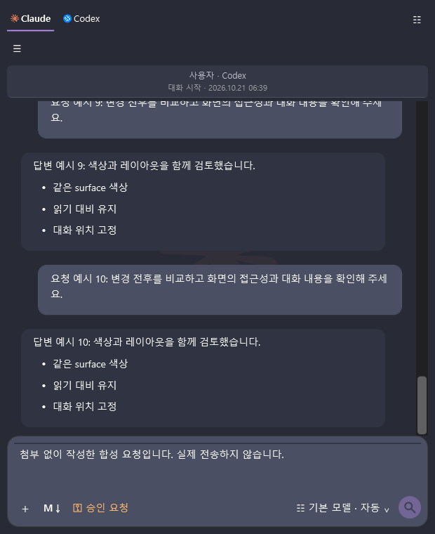 | 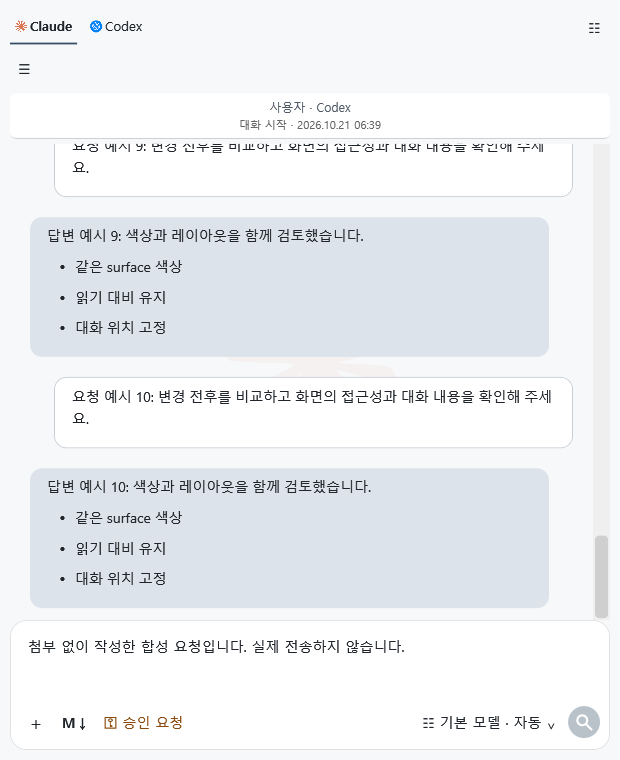 |


## Markdown 답변과 작성기

AI 답변은 제목·목록·강조·표·코드 블록을 서식으로 표시합니다. **▣** 링크는 로컬 파일을 Visual Studio 텍스트 편집기로 열고, **↗** 링크는 웹 주소로 이동합니다. 링크가 존재하지 않거나 지원하지 않는 주소이면 상태 안내를 확인하세요. 답변의 **우클릭 → Markdown 원문 복사**로 링크와 서식을 포함한 원문을 복사할 수 있습니다. 일반 **복사**는 선택한 표시 텍스트를 복사합니다.

요청 입력란이나 공통 규칙에서 **우클릭 → Markdown 작성 · 미리보기**를 선택합니다. 작성·분할·미리보기로 확인한 뒤 **입력란에 적용**을 눌러 원래 입력에 반영합니다. 창을 닫는 것만으로 요청이 전송되거나 규칙이 저장되지는 않습니다. 별도 문서를 만들려면 **우클릭 → Markdown 문서 작성**을 사용합니다.

| 작성기 기능 | 사용 방법 |
|---|---|
| 굵게·기울임·링크 | 도구 모음 또는 Ctrl+B / Ctrl+I / Ctrl+K |
| 체크 목록 만들기·완료 전환 | Ctrl+Shift+C / Ctrl+Enter |
| 목록·인용 이어 쓰기 | 줄 끝에서 Enter, 빈 항목에서 목록 끝내기 |
| 목록 들여쓰기·내어쓰기 | Tab / Shift+Tab, 빈 중첩 항목 끝의 Backspace |
| 찾기 | Ctrl+F, 다음·이전 찾기 |
| 줄바꿈 표시 | Alt+Z |
| 미리보기 전환 | Ctrl+Shift+V 또는 보기 탭 |
| 글자 확대·축소 | Ctrl+마우스 휠, 60~200% |
| 파일 열기·저장 | 로컬 `.md`/`.markdown`, UTF-8 내보내기·Ctrl+S |
| 미저장 내용 | 새 문서·다른 파일·종료 전 확인, 취소하면 초안 유지 |

작성기는 줄 번호·현재 줄 강조와 Markdown·SQL/C# 코드 편집 색상을 제공합니다. 작성기에서 **Ctrl+Enter는 체크 항목 전환**이며, 대화 입력란의 Ctrl+Enter 줄바꿈과 구분합니다. 명시적으로 연 문서의 PNG·GIF 상대 경로는 해당 문서 폴더를 기준으로 표시합니다. 파일 열기나 저장을 취소·실패하면 기존 문서와 기준 폴더를 유지합니다. 일반 AI 답변의 이미지 주소를 자동으로 내려받지는 않습니다.

### Markdown 지원 범위와 미리보기 재사용

제목, 목록, 인용, 표, 코드 블록, 인라인 서식, 링크와 로컬 이미지 등 이 안내에 적힌 문법을 사용할 수 있습니다. 이 작성기는 CommonMark·GitHub Flavored Markdown(GFM) 전체 호환을 인증하지 않았고 Obsidian 전용 위키 링크·임베드·콜아웃도 제공 범위에 포함하지 않습니다. 각주·자동 링크·체크박스 렌더처럼 표준 확장에 따라 달라질 수 있는 문법은 붙여넣은 뒤 미리보기에서 결과를 확인하세요. Markdown의 링크·HTML·원격 자료 처리는 안전 경계를 유지하며 스크립트, iframe, 스타일시트 또는 원격 이미지 자동 실행을 하지 않습니다.

같은 Visual Studio 세션에서 이미 표시한 Markdown 내용과 유효한 팔레트가 그대로면 창을 다시 열 때 기존 렌더를 재사용해 전체 문서를 다시 그리는 부담을 줄입니다. 내용·글꼴·테마·이미지 기준 폴더가 바뀌거나 사용자가 새로 고치면 필요한 렌더를 다시 수행합니다. 실제 체감 시간은 문서 크기와 PC 환경에 따라 다릅니다.

독립 문서 작성기에서는 처음 접힌 **문서 목록**을 펼쳐 **폴더 선택**을 누릅니다. 넓은 화면에서는 편집 탭 왼쪽, 좁은 화면에서는 탭 위에 나타나며, 좁은 패널은 안쪽에서 세로로 스크롤합니다. 파일 목록은 선택한 폴더 바로 아래의 `.md`·`.markdown` 문서만 표시합니다. 두 번 클릭하거나 파일을 선택하고 Enter를 눌러 엽니다. **저장/Ctrl+S**는 현재 열려 있는 문서에, **다른 이름으로 저장/Ctrl+Shift+S**는 새 경로에 저장합니다. **이름 변경**, **파일 위치**, **삭제**도 현재 열려 있는 문서에 적용됩니다. 삭제는 현재 문서와 저장하지 않은 내용을 함께 지우므로, 확인 문구에서 **삭제 확인** 또는 **취소**를 선택하세요. 다른 문서로 이동하면 이전 삭제 확인은 닫힙니다.

참조형 Markdown 링크와 로컬 이미지를 사용할 수 있고 표·제목·문단·목록 등 제한된 정적 HTML도 미리 봅니다. 일반 Markdown 표는 최대 16열, 정적 HTML 표는 최대 128행·16열까지 표시하며, 한도를 넘어 생략한 내용이 있으면 공통 안내가 나타납니다. 스크립트·스타일시트·iframe 실행과 원격 리소스 자동 로딩은 하지 않습니다.

최신 수정 후보의 화면은 아직 정리 중이므로 이 안내에는 이전 후보의 UI 렌더를 현재 화면 예시로 싣지 않았습니다. [Markdown 작성기 사용 설명서 C8 검토 PDF](../output/pdf/Markdown작성기_사용설명서_C8.pdf) · [Markdown 원문과 사용 흐름 도식](visual-guide-orig3/markdown-editor/revision-c8/Markdown작성기_사용설명서_C8.md)

## 자동·Light·Dark 화면 모드

**설정 → 표시**에서 화면 모드를 고릅니다. **자동**은 Visual Studio의 디자인을 우선 따르고, IDE 밖에서는 Windows 앱 모드를 참고합니다. **Light**는 흰색·회색과 옅은 보조색, **Dark**는 어두운 표면을 사용합니다. 직접 고른 모드는 자동 판정보다 우선합니다.

선택하면 현재 화면에서 즉시 미리 볼 수 있습니다. **설정 저장**으로 다음 실행에도 유지하고, 저장하지 않고 닫으면 이전 선택으로 돌아갑니다. 메뉴·도구 설명·변경 팝업·Markdown·안내도 같은 화면 모드를 따릅니다. Visual Studio나 Windows 자체의 전역 디자인을 바꾸지는 않습니다.

## v0.12.0 화면 변경 미리보기

이 절은 v0.12.0-preview.1의 화면을 설명합니다. candidate5 고정 WPF DLL을 별도 화면 렌더링 도구로 그린 캡처이며 실제 Visual Studio IDE 화면이나 고객 PC 설치 결과가 아닙니다. [이전 v0.12.0 미리보기 배포](https://github.com/Grokeen/VisualStudio2017_Codex_Claude_Extension/releases/tag/v0.12.0-preview.1)를 참고하세요.

설정과 안내 팝업의 제목·본문·아래쪽 버튼 영역을 같은 모양으로 정리했습니다. 팝업의 제목 표시줄도 확장 팔레트와 어울리도록 바꾸고 창 이동, 최소화, 최대화, 닫기 버튼을 제공합니다. 설정은 왼쪽의 **계정·모델·규칙·화면** 페이지를 선택해 한 화면씩 봅니다. 방향키와 Home/End 키로 페이지를 이동할 수 있습니다. 안내 본문에서 돌아갈 때는 스크롤 바깥 위쪽의 뒤로 버튼을 사용합니다. Claude와 Codex 탭은 좌우 방향키로 이동할 수 있고 키보드 포커스가 표시됩니다.

화면 설정에서 읽기 모드와 앱 팔레트를 따로 선택합니다. 긴 안내는 **자세히 보기 · 그림 안내**를 눌러 펼쳐 읽고, 같은 항목을 다시 눌러 접습니다. **Visual Studio 테마에 따름**은 IDE 색을 확장에 반영하고, **Kakao 대화 색상**과 **Dracula 다크 색상**은 확장 화면만 바꿉니다. 고대비 모드에서는 시스템·Visual Studio 팔레트를 우선합니다. 별도로 제공되는 Visual Studio 테마 패키지는 IDE의 테마 목록에 추가하는 선택형 확장입니다. 설치만으로 현재 IDE 테마를 바꾸지 않으며, 테마 설정은 사용자가 Visual Studio에서 직접 선택합니다. 후보 패키지는 VS2017·VS2019·VS2022용으로 분리되어 있으며 실제 IDE 설치 검증은 이 문서의 WPF 그림과 구분합니다.


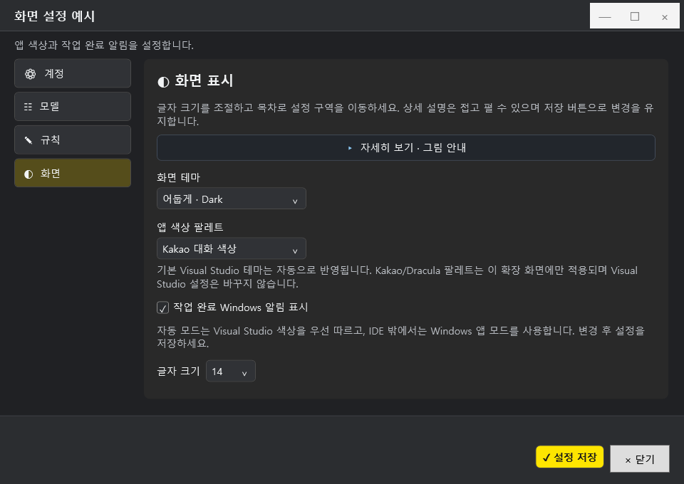

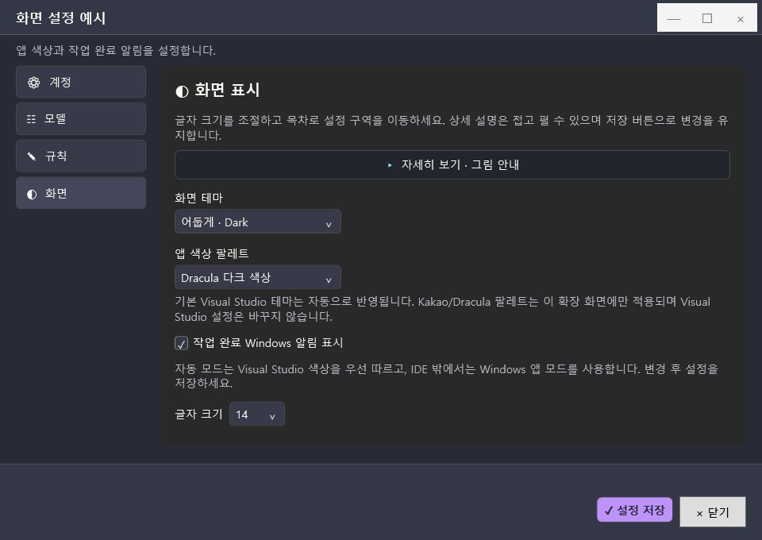

작업 완료 Windows 알림은 설정에서 켜고 끌 수 있습니다. 켜져 있으면 요청이 **성공으로 완료된 경우** 작업 표시줄 balloon 알림을 한 번 보여 줍니다. 요청·응답 본문과 경로는 알림에 넣지 않습니다. Windows WinRT toast처럼 화면 오른쪽 위에 뜨거나, 클릭해서 Visual Studio로 돌아가는 동작은 보장하지 않으며 Windows 알림 설정에 따라 표시되지 않을 수 있습니다.

저장한 대화를 열면 최신 메시지 20개를 먼저 표시하고, 대화 위쪽까지 스크롤하면 이전 메시지 20개를 추가합니다. 화면에 나눠 표시해도 저장 파일과 AI 요청 문맥의 메시지는 유지합니다. 저장 한도는 대화당 100개 메시지와 파일 4MB이며, 한도를 넘어 이미 제거된 메시지를 이 기능이 되살리지는 않습니다.

Markdown 작성기는 창 크기를 현재 작업 영역 안에서 넓게 조절합니다. 도구 모음은 **문서·편집·서식·삽입·체크 목록·보기** 여섯 그룹으로 나뉘며 검색 체크박스 스타일을 통일했습니다. 답변의 URL은 굵게 강조되고, `URL1 : 설명` 형식의 링크 목록은 URL 레이블과 설명 시작 위치를 맞춰 읽기 쉽게 표시합니다.

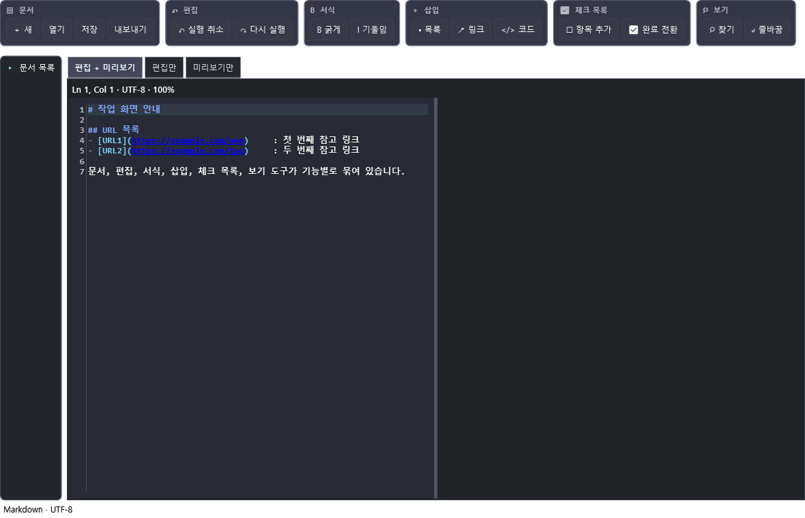

설치·연결·요청·검토·사용 안내의 움직이는 예제와 정지 그림은 [README 사용 흐름 안내](../README.md)에도 있습니다. [v0.12.0 후보 화면 PDF](../output/pdf/VisualStudio_AI_Assistant_설치_사용설명서_v0.12.0_미리보기.pdf)는 이 화면 변경을 설명하는 검토용 문서이며 기존 고객 PDF를 대체하지 않습니다.

## v0.12.1 사용자 안내 (미리보기)

이 절은 **v0.12.1-preview.1**의 사용자 흐름입니다. 사용 가능한 설치 ZIP과 사용자 PDF는 [GitHub Releases의 다운로드 자산](https://github.com/Grokeen/VisualStudio2017_Codex_Claude_Extension/releases)에서 확인하세요. 그림은 이해를 돕는 합성 WPF 렌더이며 실제 Visual Studio IDE 캡처나 GIF가 아닙니다. 계정·요청 기록은 그림에 사용하지 않았습니다.

### 화면 예시: 합성 WPF 렌더

다음 그림은 WPF `RenderTargetBitmap`으로 별도 렌더한 합성 UI입니다. 실제 Visual Studio IDE·Windows 바탕 화면 캡처나 제품 설치 화면이 아니며, 계정·프로젝트·대화 실자료를 포함하지 않습니다.


### 요청 말풍선과 Visual Studio 테마 UI 예시

아래 두 그림은 offscreen WPF `RenderTargetBitmap`으로 렌더한 합성 UI입니다. 요청 예시는 가상 텍스트이며 그림 자체에서는 버튼을 누르지 않았습니다. 실제 Visual Studio 2017 15.9, 2019 16.11, 2022 17.14 통합 시험에서 Kakao·Dracula 선택 ID와 대표 환경 색상 적용, 선택 보류 상태 소비와 임시 파일 정리를 확인했습니다. 설치 관리자 버튼의 실제 물리 클릭과 완료, Visual Studio 재시작을 포함한 고객 사용 흐름은 별도 확인 범위입니다.


### 요청 실행 중 다음 요청 넣기

요청을 보내면 입력란은 다음 요청을 쓸 수 있게 비워집니다. 실행 중에도 **Enter**로 다음 요청을 대기열에 넣고, **Ctrl+Enter**로 입력 안에서 줄을 바꿉니다. 한 번에 실행되는 요청은 하나이며, 그 뒤 최대 8개를 FIFO 순서로 대기시킵니다.

| 단계 | 동작 | 다음 요청에 포함되는 내용 |
|---|---|---|
| 1. 실행 중 | 현재 요청이 CLI에서 실행됩니다. | 현재 요청에 고정한 AI, 대화, 모델, 권한, 첨부와 문서 |
| 2. 대기 | 추가 요청은 제출한 순서대로 대기합니다. | 아직 실행하지 않은 뒤쪽 요청은 현재 문맥에 섞이지 않습니다. |
| 3. 이어 실행 | 앞 요청이 끝나면 다음 요청을 시작합니다. | 앞 요청의 완료 답변과 해당 요청 시점까지의 대화 |
| 4. 중지/실패 | 남은 대기 요청은 실행하지 않습니다. | 원문은 대화에 남으며 확인 후 다시 보내야 합니다. |

대기열이 가득 차면 입력은 유지되므로 나중에 다시 보낼 수 있습니다. 저장 실패 때도 입력과 기존 대화 기록을 복구하고 요청을 실행하지 않습니다. 수정안 검토가 남아 있으면 다음 요청은 승인·적용되거나 사용자가 **이 수정안 건너뛰고 다음 요청**을 선택할 때까지 멈춥니다. 건너뛰기는 수정안을 적용하거나 저장하지 않습니다. 실행 중에는 다른 대화나 AI로 전환할 수 없습니다. 대기 상태는 메모리에 있으며 Visual Studio를 다시 열었을 때 자동으로 재실행하지 않습니다.

### 완료 알림과 팝업 사용

완료 알림을 켜면 성공한 현재 요청에 대해 Windows 작업 표시줄 알림을 표시합니다. 통합 후보 알림에는 Claude 또는 Codex의 브랜드, 다음 네 가지 고정 결과 유형 중 하나, 보고된 완료 건수가 포함됩니다: 질문 답변 작성 완료, 소스 수정안 준비 완료, 파일 작업 완료 보고, 실행·조회 작업 완료 보고. 요청 제목·원문과 답변 문장은 포함하지 않습니다. 보고된 작업 건수가 없으면 Visual Studio에서 답변을 확인하라고 안내합니다. 결과 유형과 건수는 잠금 화면이나 알림 미리보기에 보일 수 있으므로 Windows 알림 표시 설정도 확인하세요.

이 알림은 Windows 작업 표시줄의 알림 방식입니다. Windows 설정이나 조직 정책에 따라 숨겨질 수 있으며, 클릭 후 IDE 복귀 동작을 보장하지 않습니다. 오류·취소·중지 결과를 성공 완료 알림으로 표시하지 않습니다.

팝업 제목과 본문, 주요·보조 버튼은 공통 색상과 모양을 사용합니다. 창 테두리는 IDE 위에서 팝업을 구분하도록 표시합니다. Claude·Codex 탭을 선택해 대화를 전환할 수 있지만 실행 중에는 전환을 막아 현재 요청의 대화·권한이 바뀌지 않게 합니다. 부채꼴 메뉴는 포인터가 잠시 머문 뒤 열리고, 포인터나 키보드 초점이 메뉴 안에 있는 동안 유지됩니다.

### 답변을 새 문서·코드 파일로 만들기

AI 답변에서 마우스 오른쪽 버튼을 누르고 **답변 전체를 새 파일로 만들기…**를 선택합니다. 답변 안에 완결된 fenced code block이 하나 있을 때는 **코드 블록만 새 파일로 만들기…**도 사용할 수 있습니다. 저장 창에서 위치와 이름을 직접 고른 뒤 새 파일을 만듭니다.

| 파일 형식 | 저장 내용 | 확인할 점 |
|---|---|---|
| Markdown·텍스트 | 답변 또는 선택한 코드 블록을 UTF-8 원문으로 저장 | 문서 서식 변환 없이 텍스트를 보존합니다. |
| 코드·구조화 텍스트 | 저장 창에 표시되는 지원 확장자를 사용 | 확장자에 맞는 내용을 요청하고 생성 뒤 직접 확인합니다. |
| HTML | 원문을 HTML 문서의 텍스트로 이스케이프해 저장 | 스크립트·외부 리소스를 실행하거나 내려받는 웹사이트 생성 기능이 아닙니다. |
| DOCX | 기본 Word 문서 패키지로 생성 | Markdown 표·이미지·링크·스타일을 Word 서식으로 변환하지 않습니다. 실제 Word 화면 렌더링은 별도 검증 전입니다. |

기존 파일은 덮어쓰지 않습니다. 같은 이름이 이미 있으면 새 이름을 선택하세요. 저장은 로컬 고정/이동식 드라이브의 새 파일만 지원하며 네트워크 경로와 연결 폴더는 허용하지 않습니다. PDF·XLSX·실행 파일을 텍스트로 위장해 저장하지 않습니다. 생성된 파일은 자동 실행하지 않습니다.

### Claude CLI 검사 범위

이번 후보 확인에서는 Claude CLI를 로그인 없이 실행해 버전·서명·인증 상태와 비인증 초기화를 확인하고, 합성 요청으로 프로토콜·오류·취소 경계를 검사했습니다. 실제 계정 로그인과 실제 Claude 답변은 이번 범위에 포함되지 않았으며, 실제 모델 이용 가능성이나 계정 권한을 확인한 결과가 아닙니다. 실제로 사용하려면 제공자의 공식 로그인 절차를 별도로 마친 뒤 로그인 상태를 확인하고 요청을 보내세요.

### 수동 AI-VSIX 설치 시 Visual Studio 테마 추가

이 절차는 AI Assistant VSIX만 수동으로 설치했고 IDE 테마 패키지가 없을 때 사용하는 별도 선택 경로입니다. 전체 오프라인 설치기를 사용했다면 설치가 끝난 뒤 같은 IDE를 다시 열고 **도구 → 옵션 → 환경 → 일반 → 색 테마**에서 **Grokeen Dracula Inspired**를 선택하세요. 확장 내부의 Kakao·Dracula 색상 팔레트와 IDE 전체 테마 설치는 서로 다른 기능입니다.

1. **도구 → AI Assistant → 설정**에서 **Kakao 테마 설치·적용** 또는 **Dracula 테마 설치·적용**을 선택하고 VSIX 설치를 완료합니다.
2. 모든 Visual Studio 창을 닫은 다음 같은 IDE를 다시 엽니다.
3. **도구 → 옵션 → 환경 → 일반 → 색 테마**에서 설치한 테마를 선택합니다.

실제 Visual Studio 2017 15.9, 2019 16.11, 2022 17.14 통합 시험은 두 테마의 실제 선택 ID, 대표 환경 색상(Kakao `#FFD9DDE3`, Dracula `#FF282A36`), 보류 상태 처리와 임시 파일 정리를 확인했습니다. 이 결과는 설치 버튼을 실제 마우스로 누르고 설치 관리자를 완료하거나 재시작하는 물리적 고객 절차의 확인을 뜻하지 않습니다. VS2017 Professional 15.7.1과 고객의 제한망 PC도 실측하지 않았습니다.

[공개 Release 자산의 사용자 안내 PDF](https://github.com/Grokeen/VisualStudio2017_Codex_Claude_Extension/releases)에서 설치 절차와 안내를 확인할 수 있습니다.

## 이전 v0.13.0-preview.1 기능 기록

이 절은 이전 v0.13.0-preview.1의 기능 기록입니다. 당시 오프라인 ZIP은 `VisualStudio_AI_Assistant-0.13.0-Preview1-FullOffline-win-x64.zip`이었으며 [이전 34쪽 PDF](../output/pdf/VisualStudio_AI_Assistant_%EC%84%A4%EC%B9%98_%EC%82%AC%EC%9A%A9%EC%84%A4%EB%AA%85%EC%84%9C_v0.13.0_%EB%AF%B8%EB%A6%AC%EB%B3%B4%EA%B8%B0.pdf)는 그 버전의 안내를 보존합니다. 현재 기능·설치 파일은 [v0.14.2-preview.1 릴리스](https://github.com/Grokeen/VisualStudio2017_Codex_Claude_Extension/releases/tag/v0.14.2-preview.1)를 기준으로 확인하세요.

### 대화별 독립 작업

응답을 기다리는 동안 다른 대화로 이동해 별도 요청을 진행하고, 각 대화의 처리·응답을 따로 확인할 수 있습니다. 각 방에는 실행 하나와 대기 최대 여덟 개를 두며, 초안·역할·진행·사용량·취소를 분리합니다. 미승인 수정안이 있으면 해당 방의 후속 요청은 승인·적용 또는 명시적 건너뛰기를 기다립니다.

### 오래된 대화 나눠 보기

새 기록은 UTC 시간 구간으로 나누어 보관하고, 위로 스크롤할 때 오래된 구간을 백그라운드에서 이어 불러옵니다. 다른 대화로 이동한 뒤 도착한 결과는 현재 대화를 바꾸지 않습니다. 저장량 제한 때문에 같은 시간 구간이 여러 파일로 나뉠 수 있습니다. 구형 v1 메시지에 개별 발화 시각이 없으면 대화 생성 시각을 묶음 표시의 기준으로 사용할 수 있으며, 이를 실제 과거 메시지 시각 복원으로 보지 않습니다.

전체 백업에는 대화의 최신 Markdown 파일과 같은 ID의 `.history` 폴더를 함께 보관하세요. 메인 Markdown 파일만 복사하면 최신 20개만 백업될 수 있습니다. 다른 창이나 외부 편집의 변경이 먼저 기록된 경우 저장을 거절하고 작성 초안을 보존합니다. 최신 파일을 다시 불러와 변경을 확인한 뒤 재시도하세요. 원본을 자동으로 다시 캡처하거나 승인 단계를 건너뛰지 않습니다.

### 좁은 화면에서 대화 목록 접기

폭 460픽셀 미만의 좁은 화면에서는 대화 항목을 더블클릭해 목록을 접고 본문 공간을 넓힙니다. 단일 선택은 대화 전환, 더블클릭은 목록 접기로 구분합니다.

| 대화 목록 열림 | 대화 목록 접힘 |
|---|---|
| 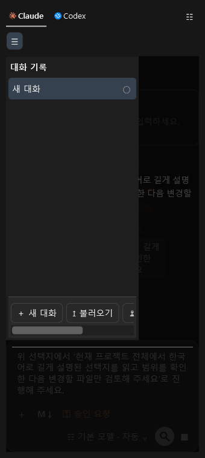 | 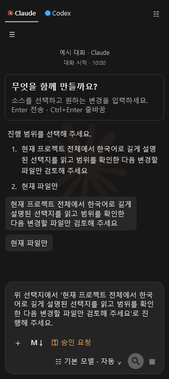 |

위 이미지는 C2 제품 DLL의 WPF 컨트롤을 창 없이 렌더한 결과로, 실제 Visual Studio 화면이나 OS 포인터 조작을 캡처한 자료가 아닙니다. 최종 후보에서도 같은 좁은 폭·테마 조건의 접힘 동작을 확인했습니다. 실제 IDE 키보드 포커스 이동은 이 합성 검사의 범위 밖입니다.

### AI 선택 질문

AI가 정보 확인을 위해 보기를 제시하면 사용자는 항목을 선택하거나 직접 답을 입력할 수 있습니다. 선택 내용은 요청 입력란의 초안에 들어가는 흐름이며, 사용자가 내용을 검토한 뒤 직접 전송을 시작합니다. 선택만으로 AI 요청이 자동 제출되거나 도구 실행이 시작되는 것으로 안내하지 않습니다.

C2 렌더에서는 긴 한국어 보기가 여러 줄로 표시되는 선택지 화면을 볼 수 있습니다. 아래는 C2 제품 WPF 컨트롤의 off-screen 렌더이며 실제 IDE 캡처가 아닙니다. 최종 후보에서도 같은 조건의 줄바꿈·버튼 대비·초안 삽입을 확인했습니다. 실제 IDE 키보드 포커스 이동은 별도 확인 범위입니다.

| 선택 질문 다크 | 선택 질문 라이트 |
|---|---|
| 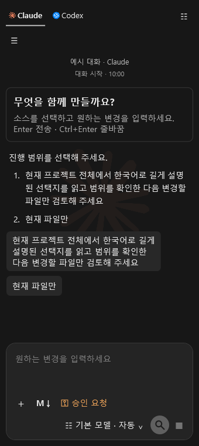 | 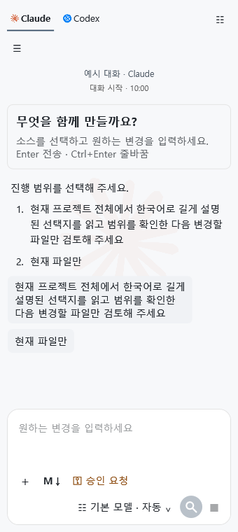 |

선택한 답변은 요청 입력란의 초안에 들어가며 사용자가 직접 검토하고 전송을 시작합니다. 선택만으로 자동 제출되거나 도구가 실행되지는 않습니다. 통합 PDF에는 이 합성 렌더와 절차 설명을 함께 실었습니다.

### 필수 작업 지침

확장 첫 사용 시 숨김 필수 지침 파일을 준비하고 AI 요청 문맥에 포함합니다. 지침에는 진행 중인 프로젝트의 UI·소스 패턴 확인, 최소한의 소스 수정, 작업 주석·변경 기록, 감사 담당자 확인 요청이 포함됩니다. 정확한 구버전 공식 사본은 새 공식 내용으로 갱신하고 사용자 수정본은 보존합니다. 내장 필수 지침은 사용자 지침과 함께 요청에 포함합니다.

### 설치 파일과 검증 상태

이전 `UserDistribution/v0.13.0` 묶음은 VSIX와 IDE 테마, CLI 런타임·라이선스, 설치/검증 도구, 체크섬·manifest, 오프라인 안내와 PDF로 구성했습니다. 당시 묶음은 v0.14.0-preview.1의 파일과 릴리스 manifest를 따르며, 제품 소스·PDB·테스트·개발 증거·Git 자료·계정·토큰·사용자 기록은 포함하지 않습니다.

배포와 로컬 `releases`에는 v0.14.0과 직전 v0.13.0을 보존하고, 새 파일과 체크섬 게시 후 v0.12.1 패키지 첨부만 정리합니다. 이전 태그·이력과 개발·감사 기록은 유지합니다.

## 직접 수정과 자체 테스트를 맡기기

1. 열린 편집 파일과 프로젝트 변경을 모두 저장합니다. 다른 탭의 미저장 버퍼나 프로젝트 속성 변경도 직접 실행을 막으므로 저장 후 다시 시도합니다.
2. 작업할 소스나 솔루션을 선택하고 **전체 액세스**를 고릅니다. 파일이 열려 있지 않아도 저장된 솔루션 폴더에서 작업할 수 있습니다.
3. 원하는 변경과 확인할 테스트를 구체적으로 요청합니다. 예: “이 메서드를 수정하고 해당 단위 테스트를 실행한 뒤 실제 결과를 알려 주세요.”
4. 공개된 중간 답변·명령·파일 도구 상태를 확인합니다. 내부 추론 원문은 수집하지 않습니다. ‘생각 중’에는 회색 글자 위로 흰색 빛이 좌→우로 이동합니다.
5. 종료 후 실제 답변·테스트 결과·변경 카드를 확인합니다. 변경 파일을 선택해 초록 추가·빨강 삭제를 비교하고 파일 링크로 이동합니다.

Codex는 app-server의 danger-full-access, Claude는 bypassPermissions로 명시된 직접 실행을 요청합니다. 현재 Windows 사용자 권한 안에서 동작하며 관리자 권한을 자동으로 획득하지 않습니다. 네이티브 CLI의 작업은 프로젝트 밖에도 접근할 수 있습니다. 중지 버튼은 해당 실행과 하위 프로세스의 종료를 요청하지만 이미 수행한 파일·외부 서버 작업을 되돌리지 않습니다.

동료 AI가 지정되어 있으면 선택한 소스를 대상으로 기존 수정안 검토를 순차 실행한 뒤 최종 담당자가 직접 작업합니다. 동료 검토에는 각각 사용량이 발생합니다. 협업 검토에 사용할 소스가 없으면 소스를 선택하거나 참여자를 해제하라는 안내가 나옵니다.

### 프로젝트 파일이 외부에서 수정되었다는 알림

전체 액세스로 실행하는 동안 열린 텍스트 파일과 로드된 프로젝트 파일의 변경 알림을 잠시 모읍니다. 완료·중지·실패 뒤 저장된 소스와 프로젝트 변경을 다시 읽고 알림을 복원합니다. 기본 C# 프로젝트를 다시 읽는 동안 닫힌 텍스트 탭은 다시 엽니다. Visual Studio의 전역 자동 다시 읽기 설정은 바꾸지 않습니다.

미저장 변경이 생겼거나 파일이 삭제됐거나 프로젝트 종류가 자동 동기화를 지원하지 않으면 내용을 덮어쓰지 않고 확인 안내를 표시합니다. 실행 범위 밖에서 다른 프로그램이 수정한 파일에는 Visual Studio의 일반 변경 알림이 나타날 수 있습니다. 먼저 편집 내용과 디스크 차이를 확인하세요.

### 변경 기록의 출처와 범위

CLI의 파일 도구 보고·누적 diff를 먼저 사용합니다. 명령으로 파일을 쓰면 도구 보고가 없을 수 있어 실행 전후의 프로젝트 텍스트 소스도 비교합니다. 툴팁에서 **CLI 보고 / 프로젝트 전후 비교**를 구분합니다. 전후 비교는 실행 기간에 관찰한 변경이며 다른 프로세스의 동시 편집까지 AI가 작성했다고 증명하는 기록은 아닙니다.

보완 비교는 최대 4,000개 파일·32MiB 입력·파일당 200,000자, 1,000개 폴더·20,000개 경로 방문으로 제한합니다. 코드·설정·문서 텍스트 확장자만 비교하고 링크, `.git`, `.vs`, `bin`, `obj`, `node_modules`, `packages`, `releases`, `artifacts` 하위 폴더는 제외합니다. 큰 파일·바이너리·인코딩만의 변경·프로젝트 밖 파일과 한도 이후 항목은 CLI 보고 범위를 따릅니다. 전체 컴퓨터의 완전한 감사 로그가 아닙니다.

공통 중간 줄을 보존해 추가·삭제 줄을 계산합니다. 비교 작업 한도 내에서 정확한 줄 수를 얻지 못하거나 diff가 없으면 계수를 단정하지 않고 **줄 수 미제공**으로 표시합니다. 취소·실패 후에는 보고되지 않은 변경이 남을 수 있으므로 실제 파일 상태도 확인하세요.

### 토큰 도구 설명 읽기

입력란의 **모델·생각 강도** 버튼에 마우스를 올리면 실제 보고한 입력(캐시 포함)·출력·캐시·합계, 모델 컨텍스트 한도와 계정 할당량 사용률을 볼 수 있습니다. 토큰 수와 백분율은 서로 다른 단위입니다. 계정 조회 시각과 사용량 수신 시각도 구분합니다.

전체 액세스 Codex는 thread/tokenUsage/updated, 일반 수정안 Codex는 exec 완료 이벤트, Claude는 제공되는 메시지·결과 usage를 읽습니다. 일반 Codex가 중간 사용량을 제공하지 않으면 완료 시점까지 기다립니다. Claude 부분 이벤트가 출력만 제공하면 입력·합계는 확인 불가로 남깁니다. 다른 이벤트의 누락 필드를 섞어 현재 사용량으로 추정하지 않습니다. 계정의 남은 월간 토큰이나 최종 비용을 계산하는 화면은 아닙니다.

## 이미지·문서·텍스트 첨부

탐색기에서 파일을 창으로 끌어 놓거나 **＋ 첨부**로 선택합니다. 탐색기에서 복사한 문서 파일이나 클립보드 이미지는 프롬프트의 **Ctrl+V**로 추가합니다. 별도 붙여넣기 버튼은 없으며 텍스트의 기본 편집 메뉴도 사용할 수 있습니다.

이미지는 프롬프트 위에 미리보기로 표시합니다. 마우스를 올리면 나타나는 **×**로 제거합니다. 키보드로 첨부 항목과 제거 동작에 접근할 수도 있습니다. 파일을 놓는 것만으로 전송되지는 않으며, 보내기를 누를 때 현재 목록을 함께 전달합니다.

| 항목 | 지원 범위 |
|---|---|
| 이미지 | PNG/JPEG, 각 2MB·최대 1,600만 픽셀 |
| 텍스트 | UTF-8 또는 BOM이 있는 Unicode, 각 100KB |
| 개수 | 최대 4개 |
| 문서 | DOCX/PPTX/XLSX·ODT/ODP/ODS·RTF·HTML, 원본 16MB·추출 본문 UTF-8 100KB |
| PC별 문서 | PDF·DOC/PPT/XLS, 해당 Windows IFilter가 필요하며 같은 크기 제한 적용 |
| 지원하지 않는 첨부 | 폴더·압축·실행 파일, 암호 문서, 텍스트가 없는 스캔 PDF |

문서는 본문을 추출해 전달합니다. 그림·서식·페이지 모양을 그대로 보내는 기능은 아닙니다. 추출 중에도 창을 사용할 수 있고 중지할 수 있습니다. 읽지 못한 파일이 있으면 해당 묶음을 부분 첨부하지 않으며 오류를 안내합니다. 스캔 PDF는 먼저 OCR로 텍스트를 넣고, 읽기 필터가 없으면 최신 Office 형식이나 텍스트로 저장해 첨부하세요.

텍스트 첨부는 **TXT** 표시와 전체 파일명 툴팁으로 확인할 수 있습니다. 각 파일의 문자 수와 UTF-8 크기도 첨부 항목과 보낸 요청에서 확인하세요. 한 요청에 파일은 최대 네 개까지 포함되며, 한 파일이 100KB 제한을 넘거나 파일을 읽지 못하면 해당 전송 묶음 전체를 보내지 않고 CLI 요청도 시작하지 않습니다. 파일별 본문을 다시 입력란에 펼쳐 넣지 않으므로 요청 화면의 원문이 불필요하게 길어지지 않습니다.

첨부는 제거할 때까지 다음 요청에도 포함됩니다. 원본 파일을 고쳤다면 기존 항목을 제거하고 다시 첨부해야 새 내용이 반영됩니다. 대화를 재실행해 복원할 때 첨부 원본은 복원하지 않으므로 필요한 자료를 다시 추가하세요. 전송할 때는 현재 첨부 목록을 모두 확인하세요.

## 대화 AI 이름과 협업

> 교차 제공자 협업은 v0.11.0부터 제공합니다. Claude 앱·브라우저 로그인과 CLI 로그인은 별도이며, 격리 제공자 검사와 실제 Claude 계정 성공은 구분합니다.

대화 목록 하단의 **AI 지정하여 대화 → 역할·협업 설정**에서 담당 역할·팀과 함께 검토할 AI를 선택합니다.

1. 대화 목록 하단의 **새 대화**로 검토용 AI 대화를 만듭니다. 이름은 사용자명+AI명+알파벳 한 자리(A~Z)로 정하며 대화 제목과는 별개입니다. AI 설정에서 담당 역할을 지정합니다.
2. 함께 일할 AI는 동일한 협업팀 이름을 사용합니다. 주 담당을 Claude로 두고 Codex를 동료로 두거나 그 반대로 구성할 수 있습니다. 팀을 바꿀 때는 참여자를 먼저 해제하고 새 팀을 저장한 뒤 다시 엽니다.
3. 주 담당 대화에서 같은 팀의 **열린** Claude·Codex 대화를 최대 3개 선택해 저장합니다. 각 동료는 자기 대화에 저장된 CLI 경로·모델·생각 강도·응답 속도로 실행됩니다. 보내기 전에 선택 인원과 역할, 공유 대상을 확인하세요.
4. 주 담당자가 소스를 열고 명시적으로 보내기를 누르면, 요청·선택한 소스·현재 첨부가 각 선택 서비스에 전달되고 동료 AI가 한 차례씩 순서대로 호출됩니다. 회신을 받은 현재 AI가 결과를 종합해 최종 수정안을 만듭니다. 동료 AI가 서로 자동으로 다시 대화하는 재귀 검토나 무한 토론은 하지 않습니다. 중지 버튼은 진행 중인 호출을 취소합니다.
5. 각 대화의 완료·실패·중지·읽지 않음을 확인하고 **협업 기록**을 열어 요청·회신·전달 상태를 봅니다. 최종 코드는 비교·승인 후 적용하고 별도로 저장합니다.

협업은 참여자 수만큼 실제 CLI 호출·사용량과 대기 시간이 추가됩니다. 각 선택 서비스에 요청·선택 소스·현재 첨부를 공유하므로 민감한 자료가 포함됐는지 보내기 전에 확인하세요. 동료 검토 요청은 5,000자, 회신은 10,000자까지 전달하고 초과 부분의 생략을 표시합니다. 최종 AI에는 전체 원래 요청과 8,000자 이내의 역할·동료 결과를 전달합니다. 협업 중 원본이 달라지면 적용하지 않고 중단합니다. 참여 대화를 닫거나 팀을 바꾸었다면 다시 선택해야 합니다.

AI 이름은 예를 들어 **홍길동클로드A**처럼 사용자명+AI명+알파벳 한 자리입니다. **AI 지정하여 대화** 버튼의 목록에서 질문할 담당자를 고릅니다. A~Z 담당자가 모두 있으면 다음 새 대화는 기존 A로 연결하고 기록을 새로 만들거나 지우지 않습니다. 사용자명에는 확인된 GitHub 계정 또는 명확히 선택할 수 있는 Git Credential Manager 저장 계정을 우선 사용합니다. 저장 계정은 서버 인증을 재확인한 상태와 구분해 표시합니다. Git 작성자 설정만으로 로그인했다고 판단하지 않으며, 과거 대화의 역할과 협업 기록은 보존하며 이름 표시는 새 A~Z 규칙을 따릅니다. 계정을 확인하기 전에는 Windows 사용자명을 사용합니다. AI 목록에서 **계정 이름 다시 확인**을 누르면 사용자명 출처를 갱신합니다. 이름은 자동 지정되어 읽기 전용이며 역할·팀은 직접 수정합니다. 이전 버전에서 26개를 넘긴 AI는 기록을 보관하고 새 선택 목록에서는 제외합니다.

이름·역할·팀과 실제 협업 상태는 공통 작업 폴더의 `collaboration.json`, 사람이 읽는 결과는 `collaboration-report.md`에 남습니다. 대화 Markdown에는 선택한 참여자 ID를 보관합니다. 토큰·암호·첨부 원본은 이 메타데이터에 저장하지 않습니다.


## 대화 목록·이름·닫기·불러오기

AI 탭 아래의 대화 목록을 선택해 대화를 전환합니다. 목록 오른쪽 세로 경계를 드래그하면 폭을 조절할 수 있습니다. 왼쪽 끝으로 끌어 접은 뒤 **☰**로 펼치면 마지막 유효 폭으로 복원됩니다. 경계에 키보드 포커스를 옮긴 뒤 좌우 방향키로도 조절할 수 있습니다. 폭·숨김 선택은 다음 실행에 복원됩니다. 좁은 창에서 목록을 열면 뒤 대화에 배경막을 표시하고 가려진 본문 입력을 잠시 차단합니다. 목록을 선택하거나 Escape·배경막 클릭으로 닫아 대화로 돌아옵니다.

| 표시 | 의미 |
|---|---|
| ◌ 파란 진행 표시 | 해당 대화의 실제 요청 처리 중 |
| ● 파란 점 | 보지 않은 응답이 있음 |
| ✓ | 요청 완료 |
| ! 빨간 표시 | 요청 실패 |
| ■ 노란 표시 | 사용자가 요청 중지 |
| ! 노란 표시 | 이전 실행에서 요청이 중단됨 |
| ○ | 아직 요청하지 않은 대화 |

실패·중지 표시의 툴팁에서도 읽지 않음을 구분합니다. 대화를 직접 선택하거나 본문을 클릭·스크롤·키보드로 확인하면 현재 대화만 읽음 처리합니다. 다른 소스 탭이나 앱에서 작업하느라 보지 않은 응답의 점은 남아 있습니다. 수정안 검토의 완료는 응답 수신 상태이며 적용·저장을 별도로 승인합니다. 전체 액세스의 완료는 CLI 대화 실행 종료를 뜻합니다. 테스트 통과 여부와 외부 서버 반영 결과는 실제 보고 내용을 확인하세요. 상태와 읽지 않음은 Markdown에 저장하고, 재시작 후 계속 실행 중인 것처럼 표시하지 않습니다.

대화 관련 버튼은 목록 하단에 있습니다. 너비가 좁으면 버튼 영역을 가로 스크롤합니다. **새 대화**는 A~Z 여유 슬롯이 있을 때 현재 기록을 지우지 않고 새 항목을 추가합니다. AI별 대화·작성 중 요청을 분리해 저장합니다.

첫 질문에서 제목을 자동으로 만듭니다. 직접 이름을 바꾸면 이후 질문으로 덮어쓰지 않습니다. 제목은 한 줄 최대120자이며, 화면 폭을 넘으면 줄임표로 표시하고 전체 제목을 툴팁으로 확인합니다.

항목의 **우클릭 → 닫기**는 다음 시작의 자동 복원 대상에서 제외합니다. 원본 Markdown 파일은 보관합니다. **대화 불러오기**로 같은 AI의 보관 파일을 선택하면 다시 열 수 있습니다. 다른 AI 파일은 해당 AI 탭에서 불러오세요.

기본 저장 위치:

```text
%LOCALAPPDATA%\VS2017AIAssistant\workspace\
  instructions.md
  conversations\claude\<대화 식별자>.md
  conversations\codex\<대화 식별자>.md
```

대화에는 front matter의 제목·날짜·AI·열림 상태와 실제 메시지·작성 중 요청이 들어갑니다. 저장 파일은 사용자가 읽을 수 있는 Markdown입니다. AI별 최대500개 파일(닫은 기록 포함), 파일당4MB와 각 대화의 최근100개 메시지를 보관합니다. 한도에 도달하면 오래된 Markdown을 별도 폴더로 옮겨 보관할 수 있습니다. 손상된 파일은 오류 안내와 함께 건너뛰고 유효한 기록을 계속 불러옵니다.

대화 원문과 소스 일부가 응답에 포함되었다면 로컬 기록에도 남을 수 있습니다. 첨부 원본·이미지 바이트·AI 인증 정보는 기록에 저장하지 않습니다. 저장 파일을 옮기거나 공유할 때는 내용을 확인하세요. 메시지 경계와 문자 수를 사용하는 자체 기록 형식이므로 임의로 구분자를 고치지 말고, 이름 변경·닫기는 화면 기능을 사용하세요.

## 공통 instruction과 설정

instruction은 모든 프로젝트에서 반복 사용할 규칙입니다. 응답 언어, 프레임워크, 유지할 API와 코딩 규칙을 적습니다. 최대8000자이며 창 크기에 맞춰 입력 영역이 늘어나고 긴 내용은 스크롤할 수 있습니다.

```text
응답은 한국어로 작성해 주세요.
C# 7.0과 .NET Framework 4.6.2에서 빌드할 수 있어야 합니다.
기존 메서드 이름과 매개변수를 유지해 주세요.
```

설정 저장 시 공통 규칙은 `workspace\instructions.md`에 Markdown으로 보관합니다. 요청할 때 디스크의 공통 규칙을 다시 읽으므로 다른 프로젝트나 외부 편집기에서 저장한 변경도 반영됩니다. AI별 경로·모델·글자 크기·안내 표시 등 기본 설정은 `%LOCALAPPDATA%\VS2017AIAssistant\settings.json`에 저장합니다. 이전 버전의 저장된 규칙도 새 Markdown 흐름으로 이어집니다.

설정 저장에 성공하면 창이 닫힙니다. 저장 전 **닫기·Esc·X**는 이번 설정 입력을 취소합니다. CLI에서 이미 마친 계정 로그인은 설정 취소와 별개입니다. 저장 실패는 팝업 안에 표시하며 이전 파일을 유지합니다.

## 수정안 확인·소스로 이동·저장

답변 아래 변경 카드에서 대상 파일과 추가·삭제 내용을 확인합니다. 파일 링크를 누르면 그 소스로 이동합니다. 변경 비교·원본·수정안으로 전체 결과를 읽고, 적용 동의에 체크한 뒤 **승인 후 적용**을 누릅니다. 이후 **적용 내용 저장** 또는 소스 편집기에서 **Ctrl+S**로 저장합니다.

적용은 편집기 버퍼를 바꾸며 자동 저장하지 않습니다. 다른 파일을 열더라도 요청 당시 대상 파일을 유지합니다. 요청 후 사용자가 편집했거나 디스크 원본이 달라지면 적용을 거부하므로 새 상태로 다시 요청하세요. 새 수정안에는 이전 승인을 재사용하지 않습니다.

**직전 적용 되돌리기**는 마지막 적용 전의 버퍼로 복구하며, 그때 있던 미저장 편집도 보존합니다. 복구 후 디스크에 반영하려면 다시 저장합니다. Visual Studio의 **Ctrl+Z**도 사용할 수 있습니다. 중지 버튼은 진행 중 요청을 취소하며 이미 적용한 내용을 되돌리는 동작은 아닙니다.

## DB 구조를 참고한 SQL 작성

1. 프로젝트 작업의 DB 탭에서 **SQL Server 스키마 읽기 허용**을 선택합니다.
2. 서버와 데이터베이스를 포함한 연결 문자열을 입력합니다. 예: `Server=localhost;Database=Sample;Integrated Security=true;`
3. **스키마 읽기**를 누르고 읽어 온 테이블·열 정의를 먼저 확인합니다.
4. SQL 작성 요청을 적은 뒤 **미리본 스키마를 AI 요청에 넣기**를 선택합니다.
5. 대상 SQL 파일을 열어 AI에게 보내고, 생성한 쿼리를 비교·승인·저장합니다.

연결 정보는 이 창 수명 동안만 사용하며 설정·대화에 저장하거나 AI에게 전달하지 않습니다. DB는 허용된 계정으로 테이블·열 메타데이터만 읽고 실제 행은 조회하지 않습니다. 최대512열·약12000자까지 참고하고 SQL 작성 요청은2000자까지 입력합니다. 범위를 넘는 스키마는 잘림을 표시합니다. 입력란에 넣어 전송한 스키마는 대화 기록에도 포함됩니다. 생성한 SQL을 DB에 실행하지 않습니다. 다른 엔진 연결과 SQL 실행은 현재 범위에 포함되지 않습니다.

## 이전 v0.14.0-preview.1 사용자 안내

이 절은 v0.14.0-preview.1 당시 기능을 보존합니다. [당시 44쪽 PDF 저장소 보존본](../output/pdf/VisualStudio_AI_Assistant_%EC%84%A4%EC%B9%98_%EC%82%AC%EC%9A%A9%EC%84%A4%EB%AA%85%EC%84%9C_v0.14.0_%EB%AF%B8%EB%A6%AC%EB%B3%B4%EA%B8%B0.pdf)을 함께 제공합니다. 현재 설치 파일과 46쪽 안내서는 [v0.14.2-preview.1 릴리스](https://github.com/Grokeen/VisualStudio2017_Codex_Claude_Extension/releases/tag/v0.14.2-preview.1)에서 받으세요.

### AI에게 메시지를 전달하고 답변 받기

1. A 대화에서 답변을 마우스 오른쪽 버튼으로 열고 구조화된 메시지 초안을 만듭니다. 일반 답변을 보낼 때는 수신 AI를 직접 선택합니다.
2. 실제 수신자와 본문, 포함된 자료를 확인합니다. 전송 승인을 누르기 전에는 전달되지 않습니다.
3. 승인 직후 상태는 **Pending**입니다. 이는 메시지가 처리 대기 중이라는 뜻이며 AI 답변이 아닙니다.
4. B 대화의 역할·설정에서 **메시지 센터**를 열고 받은 편지함의 요청을 직접 선택합니다. B의 AI는 해당 요청을 읽기 전용으로 받아 한 번 응답합니다.
5. 응답 상태가 **Replied**가 되면 A의 보낸 편지함에서 회신을 읽습니다. 발신 대화에 전달되어 **Delivered**로 표시된 뒤 새 요청에 포함할 수 있습니다.

전달, 수신, 회신과 발신자 전달은 사용자가 선택한 대화와 명시적 승인에 따라 진행됩니다. 자동 무한 발송·재귀 대화는 하지 않습니다. 실제 AI 계정 로그인과 실제 모델 답변은 이 사용자 안내 후보에서 확인하지 않았습니다.

### 표시된 AI 설정과 요청

제공자·모델·생각 모드 선택을 확인한 뒤 요청하세요. v0.14.0 후보는 선택된 설정을 해당 CLI 호출에 전달하도록 구성되어 있습니다. 이 표시가 CLI 계정 로그인, 서비스 권한 또는 AI의 실제 응답 가능성을 뜻하지는 않습니다. Claude 인증은 연결 가능한 환경에서 [공식 로그인 절차](https://code.claude.com/docs/en/authentication)를 따르세요.

### 작업 기록 펼치기

작업 카드의 상세 단계는 카드를 클릭하거나 키보드로 선택해 펼치고 다시 닫습니다. 포인터를 올려두는 동작만으로 상세 내용이 나타나지 않습니다. 카드에 제공되는 진행 상태만 표시하며 내부 추론은 보여 주지 않습니다.

아래 그림은 후보 제품 DLL에서 화면 밖 WPF로 렌더한 카드와 공개 작업 상세입니다. 실제 Visual Studio IDE 화면이나 고객 PC의 캡처는 아닙니다.

| Dracula | 밝은 화면 |
|---|---|
|  |  |

### 대화 색상, 입력 상태, 고정 머리글

후보5의 아래 화면은 합성 대화 데이터를 사용한 오프스크린 WPF 렌더입니다. 실제 Visual Studio 창이나 운영 계정 캡처가 아닙니다. 넓은 어두운 화면과 좁은 밝은 화면에서 사용자의 말풍선이 작성란과 같은 표면색이고 AI 답변은 조금 더 진한 표면색인 것을 비교할 수 있습니다. 대화 이름과 시작 시각은 긴 대화에서 아래로 스크롤해도 위에 고정됩니다.

대화 폭에 따라 좌우 12~20px 여백을 두어 가장자리와 본문을 구분합니다.

| 넓은 어두운 화면 | 좁은 밝은 화면에서 아래까지 스크롤 |
|---|---|
|  | 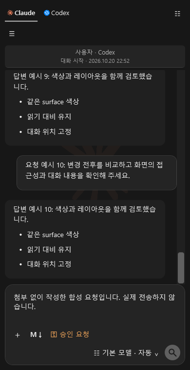 |

현재 대화에 실행 중이거나 대기 중인 요청이 없을 때(유휴 상태)는 돋보기 보내기 버튼만 표시합니다. 현재 대화에 요청이 실행 중이거나 대기 중이면 중지 버튼만 표시합니다. 다른 대화가 실행 중이라는 이유만으로 현재 대화의 전송 버튼을 중지 버튼으로 바꾸지는 않습니다.

| 요청 대기 상태 | 요청 실행 상태 |
|---|---|
|  |  |

### 텍스트 줄끝 자동 정규화

AI가 수정한 UTF 텍스트의 줄끝 표현만 다른 경우, 확장은 줄끝을 정규화해 비교한 뒤 파일 변경을 원자적으로 반영합니다. 줄끝만 정돈되는 상황에는 별도의 정규화 확인 대화상자를 반복해서 띄우지 않습니다. 읽기 전용 파일, 바이너리 파일, 취소 또는 실제 내용 변경은 기존 보호·검토 흐름을 따릅니다.

### Dracula와 Kakao 테마 확인

Dracula 팔레트에서는 세로 스크롤 막대와 thumb가 배경에서 구분됩니다. Kakao 팔레트에서는 탭의 기본·마우스 오버·선택 상태가 서로 다른 명암으로 표시됩니다. 테마의 색상 변경은 AI Assistant 화면용입니다. IDE 전체 테마 설치는 아래 오프라인 전용 설치기 절차와 구분하세요.

Visual Studio 2017·2019·2022의 격리된 호스트에서 테마 메뉴·편집기 색 리소스와 대비를 확인했습니다. 이 검사는 테마 값과 호스트 리소스 적용을 확인한 결과입니다. 물리적인 메뉴 hover나 편집기 오류·경고·중단점 표식이 실제 스크롤 막대에 그려지는지는 확인하지 않았으므로, 모든 환경에서 보인다고 보증하지 않습니다. 편집기 스크롤 표식은 Visual Studio의 주석 표시 설정과 표시 폭에도 영향을 받습니다. 설치기는 사용자 설정을 임의로 바꾸지 않습니다.

Dracula 테마 정의에서 메뉴 hover·중단점 스크롤 표식은 보라색(`#BD93F9`), 메뉴 경계는 청보라색(`#7586B5`), 오류 표식은 분홍색(`#FF79C6`)을 사용합니다. 아래는 팔레트 역할을 읽는 범례이며 실제 IDE hover나 편집기 marker 캡처가 아닙니다.

| 메뉴 선택·중단점 표식 | 메뉴 경계 | 오류 표식 |
|---|---|---|
| 🟪 보라 `#BD93F9` | 🟦 청보라 `#7586B5` | 🩷 분홍 `#FF79C6` |

### 디버깅 정보 초안을 요청에 추가하기

디버거가 중단된 상태에서 작성란의 **DBG** 버튼을 누르면 현재 파일명·줄·함수, 해당 소스 문서의 중단 줄 앞뒤 최대 3줄, 호출 스택의 함수명 최대 3개를 기존 요청 초안에 덧붙입니다. 초안과 선택 영역은 보존되며, 내용을 확인하고 필요한 부분을 고친 뒤 사용자가 직접 전송합니다. 열린 문서가 현재 중단 위치와 일치해야 합니다.

이 기능은 코드 문맥을 요청 초안에 추가하는 도구입니다. 변수 값·Locals·Autos·Watch·인수 값을 읽거나 식을 평가하지 않고, 예외 종류나 중단 원인을 추측하지 않으며, 디버거를 제어하거나 AI에게 자동 전송하지 않습니다. 소스 문맥을 읽을 수 없거나 초안이 16,000자를 넘으면 기존 초안을 바꾸지 않고 안내합니다. 소스에는 비밀 정보가 들어갈 수 있으므로 전송 전에 직접 확인하세요.

별도 격리된 Visual Studio 2017 환경에서 실제 DTE 중단 프레임·열린 소스·호출 스택 연결을 확인했습니다. 이는 시험용 프로젝트와 환경의 결과이며 고객 PC나 프로젝트, Claude 로그인 또는 실제 AI 응답을 검증한 것은 아닙니다.

다음은 v0.14.0-preview.1 제품 DLL을 합성 중단 프레임에 연결해 만든 안내 그림입니다. 실제 IDE에서 캡처한 화면이 아니며, 대화와 소스 내용은 가상 예시입니다.

| 중단 상태의 DBG 버튼 | 초안에 추가된 결과 |
|---|---|
|  |  |

아래 화면은 밝은 Visual Studio와 Dracula 팔레트, 읽기 실패·16,000자 제한에 따른 기존 초안 보존을 비교합니다.

| 밝은 화면·좁은 폭 | Dracula | 읽기 오류 보존 | 글자 수 제한 보존 |
|---|---|---|---|
| 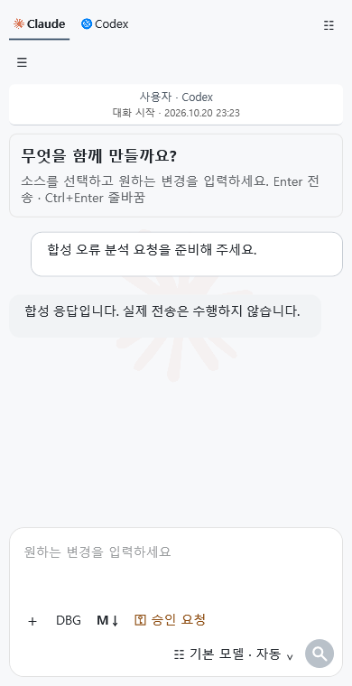 | 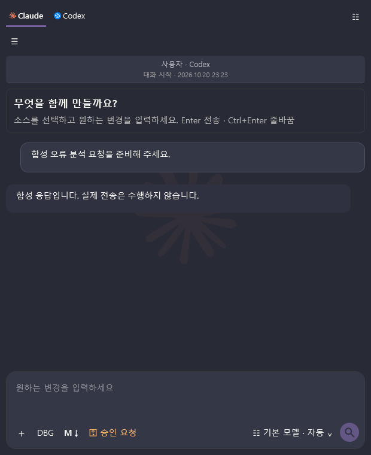 |  | 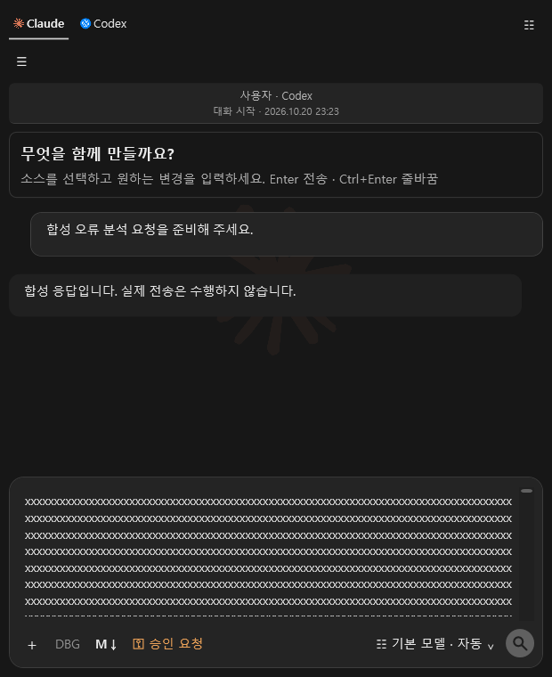 |

### 오프라인 확장·IDE 테마 설치기

동일한 v0.14.0 설치 묶음에 포함된 `Grokeen-AI-Theme-Offline-Installer-0.14.0.exe`를 사용합니다.

1. ZIP 전체를 새 폴더에 압축 해제하고 `SHA256SUMS` 또는 manifest로 파일을 확인합니다. 다른 릴리스의 VSIX와 설치기를 섞지 마세요.
2. 열려 있는 Visual Studio를 사용자가 직접 모두 닫습니다. 설치기는 실행 중인 IDE를 강제로 종료하지 않습니다.
3. 전용 설치기를 실행합니다. 설치된 Visual Studio를 감지하고 대상 인스턴스와 버전을 표시합니다. 여러 개가 있으면 대상 항목을 선택합니다.
4. 사전 검사가 통과하면 동봉 패키지에서 확장과 IDE 테마를 설치합니다. 인터넷에서 파일을 받지 않습니다.
5. 설치 결과와 오류가 있으면 표시된 진단 JSON 및 VSIX 설치 로그 경로를 기록합니다. 설치 후 같은 Visual Studio를 다시 열어 AI Assistant 창과 IDE 색 테마를 확인합니다.

이 설치기는 확장과 IDE 테마 설치를 위한 도구입니다. Codex·Claude CLI 런타임 설치와 계정 로그인은 별도 단계입니다. 실제 Claude 로그인·AI 응답과 고객 VS2017 Professional 15.7.1 또는 별도 고객 오프라인 PC에서의 전체 설치 흐름은 확인 범위 밖입니다.

### 필수 지침과 프로젝트 협업 공간

확장은 설치/업데이트 때 구형 공식 필수 지침 1–5를 최신 공식 규칙 1–8로 갱신합니다. 별도 사용자 지침과 사용자가 수정한 사본은 보존합니다. AI 간 협업 파일은 기본적으로 사용자에게 노출하지 않으며, 사용자가 명시적으로 협업 파일을 요청한 경우에는 전달할 수 있습니다.

연결된 SCM과 두 명 이상의 참여자가 확인된 때에만 오래되었고 수정 이력이 없는 위치에 별도 협업 폴더를 준비합니다. 이 폴더는 다른 기기의 AI와 메시지를 주고받고 문제 및 해결 제안을 기록하는 공간입니다. 확장이 SCM에 자동 commit/push하지 않으며, 공유 전 파일 내용을 확인하고 팀의 형상 관리 절차를 따르세요.

### TFS/TFVC 작업

프로젝트 작업 창에서 **TFS Get**, **TFS Checkout**, **TFS Checkin** 중 필요한 작업을 고릅니다. `tf.exe` 경로를 비워 두면 설치된 Visual Studio의 Team Explorer/TFVC 구성에서 실행 파일을 찾습니다. Visual Studio 2019 이후에는 고정 설치 경로에 `tf.exe`가 없을 수 있으므로 설치 경로를 직접 추정하지 마세요. [Microsoft의 TFVC 명령 안내](https://learn.microsoft.com/en-us/azure/devops/repos/tfvc/use-team-foundation-version-control-commands?view=azure-devops)를 참고하세요.

대상 프로젝트 폴더는 서버에 매핑된 TFVC workspace 안에 있어야 합니다. Visual Studio/Team Explorer에 해당 서버와 프로젝트 접근을 준비하고, 작업에 필요한 네트워크·읽기/체크아웃/체크인 권한을 확보하세요. 인증 방식은 조직의 Azure DevOps Server/TFS 정책을 따릅니다. 확장 작업 창은 비밀번호나 토큰 입력란을 제공하지 않으므로 인증된 Visual Studio/TFVC 클라이언트 환경을 먼저 준비하고 연결 상태를 확인하세요. 명령 결과에서 파일·프로젝트·서버 오류를 읽고 성공 여부를 판단합니다.

이 기능의 검사는 로컬 `tf.exe` 호출 경계까지 확인한 결과이며 실제 TFS/Azure DevOps Server 로그인, 권한 또는 파일 반영은 확인하지 않았습니다. 연결과 인증이 되지 않으면 조직의 TFS 관리자가 제공한 서버 URL, collection, workspace 매핑 및 계정 등록 절차를 확인하세요.

### 응답 지연 또는 멈춤 문제

현재까지 관찰된 멈춤 사고의 원인은 확정하지 않았습니다. 반복되면 작업 내용과 화면을 보존하고, 발생 시각, Visual Studio 버전, 선택한 AI, 진행 중이던 작업, 화면에 표시된 오류 문구를 기록하세요. 사용자명·서버명·토큰·실제 소스 내용은 제거하고 지원에 전달합니다. 원인이 확인되지 않은 상태에서 한 가지 원인으로 단정하거나 안전한 종료/복구 절차가 아닌 임시 파일 삭제를 권하지 않습니다.

### 입력·중지 버튼과 대화 머리글

현재 대화에 실행 중이거나 대기 중인 요청이 없을 때(유휴 상태)는 돋보기 보내기 버튼만 보이고, 현재 대화에 요청이 실행 중이거나 대기 중이면 중지 버튼만 보입니다. 실행 중 Enter로 새 요청을 대기시키면 제출한 문맥과 입력 내용은 그 요청에 보관됩니다. 요청 수 제한이나 검증·기록 저장 오류로 대기 등록이 실패하면 작성란의 초안을 유지해 다시 확인할 수 있습니다.

대화 이름과 시작 시각은 메시지 목록을 스크롤해도 화면 위쪽에 고정됩니다. 긴 대화 이름은 여러 줄로 표시되며 전체 이름은 툴팁에서 확인할 수 있습니다. 사용자가 보낸 말풍선은 작성란과 같은 배경색을 쓰고, AI 답변은 조금 더 진한 배경으로 구분합니다. 색만으로 역할을 구분하지 않고 화면에 표시된 대화와 발신자 정보를 함께 확인하세요.

### Markdown 미리보기 재사용과 기능 범위

같은 세션에서 내용·팔레트가 바뀌지 않은 Markdown 미리보기는 재사용해 다시 표시할 때 전체 재렌더링 부담을 줄입니다. 입력 내용이나 표시 조건이 바뀌면 다시 렌더링하며, 실제 PC에서의 체감 시간은 문서와 환경에 따라 다릅니다. 지원 문법과 표준 호환성 범위는 위의 [Markdown 지원 범위](#markdown-지원-범위와-미리보기-재사용)를 참고하세요.

### TXT 첨부 확인

텍스트 첨부는 **TXT** 표시와 전체 파일명 툴팁으로 확인할 수 있습니다. 각 파일의 문자 수와 UTF-8 크기도 첨부 항목과 보낸 요청에서 확인하세요. 한 요청에 파일은 최대 네 개까지 포함되며, 한 파일이 100KB 제한을 넘거나 파일을 읽지 못하면 해당 전송 묶음 전체를 보내지 않고 CLI 요청도 시작하지 않습니다. 파일별 본문을 입력란에 다시 펼쳐 넣지 않으며 첨부는 제거할 때까지 다음 요청에도 유지됩니다.

아래는 후보5 제품 DLL에 네 개의 합성 TXT 파일을 표시한 화면 밖 WPF 예시입니다. 파일명은 캡처 폭에 따라 일부가 줄임표로 보일 수 있습니다. 전체 이름과 분량은 첨부 항목의 도구 설명에서 확인하세요. 실제 IDE 캡처나 전송 결과 화면은 아닙니다.

| 넓은 어두운 화면 | 좁은 밝은 화면 |
|---|---|
|  |  |

### 아직 검증 중인 화면

Dracula 우클릭 메뉴의 hover·선택 위치와 편집기 오류·경고·중단점 스크롤 표식은 실제 Visual Studio 버전별 표시 확인이 끝나기 전까지 모든 환경에서 동작한다고 안내하지 않습니다. 문제가 보이면 IDE의 편집기 스크롤 표시 설정을 확인하고, 기존 색상 설정을 임의로 바꾸기 전에 화면과 버전을 기록해 지원에 전달하세요.

## v0.14.2-preview.1 설치·Dracula 편집기 색상 안내

v0.14.2-preview.1에는 독립 Visual Studio 테마 패키지와 작은 MEF 분류 DLL이 포함됩니다. Visual Studio Editor SDK DLL은 VSIX에 재배포하지 않으며 Visual Studio 호스트의 서비스를 사용합니다. 테마를 설치하고 편집기 색상을 확인하는 데 Codex·Claude CLI, 서비스 계정 로그인 또는 AI 네트워크 연결은 필요하지 않습니다. AI 요청은 별도의 CLI 설치·로그인을 마쳐야 합니다.

### 다운로드와 설치

전체 오프라인 ZIP 또는 설치 대상 IDE에 맞는 VSIX를 [v0.14.2-preview.1 Release](https://github.com/Grokeen/VisualStudio2017_Codex_Claude_Extension/releases/tag/v0.14.2-preview.1)에서 받습니다. Preview 자산 링크는 Release 게시가 끝나면 활성화됩니다. 파일명은 `VisualStudio_AI_Assistant-0.14.2-Preview1-FullOffline-win-x64.zip`, `Grokeen-AI-Theme-Offline-Installer-0.14.2.exe`, `VS2017.15.7.AIAssistant-0.14.2.vsix`, `VS2017.AIAssistant-0.14.2.vsix`, `VS2019.AIAssistant-0.14.2.vsix`, `VS2022.AIAssistant-0.14.2.vsix`입니다. 직전 v0.14.1 Release는 보존되며, v0.14.0 당시의 44쪽 PDF는 [저장소 보존본](../output/pdf/VisualStudio_AI_Assistant_%EC%84%A4%EC%B9%98_%EC%82%AC%EC%9A%A9%EC%84%A4%EB%AA%85%EC%84%9C_v0.14.0_%EB%AF%B8%EB%A6%AC%EB%B3%B4%EA%B8%B0.pdf)에서 읽을 수 있습니다.

1. 전체 ZIP을 새 폴더에 완전히 압축 해제하고 동봉 manifest/체크섬을 확인합니다.
2. 열려 있는 Visual Studio 창을 모두 닫습니다.
3. `Grokeen-AI-Theme-Offline-Installer-0.14.2.exe`를 실행하면 동봉 확장과 IDE 테마 VSIX를 설치합니다. 확장만 설치하려면 `InstallAIAssistant.bat` 또는 해당 IDE 버전의 VSIX를 사용합니다.
4. 설치가 끝나면 같은 Visual Studio IDE를 다시 엽니다.
5. **도구 → 옵션 → 환경 → 일반 → 색 테마**에서 **Grokeen Dracula Inspired**를 선택합니다. 편집기 diff 표식과 주석/오류 표시를 보려면 코드 편집기와 diff 보기를 엽니다.

테마 VSIX 없이 AI Assistant VSIX만 수동 설치했다면, 별도 선택 경로로 **도구 → AI Assistant → 설정 → Dracula 테마 설치·적용**을 사용해 IDE 테마 VSIX를 추가할 수 있습니다. 설치 관리자 완료 후 같은 IDE를 다시 열고 위 색 테마 메뉴에서 **Grokeen Dracula Inspired**를 선택하세요. 전체 오프라인 설치기 사용자는 이 추가 설치 단계를 건너뜁니다.

### 편집기 색상 읽기

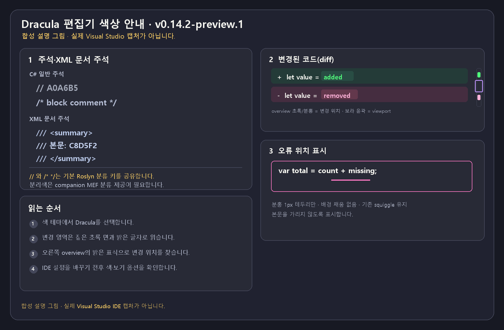

| 편집기 표시 | Dracula 색상 | 사용법 |
|---|---|---|
| 추가된 diff 줄·단어 | 줄 면 `#243B38`; 단어 전경 `#50FA7B`, 배경 `#294D44` | 기존 구문색을 유지할 수 있는 줄 면 위에서 밝은 초록 단어를 찾습니다. |
| 삭제된 diff 줄·단어 | 줄 면 `#452D40`; 단어 전경 `#FFB3D9`, 배경 `#63384C` | 분홍 단어와 어두운 면으로 삭제 범위를 읽습니다. |
| 변경 표식·현재 viewport | 변경 표식은 초록/분홍; overview 배경 `#282A36`, viewport 윤곽 `#BD93F9` | 변경 위치 표식과 현재 화면을 둘러싼 보라 윤곽은 다른 의미입니다. |
| C# `//` 주석 | `#A0A6B5` | 일반 주석입니다. |
| C# block `/* */` 주석 | `#B5BDD4` | companion MEF 분류로 일반 주석과 구분합니다. |
| XML 문서 본문 / tag·delimiter | `#C8D5F2` / `#B9C8E8` | `///` 본문과 XML 요소 이름·구분자를 구분합니다. |
| Roslyn 오류 span | 분홍 1px 테두리 `#FFFF79C6`, 배경 채움 없음 | 기존 squiggle은 그대로 두고 테두리로 범위를 찾습니다. 배경을 덮지 않아 본문 글자를 가리지 않습니다. |

C# `//`와 `/* */`는 기본 Roslyn classification key가 `comment`를 공유합니다. block 주석 전용 색을 위해 동봉 MEF 분류가 native classification의 우선순위를 보완합니다. XML 문서 주석에는 기존 XML 전용 classification을 사용합니다. 색 테마 XML만으로 일반/block 주석이 구분된다고 가정하지 마세요.

### Diff 보기와 옵션 복원

Dracula 테마가 활성화된 동안 diff 줄의 추가·삭제 영역과 overview 변경 위치를 살펴봅니다. VS2019·VS2022에서는 diff view별 `ShowDiffOverviewMargin` 옵션을 로컬로 활성화해 native overview를 보이게 하고, 테마를 벗어나거나 view를 닫을 때 기존 local/inherited 설정을 복원합니다. 사용자가 그 사이에 변경한 설정은 보존하는 동작을 목표로 합니다. Visual Studio 전체의 설정을 영구 변경하는 기능은 아닙니다.

### 확인 범위와 제한

버전별 실제 IDE 기능 검사 결과와 적용 범위는 [TASK-072 통합 검증 보고서](../MarkdownReport/CodexOrig2_TASK-072_Audit.md)에서 확인하세요. 이 사용자 안내는 설치·사용 흐름과 기능, 알려진 제한을 설명하며 특정 후보의 검사 상태를 보증하지 않습니다.

고객 VS2017 Professional 15.7.1, 별도 고객 오프라인 PC, 실제 Claude/OpenAI 계정 로그인·응답, 실제 TFS/TFVC 서버 작업, 설치 버튼의 물리적 마우스/포인터 흐름은 이 문서 작성 시점에 확인되지 않았습니다. 합성 설명 그림은 실제 IDE 화면 캡처가 아닙니다.

이전 v0.14.0의 기능 설명과 캡션은 해당 버전의 이력으로 보존합니다. 구버전 Release 첨부 정리는 v0.14.2 게시·익명 다운로드 검증 이후 별도로 진행하며 v0.14.1은 직전 Release로 보존합니다.

## Git·SVN·TFVC와 배포

프로젝트 작업 창에서 작업 종류, 프로젝트 폴더와 CLI 실행 파일을 지정합니다. CLI 경로를 비우면 PATH의 `git.exe`, `svn.exe`, `tf.exe`를 사용합니다. 해당 저장소의 인증·작업 사본/워크스페이스는 각 CLI에서 먼저 준비합니다.

| 작업 | 입력과 동작 |
|---|---|
| Git fetch | 선택한 원격의 변경을 받음 |
| Git pull | 현재 브랜치를 fast-forward 방식으로 최신화 |
| Git checkout | 명시한 기존 브랜치로 전환 |
| Git commit | 메시지와 지정한 기존 추적 파일만 커밋 |
| Git push | 선택한 원격으로 현재 브랜치 반영 |
| SVN update | 현재 작업 사본 최신화 |
| SVN checkout | 저장소 URL에서 아직 없는 프로젝트 하위 폴더로 새 사본 받기 |
| SVN commit | 지정 파일과 메시지로 체크인 |
| TFVC get·checkout·checkin | 현재 워크스페이스의 최신 버전 받기·선택 파일 체크아웃·체크인 |
| 배포 | 지정한 네이티브 실행 파일과 인수를 프로젝트 폴더에서 실행 |

1. 형상관리 또는 배포 권한을 해당 작업에 맞게 선택합니다.
2. 필요한 브랜치·원격·메시지·파일을 입력합니다. 파일은 프로젝트 상대 경로로 한 줄에 하나씩 적습니다. 폴더 전체·와일드카드는 사용하지 않습니다.
3. **실행 계획 확인**을 눌러 폴더와 정확한 명령·인수를 읽습니다.
4. 실행 동의에 체크하고 **확인한 작업 실행**을 누릅니다. 입력을 바꾸면 다시 계획을 확인합니다.
5. 종료 코드와 결과를 확인합니다. 진행 중에는 **실행 중지**를 사용할 수 있습니다.

배포 인수는 한 줄이 인수 하나이며 따옴표로 다시 감싸지 않습니다. 커밋·체크인·push·배포는 실제 로컬/원격에 반영됩니다. 확장은 실패·취소를 성공으로 표시하지 않습니다. 시간 초과나 네트워크 중단은 서버 쪽 작업 완료 여부까지 되돌리지 않으므로 결과를 확인한 뒤 재시도합니다.

## 문제 해결

**CLI 환경 설정 → PDF 설명서 · CLI 설치**는 동봉된 고객용 설명서를 WebView2 화면으로 엽니다. 설치·로그인·연결·첫 요청의 순서는 [그림 설명서](../HowToInstallCLI.md)와 같습니다. WebView2 Runtime이 없으면 화면의 대체 안내와 PDF 기본 앱 열기를 사용할 수 있습니다. 설치 버튼은 설치 확인 창의 승인을 받은 뒤 동봉 배치를 일반 사용자 콘솔로 실행합니다. 닫기·취소만으로 설치나 로그인이 시작되지는 않습니다. 실행 후 ‘연결 확인’으로 결과를 확인하세요.

긴 대화를 읽어도 입력란은 창 아래에 남고 대화·변경 결과만 스크롤됩니다. 답변 중 위로 스크롤하면 읽던 위치를 유지하고 ‘생각하는 중…’ 표시를 상단으로 옮깁니다. 가장 아래에 있을 때는 대화 끝에서 표시합니다. 진행 카드는 같은 작업의 시작·완료를 갱신하며, 빌드·테스트·파일 변경·조회·형상관리 상태를 색상과 아이콘으로 구분합니다. 카드를 클릭하거나 Enter로 열면 작업별 상태·수신 시각·제공된 종료 코드를 볼 수 있으며, 마우스 오버만으로는 상세가 열리지 않습니다. 표시되는 것은 CLI가 공개한 작업 정보이며 내부 추론이나 비공개 명령 출력이 아닙니다.

직접 소스를 수정하는 전체 액세스 요청은 먼저 열린 문서가 저장되어 있는지 확인합니다. 실행 중 열린 텍스트 편집기는 일시적으로 읽기 전용이 되고 파일 변경 안내를 보류합니다. 완료·중지·실패 후 저장된 디스크 변경을 편집기에 다시 읽고 원래 편집 가능 상태를 복원합니다. 실행 중 문서를 닫으면 요청을 중지합니다. 예상치 못한 미저장 버퍼나 삭제된 파일은 내용을 보존하고 비교 안내를 표시합니다. 보호 가능한 열린 텍스트 문서는 최대64개·합계16MiB·파일당2MiB입니다. 한도를 넘으면 사용하지 않는 문서를 닫은 뒤 요청하세요.

CLI 경로가 비어 있으면 현재 프로세스·사용자·시스템 PATH와 알려진 네이티브 설치 위치를 탐색합니다. Claude의 `%USERPROFILE%\.local\bin\claude.exe`, Codex의 `%LOCALAPPDATA%\Programs\OpenAI\Codex\bin\codex.exe`도 확인하므로 설치 전에 실행해 둔 IDE에서도 찾을 수 있습니다. 직접 지정한 경로는 우선하며, 그 경로가 잘못됐을 때 다른 CLI로 몰래 바꾸지 않습니다. CLI 발견은 로그인 확인과 별개이며 브라우저·Claude 앱 로그인만으로 CLI 인증이 완료되지는 않습니다. 모델 목록만 응답한 경우 로그인 상태는 ‘확인 필요’로 표시합니다.

확장을 처음 초기화하면 대화 저장 폴더에 숨김 `.mandatory-instructions.md` 관리 사본을 생성합니다. 필수 내용은 협업 파일 사용과 클래스·메서드 주석 형식·기존 주석 내용 보존입니다. 사용자 `instructions.md`와 별도이며 각 AI 요청에 내장 기본 규칙을 한 번 조합합니다. 관리 사본이 없어지면 복구하고 기존 사본 내용은 덮어쓰지 않습니다. 사본 변경 내용으로 AI 권한을 확대하지 않으며 사용자 규칙의8000자 한도를 줄이지 않습니다. Windows 탐색기에서 숨김 항목 표시를 켜면 위치를 확인할 수 있습니다.

| 증상 | 확인할 내용 |
|---|---|
| 설치 대상이 없음 | 설치한 IDE 버전과 VS2017/2019/2022용 VSIX가 일치하는지 확인 |
| CLI를 찾지 못함 | 올바른 Windows 네이티브 .exe 또는 PATH 확인 |
| 모델·모드 요청 실패 | 해당 CLI 버전·모델 이용 권한과 이름 확인, 기본값으로 재시도 |
| Enter로 줄바꿈되지 않음 | 줄바꿈은 Ctrl+Enter, Enter는 보내기 |
| 이미지 제거 버튼이 안 보임 | 미리보기에 마우스를 올리거나 키보드로 항목에 이동 |
| 이전 대화가 안 나타남 | 현재 AI 탭과 대화 저장 위치, 닫힌 항목의 불러오기 확인 |
| 기록 저장 실패 | 로컬 파일 쓰기 권한·저장 한도 확인. 현재 대화는 그대로 두고 재시도 |
| 수정안 적용 실패 | 현재 소스와 외부 변경을 확인한 뒤 다시 요청 |
| DB 스키마를 못 읽음 | DB 권한 선택, 서버·DB·계정의 메타데이터 읽기 권한 확인 |
| 형상관리 명령 실패 | CLI 설치, 인증, 프로젝트 폴더, 추적 파일·브랜치 상태 확인 |
| Visual Studio 라이선스 안내 | AI 계정과 별개. [IDE 로그인 안내](BUILD_AND_LICENSE.md) 참고 |

저장소 전체를 받은 환경에서는 최상위 [VisualStudio_AIChat_ExtentionTest.exe](../VisualStudio_AIChat_ExtentionTest.exe)를 실행해 검사 항목을 선택하고 결과·로그를 확인할 수 있습니다. 실행 기록은 `artifacts/tl/<실행 ID>/launcher.log`와 `summary.txt`에도 남습니다. 실제 IDE 실행과 실시간 Codex 대화는 사용자가 직접 선택해야 합니다. 결과와 범위는 [TASK-072 통합 검증 보고서](../MarkdownReport/CodexOrig2_TASK-072_Audit.md)를 확인하세요. VSIX를 설치해 AI Assistant를 사용하는 것과 저장소 검사는 별개입니다.

문제 보고에는 IDE·확장·CLI 버전, 작업 순서와 오류 문구를 포함하세요. [개발 문서](DEVELOPMENT.md)와 [이번 검증 보고](../MarkdownReport/CodexOrig_TASK-025.md)에서 자동 검사·실계정/서버 검증 범위를 구분합니다.
