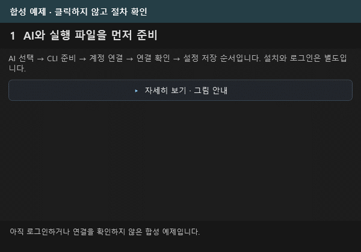
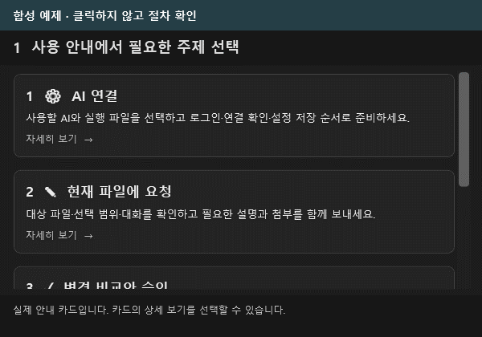
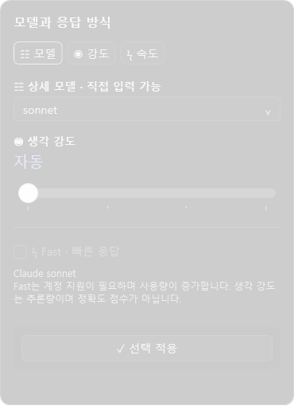
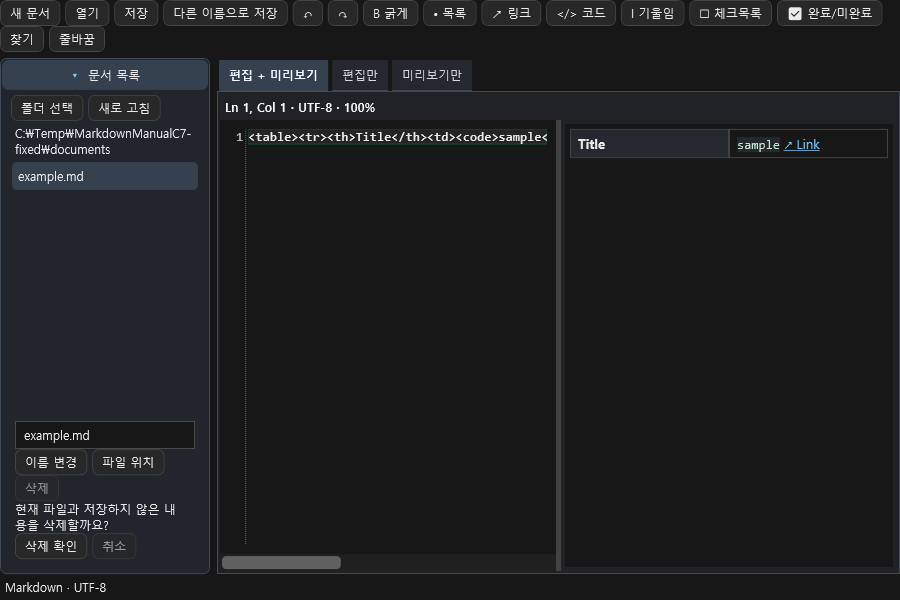
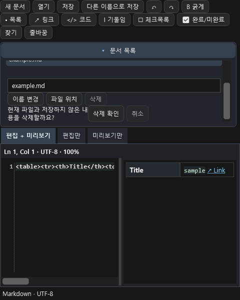
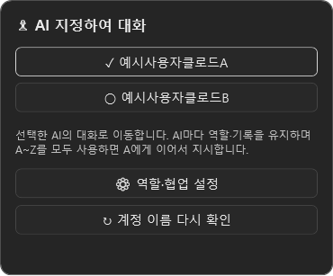

# AI Assistant 사용 안내

Claude·Codex와 대화를 이어 가고, 현재 파일의 수정안을 비교해 적용하는 방법입니다. [v0.10.0 설치 파일과 버전별 지원 조건](../releases/v0.10.0/README.md)을 확인하고 시작하세요. VS2017·2019·2022 각각의 패키지를 제공합니다.

## 설치와 AI 연결

1. 사용 중인 Visual Studio 버전에 맞는 VSIX와 사용할 AI의 Windows 네이티브 CLI `.exe`를 준비합니다. 이 프로젝트를 빌드하거나 VS 확장 개발 도구를 설치할 필요는 없습니다.
2. VSIX를 내려받고 Visual Studio를 닫은 뒤 실행합니다. 설치 후 Visual Studio를 다시 엽니다.
3. **도구 → AI Assistant**를 엽니다. 맨 위의 첫 탭은 **Claude**, 다음은 **Codex**입니다. 로고와 반투명 배경으로 현재 AI를 구분할 수 있습니다.
4. 오른쪽 위 메뉴를 펼치거나 창에서 **우클릭 → 설정**을 선택합니다. 중앙 설정 창에서 현재 AI의 CLI `.exe` 경로를 지정합니다. PATH에 있으면 비워둘 수 있습니다.
5. **계정 로그인 화면**에서 Claude·Codex를 선택하고 **공식 로그인 열기**로 공식 CLI·브라우저 인증을 진행합니다. 돌아와 **로그인 상태 확인**을 누릅니다. 이미 CLI에 로그인했다면 상태 확인부터 사용할 수 있습니다.
6. 모델·공통 규칙·글자 크기·화면 모드를 조절하고 **설정 저장**을 누릅니다. 다른 AI는 해당 탭을 선택한 뒤 설정합니다. 로그인 정보 확인과 실제 모델 요청 성공은 각각 확인합니다.

설정 위쪽 목차에서 계정·모델·공통 규칙·표시 구역으로 바로 이동합니다. 먼저 짧은 요약을 읽고 **자세히 보기 · 그림 안내**를 펼쳐 전체 설명과 그림을 확인하세요. 저장·닫기는 본문과 다른 하단 영역에 고정됩니다. 메뉴·도구 설명·팝업은 선택한 화면 모드를 따릅니다. 안내 카드를 클릭하면 Markdown 상세 설명으로 바뀌며 본문 밖 **우측 상단의 돌아가기**로 목록에 복귀합니다. `.cmd`나 `.bat` 대신 네이티브 `.exe`가 필요합니다. 계정 ID·비밀번호는 제공자의 공식 창에 입력하며, 확장은 암호·토큰을 직접 수집·저장하지 않습니다. 실제 인증과 모델 이용 권한·비용은 해당 CLI와 서비스 계정에 따릅니다.

공식 안내: [Codex CLI](https://developers.openai.com/codex/cli), [Claude Code 설치](https://code.claude.com/docs/en/setup), [Claude CLI 옵션](https://code.claude.com/docs/en/cli-reference).



이 페이지의 GIF는 제품 컨트롤에 예제 데이터를 넣어 만든 절차 안내입니다. 실제 계정 인증·설치·유료 AI 실행 결과를 촬영한 화면이 아닙니다. 움직임 없이 보려면 [정지 그림](assets/guide-media/01-connect.png)을 여세요.

## 처음 나타나는 사용 안내

처음 창을 열면 번호와 그림이 있는 안내에서 AI 연결 → 파일에 요청 → 변경 비교·승인 → 저장 순서를 확인합니다. **계정 설정 열기**는 연결 설정으로, **시작하기**는 대화 화면으로 이동합니다.



[정지 그림](assets/guide-media/04-guide.png) · [별도 그림·PDF 보완 안내](visual-guide-orig3/화면안내_보완가이드.md) · [설명용 도식 갤러리](visual-guide-orig3/gallery.html). 별도 도식은 사용 순서를 그린 자료이며 실제 제품 캡처와 구분합니다.

**다시 보지 않기**를 선택해 닫으면 다음 실행의 자동 안내를 생략합니다. 오른쪽 위 메뉴 또는 **우클릭 → 사용 안내**에서 언제든 다시 열 수 있습니다. 자동 표시를 다시 켜려면 그 화면에서 체크를 해제하고 닫으세요. 이 선택은 저장된 CLI 경로·모델·규칙을 보존합니다.

## 첫 요청과 키보드

1. 수정할 소스를 편집기에서 열거나 선택합니다. 새 문서는 먼저 파일로 저장합니다.
2. AI 창으로 돌아와 요청을 작성합니다. 마지막으로 선택한 소스 파일을 대상으로 합니다.
3. 필요하면 이미지·텍스트를 첨부하고 모델·모드를 고릅니다.
4. **Enter** 또는 원 안의 굵은 **돋보기 보내기 버튼**으로 요청합니다. 돋보기는 요청 전송 아이콘이며 줄바꿈은 **Ctrl+Enter**입니다.
5. 응답을 읽고 같은 대화에서 후속 요청을 계속 보냅니다.

| 키 | 동작 |
|---|---|
| Enter | 요청 보내기 |
| Ctrl+Enter | 프롬프트 줄바꿈 |
| Ctrl+C | 선택한 텍스트 복사 |
| Ctrl+V | 일반 텍스트 붙여넣기 또는 이미지·파일 첨부 |
| Ctrl+S | 소스 편집기에서 파일 저장 |

```text
이 메서드에 null 처리를 추가해 주세요.
기존 메서드 이름과 API는 유지해 주세요.
```

모델을 비워 두면 CLI 기본 모델을 사용합니다. 입력란 오른쪽 **모델·생각 강도** 버튼 하나에서 모델·강도·Fast를 선택하고 같은 버튼에 마우스를 올려 토큰 사용량을 봅니다. 연결된 CLI에서 모델 목록과 지원 기능을 자동 조회합니다. Codex는 app-server의 모델 목록, Claude는 SDK 초기화 응답을 사용합니다. 조회가 지원되지 않으면 기본값·직접 입력과 기존 로컬 모델 정보를 안내합니다. CLI를 업데이트한 뒤 다시 연결하면 새 목록을 조회합니다.

생각 강도는 해당 모델이 광고한 단계만 선택합니다. Fast도 지원이 확인된 모델에서 켤 수 있으며 계정과 CLI 버전 조건이 적용됩니다. 생각 강도는 정확도 점수가 아닙니다. 요금제 이름만으로 기능을 임의 제한하거나 모델 목록을 유료 이용 권한으로 해석하지 않습니다. 실제 요청은 해당 서비스가 승인하거나 거절합니다. 자세한 전달 방식은 [CLI 옵션](CLI_OPTIONS.md)을 참고하세요.

입력란 왼쪽 권한 메뉴의 **승인 요청**은 수정안 검토, **작업 도구 허용**은 검토 방식과 확장의 업무 작업 권한, **전체 액세스**는 네이티브 CLI의 직접 파일·명령·테스트 실행을 선택합니다. 세부 DB·형상관리·배포 체크박스는 확장 작업 창에 적용되는 권한입니다. 네이티브 전체 액세스는 별도의 직접 실행 모드이므로 보내기 전에 현재 모드와 작업 폴더를 확인하세요.

사용자 요청은 오른쪽 둥근 말풍선에, AI 답변은 왼쪽 본문에 표시합니다. 위쪽에는 대화 시작 시각을 표시하고, 응답을 기다리는 동안 실제 경과 시간과 움직이는 상태 표시를 보여 줍니다. 요청을 취소하려면 중지 버튼을 누릅니다. 안내는 중앙에서 잠시 보인 뒤 사라지며, 오른쪽 위 메뉴의 최근 알림에서 다시 확인할 수 있습니다. 수정안 검토 모드에서는 승인·적용 전까지 원본 파일을 유지합니다. 전체 액세스에서는 실행 중 실제 파일이 바뀔 수 있습니다.



## Markdown 답변과 작성기

AI 답변은 제목·목록·강조·표·코드 블록을 서식으로 표시합니다. **▣** 링크는 로컬 파일을 Visual Studio 텍스트 편집기로 열고, **↗** 링크는 웹 주소로 이동합니다. 링크가 존재하지 않거나 지원하지 않는 주소이면 상태 안내를 확인하세요. 답변의 **우클릭 → Markdown 원문 복사**로 링크와 서식을 포함한 원문을 복사할 수 있습니다. 일반 **복사**는 선택한 표시 텍스트를 복사합니다.

요청 입력란이나 공통 규칙에서 **우클릭 → Markdown 작성 · 미리보기**를 선택합니다. 작성·분할·미리보기로 확인한 뒤 **입력란에 적용**을 눌러 원래 입력에 반영합니다. 창을 닫는 것만으로 요청이 전송되거나 규칙이 저장되지는 않습니다. 별도 문서를 만들려면 **우클릭 → Markdown 문서 작성**을 사용합니다.

| 작성기 기능 | 사용 방법 |
|---|---|
| 굵게·기울임·링크 | 도구 모음 또는 Ctrl+B / Ctrl+I / Ctrl+K |
| 체크 목록 만들기·완료 전환 | Ctrl+Shift+C / Ctrl+Enter |
| 목록·인용 이어 쓰기 | 줄 끝에서 Enter, 빈 항목에서 목록 끝내기 |
| 목록 들여쓰기·내어쓰기 | Tab / Shift+Tab, 빈 중첩 항목 끝의 Backspace |
| 찾기 | Ctrl+F, 다음·이전 찾기 |
| 줄바꿈 표시 | Alt+Z |
| 미리보기 전환 | Ctrl+Shift+V 또는 보기 탭 |
| 글자 확대·축소 | Ctrl+마우스 휠, 60~200% |
| 파일 열기·저장 | 로컬 `.md`/`.markdown`, UTF-8 내보내기·Ctrl+S |
| 미저장 내용 | 새 문서·다른 파일·종료 전 확인, 취소하면 초안 유지 |

작성기는 줄 번호·현재 줄 강조와 Markdown·SQL/C# 코드 편집 색상을 제공합니다. 작성기에서 **Ctrl+Enter는 체크 항목 전환**이며, 대화 입력란의 Ctrl+Enter 줄바꿈과 구분합니다. 명시적으로 연 문서의 PNG·GIF 상대 경로는 해당 문서 폴더를 기준으로 표시합니다. 파일 열기나 저장을 취소·실패하면 기존 문서와 기준 폴더를 유지합니다. 일반 AI 답변의 이미지 주소를 자동으로 내려받지는 않습니다.

독립 문서 작성기에서는 처음 접힌 **문서 목록**을 펼쳐 **폴더 선택**을 누릅니다. 넓은 화면에서는 편집 탭 왼쪽, 좁은 화면에서는 탭 위에 나타나며, 좁은 패널은 안쪽에서 세로로 스크롤합니다. 파일 목록은 선택한 폴더 바로 아래의 `.md`·`.markdown` 문서만 표시합니다. 두 번 클릭하거나 파일을 선택하고 Enter를 눌러 엽니다. **저장/Ctrl+S**는 현재 열려 있는 문서에, **다른 이름으로 저장/Ctrl+Shift+S**는 새 경로에 저장합니다. **이름 변경**, **파일 위치**, **삭제**도 현재 열려 있는 문서에 적용됩니다. 삭제는 현재 문서와 저장하지 않은 내용을 함께 지우므로, 확인 문구에서 **삭제 확인** 또는 **취소**를 선택하세요. 다른 문서로 이동하면 이전 삭제 확인은 닫힙니다.

참조형 Markdown 링크와 로컬 이미지를 사용할 수 있고 표·제목·문단·목록 등 제한된 정적 HTML도 미리 봅니다. 일반 Markdown 표는 최대 16열, 정적 HTML 표는 최대 128행·16열까지 표시하며, 한도를 넘어 생략한 내용이 있으면 공통 안내가 나타납니다. 스크립트·스타일시트·iframe 실행과 원격 리소스 자동 로딩은 하지 않습니다. 아래 C7 그림은 제품 DLL 컨트롤을 별도 검사에서 렌더한 이미지입니다. Visual Studio 실제 실행 화면과 구분해 주세요.





[Markdown 작성기 사용 설명서 C7 검토 PDF](../output/pdf/Markdown작성기_사용설명서_C7.pdf) · [Markdown 원문과 10개 그림](visual-guide-orig3/markdown-editor/revision-c7/Markdown작성기_사용설명서_C7.md)

## 자동·Light·Dark 화면 모드

**설정 → 표시**에서 화면 모드를 고릅니다. **자동**은 Visual Studio의 디자인을 우선 따르고, IDE 밖에서는 Windows 앱 모드를 참고합니다. **Light**는 흰색·회색과 옅은 보조색, **Dark**는 어두운 표면을 사용합니다. 직접 고른 모드는 자동 판정보다 우선합니다.

선택하면 현재 화면에서 즉시 미리 볼 수 있습니다. **설정 저장**으로 다음 실행에도 유지하고, 저장하지 않고 닫으면 이전 선택으로 돌아갑니다. 메뉴·도구 설명·변경 팝업·Markdown·안내도 같은 화면 모드를 따릅니다. Visual Studio나 Windows 자체의 전역 디자인을 바꾸지는 않습니다.

## 직접 수정과 자체 테스트를 맡기기

1. 열린 편집 파일을 모두 저장합니다. 다른 탭의 미저장 버퍼도 직접 실행을 막으므로 저장 후 다시 시도합니다.
2. 작업할 소스나 솔루션을 선택하고 **전체 액세스**를 고릅니다. 파일이 열려 있지 않아도 저장된 솔루션 폴더에서 작업할 수 있습니다.
3. 원하는 변경과 확인할 테스트를 구체적으로 요청합니다. 예: “이 메서드를 수정하고 해당 단위 테스트를 실행한 뒤 실제 결과를 알려 주세요.”
4. 공개된 중간 답변·명령·파일 도구 상태를 확인합니다. 내부 추론 원문은 수집하지 않습니다. ‘생각 중’에는 회색 글자 위로 흰색 빛이 좌→우로 이동합니다.
5. 종료 후 실제 답변·테스트 결과·변경 카드를 확인합니다. 변경 파일을 선택해 초록 추가·빨강 삭제를 비교하고 파일 링크로 이동합니다.

Codex는 app-server의 danger-full-access, Claude는 bypassPermissions로 명시된 직접 실행을 요청합니다. 현재 Windows 사용자 권한 안에서 동작하며 관리자 권한을 자동으로 획득하지 않습니다. 네이티브 CLI의 작업은 프로젝트 밖에도 접근할 수 있습니다. 중지 버튼은 해당 실행과 하위 프로세스의 종료를 요청하지만 이미 수행한 파일·외부 서버 작업을 되돌리지 않습니다.

동료 AI가 지정되어 있으면 선택한 소스를 대상으로 기존 수정안 검토를 순차 실행한 뒤 최종 담당자가 직접 작업합니다. 동료 검토에는 각각 사용량이 발생합니다. 협업 검토에 사용할 소스가 없으면 소스를 선택하거나 참여자를 해제하라는 안내가 나옵니다.

### 변경 기록의 출처와 범위

CLI의 파일 도구 보고·누적 diff를 먼저 사용합니다. 명령으로 파일을 쓰면 도구 보고가 없을 수 있어 실행 전후의 프로젝트 텍스트 소스도 비교합니다. 툴팁에서 **CLI 보고 / 프로젝트 전후 비교**를 구분합니다. 전후 비교는 실행 기간에 관찰한 변경이며 다른 프로세스의 동시 편집까지 AI가 작성했다고 증명하는 기록은 아닙니다.

보완 비교는 최대 4,000개 파일·32MiB 입력·파일당 200,000자, 1,000개 폴더·20,000개 경로 방문으로 제한합니다. 코드·설정·문서 텍스트 확장자만 비교하고 링크, `.git`, `.vs`, `bin`, `obj`, `node_modules`, `packages`, `releases`, `artifacts` 하위 폴더는 제외합니다. 큰 파일·바이너리·인코딩만의 변경·프로젝트 밖 파일과 한도 이후 항목은 CLI 보고 범위를 따릅니다. 전체 컴퓨터의 완전한 감사 로그가 아닙니다.

공통 중간 줄을 보존해 추가·삭제 줄을 계산합니다. 비교 작업 한도 내에서 정확한 줄 수를 얻지 못하거나 diff가 없으면 계수를 단정하지 않고 **줄 수 미제공**으로 표시합니다. 취소·실패 후에는 보고되지 않은 변경이 남을 수 있으므로 실제 파일 상태도 확인하세요.

### 토큰 도구 설명 읽기

입력란의 **모델·생각 강도** 버튼에 마우스를 올리면 실제 보고한 입력(캐시 포함)·출력·캐시·합계, 모델 컨텍스트 한도와 계정 할당량 사용률을 볼 수 있습니다. 토큰 수와 백분율은 서로 다른 단위입니다. 계정 조회 시각과 사용량 수신 시각도 구분합니다.

전체 액세스 Codex는 thread/tokenUsage/updated, 일반 수정안 Codex는 exec 완료 이벤트, Claude는 제공되는 메시지·결과 usage를 읽습니다. 일반 Codex가 중간 사용량을 제공하지 않으면 완료 시점까지 기다립니다. Claude 부분 이벤트가 출력만 제공하면 입력·합계는 확인 불가로 남깁니다. 다른 이벤트의 누락 필드를 섞어 현재 사용량으로 추정하지 않습니다. 계정의 남은 월간 토큰이나 최종 비용을 계산하는 화면은 아닙니다.

## 이미지·문서·텍스트 첨부

탐색기에서 파일을 창으로 끌어 놓거나 **＋ 첨부**로 선택합니다. 탐색기에서 복사한 문서 파일이나 클립보드 이미지는 프롬프트의 **Ctrl+V**로 추가합니다. 별도 붙여넣기 버튼은 없으며 텍스트의 기본 편집 메뉴도 사용할 수 있습니다.

이미지는 프롬프트 위에 미리보기로 표시합니다. 마우스를 올리면 나타나는 **×**로 제거합니다. 키보드로 첨부 항목과 제거 동작에 접근할 수도 있습니다. 파일을 놓는 것만으로 전송되지는 않으며, 보내기를 누를 때 현재 목록을 함께 전달합니다.

| 항목 | 지원 범위 |
|---|---|
| 이미지 | PNG/JPEG, 각 2MB·최대 1,600만 픽셀 |
| 텍스트 | UTF-8 또는 BOM이 있는 Unicode, 각 100KB |
| 개수 | 최대 4개 |
| 문서 | DOCX/PPTX/XLSX·ODT/ODP/ODS·RTF·HTML, 원본 16MB·추출 본문 UTF-8 100KB |
| PC별 문서 | PDF·DOC/PPT/XLS, 해당 Windows IFilter가 필요하며 같은 크기 제한 적용 |
| 지원하지 않는 첨부 | 폴더·압축·실행 파일, 암호 문서, 텍스트가 없는 스캔 PDF |

문서는 본문을 추출해 전달합니다. 그림·서식·페이지 모양을 그대로 보내는 기능은 아닙니다. 추출 중에도 창을 사용할 수 있고 중지할 수 있습니다. 읽지 못한 파일이 있으면 해당 묶음을 부분 첨부하지 않으며 오류를 안내합니다. 스캔 PDF는 먼저 OCR로 텍스트를 넣고, 읽기 필터가 없으면 최신 Office 형식이나 텍스트로 저장해 첨부하세요.

첨부는 제거할 때까지 다음 요청에도 포함됩니다. 원본 파일을 고쳤다면 기존 항목을 제거하고 다시 첨부해야 새 내용이 반영됩니다. 대화를 재실행해 복원할 때 첨부 원본은 복원하지 않으므로 필요한 자료를 다시 추가하세요.

## 대화 AI 이름과 협업

1. 대화 목록 하단의 **새 대화**로 검토용 AI 대화를 만듭니다. 이름은 사용자명+AI명+알파벳 한 자리(A~Z)로 정하며 대화 제목과는 별개입니다. AI 설정에서 담당 역할을 지정합니다.
2. 함께 일할 AI는 동일한 협업팀 이름을 사용합니다. 팀을 바꿀 때는 참여자를 먼저 해제하고 새 팀을 저장한 뒤 다시 엽니다.
3. 주 담당 대화에서 같은 팀의 열린 대화를 최대 3개 선택해 저장합니다. 보내기 전 선택 인원과 역할을 확인합니다.
4. 요청을 보내면 동료 AI를 순서대로 실제 호출합니다. 동료 검토 결과를 받은 현재 AI가 최종 수정안을 만듭니다. 중지 버튼은 진행 중인 호출을 취소합니다.
5. 각 대화의 완료·실패·중지·읽지 않음을 확인하고 **협업 기록**을 열어 요청·회신·전달 상태를 봅니다. 최종 코드는 비교·승인 후 적용하고 별도로 저장합니다.

협업은 참여자 수만큼 AI 호출·사용량이 늘어납니다. 각 AI는 동일한 원본과 현재 첨부를 받으며, 동료 검토 공유 요청은 5,000자, 회신은 10,000자까지 전달하고 초과 부분의 생략을 표시합니다. 최종 AI에는 전체 원래 요청과 8,000자 이내의 역할·동료 결과를 전달합니다. 협업 중 원본이 달라지면 적용하지 않고 중단합니다. 참여 대화를 닫거나 팀을 바꾸었다면 다시 선택해야 합니다.

AI 이름은 예를 들어 **홍길동클로드A**처럼 사용자명+AI명+알파벳 한 자리입니다. **AI 지정하여 대화** 버튼의 목록에서 질문할 담당자를 고릅니다. A~Z 담당자가 모두 있으면 다음 새 대화는 기존 A로 연결하고 기록을 새로 만들거나 지우지 않습니다. 사용자명에는 확인된 GitHub 계정 또는 명확히 선택할 수 있는 Git Credential Manager 저장 계정을 우선 사용합니다. 저장 계정은 서버 인증을 재확인한 상태와 구분해 표시합니다. Git 작성자 설정만으로 로그인했다고 판단하지 않으며, 과거 대화의 역할과 협업 기록은 보존하며 이름 표시는 새 A~Z 규칙을 따릅니다. 계정을 확인하기 전에는 Windows 사용자명을 사용합니다. AI 목록에서 **계정 이름 다시 확인**을 누르면 사용자명 출처를 갱신합니다. 이름은 자동 지정되어 읽기 전용이며 역할·팀은 직접 수정합니다. 이전 버전에서 26개를 넘긴 AI는 기록을 보관하고 새 선택 목록에서는 제외합니다.

이름·역할·팀과 실제 협업 상태는 공통 작업 폴더의 `collaboration.json`, 사람이 읽는 결과는 `collaboration-report.md`에 남습니다. 대화 Markdown에는 선택한 참여자 ID를 보관합니다. 토큰·암호·첨부 원본은 이 메타데이터에 저장하지 않습니다.



## 대화 목록·이름·닫기·불러오기

AI 탭 아래의 대화 목록을 선택해 대화를 전환합니다. 목록 오른쪽 세로 경계를 드래그하면 폭을 조절할 수 있습니다. 왼쪽 끝으로 끌어 접은 뒤 **☰**로 펼치면 마지막 유효 폭으로 복원됩니다. 경계에 키보드 포커스를 옮긴 뒤 좌우 방향키로도 조절할 수 있습니다. 폭·숨김 선택은 다음 실행에 복원됩니다. 좁은 창에서 목록을 열면 뒤 대화에 배경막을 표시하고 가려진 본문 입력을 잠시 차단합니다. 목록을 선택하거나 Escape·배경막 클릭으로 닫아 대화로 돌아옵니다.

| 표시 | 의미 |
|---|---|
| ◌ 파란 진행 표시 | 해당 대화의 실제 요청 처리 중 |
| ● 파란 점 | 보지 않은 응답이 있음 |
| ✓ | 요청 완료 |
| ! 빨간 표시 | 요청 실패 |
| ■ 노란 표시 | 사용자가 요청 중지 |
| ! 노란 표시 | 이전 실행에서 요청이 중단됨 |
| ○ | 아직 요청하지 않은 대화 |

실패·중지 표시의 툴팁에서도 읽지 않음을 구분합니다. 대화를 직접 선택하거나 본문을 클릭·스크롤·키보드로 확인하면 현재 대화만 읽음 처리합니다. 다른 소스 탭이나 앱에서 작업하느라 보지 않은 응답의 점은 남아 있습니다. 수정안 검토의 완료는 응답 수신 상태이며 적용·저장을 별도로 승인합니다. 전체 액세스의 완료는 CLI 대화 실행 종료를 뜻합니다. 테스트 통과 여부와 외부 서버 반영 결과는 실제 보고 내용을 확인하세요. 상태와 읽지 않음은 Markdown에 저장하고, 재시작 후 계속 실행 중인 것처럼 표시하지 않습니다.

대화 관련 버튼은 목록 하단에 있습니다. 너비가 좁으면 버튼 영역을 가로 스크롤합니다. **새 대화**는 A~Z 여유 슬롯이 있을 때 현재 기록을 지우지 않고 새 항목을 추가합니다. AI별 대화·작성 중 요청을 분리해 저장합니다.

첫 질문에서 제목을 자동으로 만듭니다. 직접 이름을 바꾸면 이후 질문으로 덮어쓰지 않습니다. 제목은 한 줄 최대120자이며, 화면 폭을 넘으면 줄임표로 표시하고 전체 제목을 툴팁으로 확인합니다.

항목의 **우클릭 → 닫기**는 다음 시작의 자동 복원 대상에서 제외합니다. 원본 Markdown 파일은 보관합니다. **대화 불러오기**로 같은 AI의 보관 파일을 선택하면 다시 열 수 있습니다. 다른 AI 파일은 해당 AI 탭에서 불러오세요.

기본 저장 위치:

```text
%LOCALAPPDATA%\VS2017AIAssistant\workspace\
  instructions.md
  conversations\claude\<대화 식별자>.md
  conversations\codex\<대화 식별자>.md
```

대화에는 front matter의 제목·날짜·AI·열림 상태와 실제 메시지·작성 중 요청이 들어갑니다. 저장 파일은 사용자가 읽을 수 있는 Markdown입니다. AI별 최대500개 파일(닫은 기록 포함), 파일당4MB와 각 대화의 최근100개 메시지를 보관합니다. 한도에 도달하면 오래된 Markdown을 별도 폴더로 옮겨 보관할 수 있습니다. 손상된 파일은 오류 안내와 함께 건너뛰고 유효한 기록을 계속 불러옵니다.

대화 원문과 소스 일부가 응답에 포함되었다면 로컬 기록에도 남을 수 있습니다. 첨부 원본·이미지 바이트·AI 인증 정보는 기록에 저장하지 않습니다. 저장 파일을 옮기거나 공유할 때는 내용을 확인하세요. 메시지 경계와 문자 수를 사용하는 자체 기록 형식이므로 임의로 구분자를 고치지 말고, 이름 변경·닫기는 화면 기능을 사용하세요.

## 공통 instruction과 설정

instruction은 모든 프로젝트에서 반복 사용할 규칙입니다. 응답 언어, 프레임워크, 유지할 API와 코딩 규칙을 적습니다. 최대8000자이며 창 크기에 맞춰 입력 영역이 늘어나고 긴 내용은 스크롤할 수 있습니다.

```text
응답은 한국어로 작성해 주세요.
C# 7.0과 .NET Framework 4.6.2에서 빌드할 수 있어야 합니다.
기존 메서드 이름과 매개변수를 유지해 주세요.
```

설정 저장 시 공통 규칙은 `workspace\instructions.md`에 Markdown으로 보관합니다. 요청할 때 디스크의 공통 규칙을 다시 읽으므로 다른 프로젝트나 외부 편집기에서 저장한 변경도 반영됩니다. AI별 경로·모델·글자 크기·안내 표시 등 기본 설정은 `%LOCALAPPDATA%\VS2017AIAssistant\settings.json`에 저장합니다. 이전 버전의 저장된 규칙도 새 Markdown 흐름으로 이어집니다.

설정 저장에 성공하면 창이 닫힙니다. 저장 전 **닫기·Esc·X**는 이번 설정 입력을 취소합니다. CLI에서 이미 마친 계정 로그인은 설정 취소와 별개입니다. 저장 실패는 팝업 안에 표시하며 이전 파일을 유지합니다.

## 수정안 확인·소스로 이동·저장

답변 아래 변경 카드에서 대상 파일과 추가·삭제 내용을 확인합니다. 파일 링크를 누르면 그 소스로 이동합니다. 변경 비교·원본·수정안으로 전체 결과를 읽고, 적용 동의에 체크한 뒤 **승인 후 적용**을 누릅니다. 이후 **적용 내용 저장** 또는 소스 편집기에서 **Ctrl+S**로 저장합니다.

적용은 편집기 버퍼를 바꾸며 자동 저장하지 않습니다. 다른 파일을 열더라도 요청 당시 대상 파일을 유지합니다. 요청 후 사용자가 편집했거나 디스크 원본이 달라지면 적용을 거부하므로 새 상태로 다시 요청하세요. 새 수정안에는 이전 승인을 재사용하지 않습니다.

**직전 적용 되돌리기**는 마지막 적용 전의 버퍼로 복구하며, 그때 있던 미저장 편집도 보존합니다. 복구 후 디스크에 반영하려면 다시 저장합니다. Visual Studio의 **Ctrl+Z**도 사용할 수 있습니다. 중지 버튼은 진행 중 요청을 취소하며 이미 적용한 내용을 되돌리는 동작은 아닙니다.

## DB 구조를 참고한 SQL 작성

1. 프로젝트 작업의 DB 탭에서 **SQL Server 스키마 읽기 허용**을 선택합니다.
2. 서버와 데이터베이스를 포함한 연결 문자열을 입력합니다. 예: `Server=localhost;Database=Sample;Integrated Security=true;`
3. **스키마 읽기**를 누르고 읽어 온 테이블·열 정의를 먼저 확인합니다.
4. SQL 작성 요청을 적은 뒤 **미리본 스키마를 AI 요청에 넣기**를 선택합니다.
5. 대상 SQL 파일을 열어 AI에게 보내고, 생성한 쿼리를 비교·승인·저장합니다.

연결 정보는 이 창 수명 동안만 사용하며 설정·대화에 저장하거나 AI에게 전달하지 않습니다. DB는 허용된 계정으로 테이블·열 메타데이터만 읽고 실제 행은 조회하지 않습니다. 최대512열·약12000자까지 참고하고 SQL 작성 요청은2000자까지 입력합니다. 범위를 넘는 스키마는 잘림을 표시합니다. 입력란에 넣어 전송한 스키마는 대화 기록에도 포함됩니다. 생성한 SQL을 DB에 실행하지 않습니다. 다른 엔진 연결과 SQL 실행은 현재 범위에 포함되지 않습니다.

## Git·SVN·TFVC와 배포

프로젝트 작업 창에서 작업 종류, 프로젝트 폴더와 CLI 실행 파일을 지정합니다. CLI 경로를 비우면 PATH의 `git.exe`, `svn.exe`, `tf.exe`를 사용합니다. 해당 저장소의 인증·작업 사본/워크스페이스는 각 CLI에서 먼저 준비합니다.

| 작업 | 입력과 동작 |
|---|---|
| Git fetch | 선택한 원격의 변경을 받음 |
| Git pull | 현재 브랜치를 fast-forward 방식으로 최신화 |
| Git checkout | 명시한 기존 브랜치로 전환 |
| Git commit | 메시지와 지정한 기존 추적 파일만 커밋 |
| Git push | 선택한 원격으로 현재 브랜치 반영 |
| SVN update | 현재 작업 사본 최신화 |
| SVN checkout | 저장소 URL에서 아직 없는 프로젝트 하위 폴더로 새 사본 받기 |
| SVN commit | 지정 파일과 메시지로 체크인 |
| TFVC get·checkout·checkin | 현재 워크스페이스의 최신 버전 받기·선택 파일 체크아웃·체크인 |
| 배포 | 지정한 네이티브 실행 파일과 인수를 프로젝트 폴더에서 실행 |

1. 형상관리 또는 배포 권한을 해당 작업에 맞게 선택합니다.
2. 필요한 브랜치·원격·메시지·파일을 입력합니다. 파일은 프로젝트 상대 경로로 한 줄에 하나씩 적습니다. 폴더 전체·와일드카드는 사용하지 않습니다.
3. **실행 계획 확인**을 눌러 폴더와 정확한 명령·인수를 읽습니다.
4. 실행 동의에 체크하고 **확인한 작업 실행**을 누릅니다. 입력을 바꾸면 다시 계획을 확인합니다.
5. 종료 코드와 결과를 확인합니다. 진행 중에는 **실행 중지**를 사용할 수 있습니다.

배포 인수는 한 줄이 인수 하나이며 따옴표로 다시 감싸지 않습니다. 커밋·체크인·push·배포는 실제 로컬/원격에 반영됩니다. 확장은 실패·취소를 성공으로 표시하지 않습니다. 시간 초과나 네트워크 중단은 서버 쪽 작업 완료 여부까지 되돌리지 않으므로 결과를 확인한 뒤 재시도합니다.

## 문제 해결

**CLI 환경 설정 → PDF 설명서 · CLI 설치**는 동봉된 고객용 설명서를 WebView2 화면으로 엽니다. 설치·로그인·연결·첫 요청의 순서는 [그림 설명서](../HowToInstallCLI.md)와 같습니다. WebView2 Runtime이 없으면 화면의 대체 안내와 PDF 기본 앱 열기를 사용할 수 있습니다. 설치 버튼은 설치 확인 창의 승인을 받은 뒤 동봉 배치를 일반 사용자 콘솔로 실행합니다. 닫기·취소만으로 설치나 로그인이 시작되지는 않습니다. 실행 후 ‘연결 확인’으로 결과를 확인하세요.

긴 대화를 읽어도 입력란은 창 아래에 남고 대화·변경 결과만 스크롤됩니다. 답변 중 위로 스크롤하면 읽던 위치를 유지하고 ‘생각하는 중…’ 표시를 상단으로 옮깁니다. 가장 아래에 있을 때는 대화 끝에서 표시합니다. 진행 카드는 같은 작업의 시작·완료를 갱신하며, 빌드·테스트·파일 변경·조회·형상관리 상태를 색상과 아이콘으로 구분합니다. 카드 위에 마우스를 올리면 작업별 상태·수신 시각·제공된 종료 코드를 볼 수 있습니다. 표시되는 것은 CLI가 공개한 작업 정보이며 내부 추론이나 비공개 명령 출력이 아닙니다.

직접 소스를 수정하는 전체 액세스 요청은 먼저 열린 문서가 저장되어 있는지 확인합니다. 실행 중 열린 텍스트 편집기는 일시적으로 읽기 전용이 되고 파일 변경 안내를 보류합니다. 완료·중지·실패 후 저장된 디스크 변경을 편집기에 다시 읽고 원래 편집 가능 상태를 복원합니다. 실행 중 문서를 닫으면 요청을 중지합니다. 예상치 못한 미저장 버퍼나 삭제된 파일은 내용을 보존하고 비교 안내를 표시합니다. 보호 가능한 열린 텍스트 문서는 최대64개·합계16MiB·파일당2MiB입니다. 한도를 넘으면 사용하지 않는 문서를 닫은 뒤 요청하세요.

CLI 경로가 비어 있으면 현재 프로세스·사용자·시스템 PATH와 알려진 네이티브 설치 위치를 탐색합니다. Claude의 `%USERPROFILE%\.local\bin\claude.exe`, Codex의 `%LOCALAPPDATA%\Programs\OpenAI\Codex\bin\codex.exe`도 확인하므로 설치 전에 실행해 둔 IDE에서도 찾을 수 있습니다. 직접 지정한 경로는 우선하며, 그 경로가 잘못됐을 때 다른 CLI로 몰래 바꾸지 않습니다. CLI 발견은 로그인 확인과 별개이며 브라우저·Claude 앱 로그인만으로 CLI 인증이 완료되지는 않습니다. 모델 목록만 응답한 경우 로그인 상태는 ‘확인 필요’로 표시합니다.

확장을 처음 초기화하면 대화 저장 폴더에 숨김 `.mandatory-instructions.md` 관리 사본을 생성합니다. 필수 내용은 협업 파일 사용과 클래스·메서드 주석 형식·기존 주석 내용 보존입니다. 사용자 `instructions.md`와 별도이며 각 AI 요청에 내장 기본 규칙을 한 번 조합합니다. 관리 사본이 없어지면 복구하고 기존 사본 내용은 덮어쓰지 않습니다. 사본 변경 내용으로 AI 권한을 확대하지 않으며 사용자 규칙의8000자 한도를 줄이지 않습니다. Windows 탐색기에서 숨김 항목 표시를 켜면 위치를 확인할 수 있습니다.

| 증상 | 확인할 내용 |
|---|---|
| 설치 대상이 없음 | 설치한 IDE 버전과 VS2017/2019/2022용 VSIX가 일치하는지 확인 |
| CLI를 찾지 못함 | 올바른 Windows 네이티브 .exe 또는 PATH 확인 |
| 모델·모드 요청 실패 | 해당 CLI 버전·모델 이용 권한과 이름 확인, 기본값으로 재시도 |
| Enter로 줄바꿈되지 않음 | 줄바꿈은 Ctrl+Enter, Enter는 보내기 |
| 이미지 제거 버튼이 안 보임 | 미리보기에 마우스를 올리거나 키보드로 항목에 이동 |
| 이전 대화가 안 나타남 | 현재 AI 탭과 대화 저장 위치, 닫힌 항목의 불러오기 확인 |
| 기록 저장 실패 | 로컬 파일 쓰기 권한·저장 한도 확인. 현재 대화는 그대로 두고 재시도 |
| 수정안 적용 실패 | 현재 소스와 외부 변경을 확인한 뒤 다시 요청 |
| DB 스키마를 못 읽음 | DB 권한 선택, 서버·DB·계정의 메타데이터 읽기 권한 확인 |
| 형상관리 명령 실패 | CLI 설치, 인증, 프로젝트 폴더, 추적 파일·브랜치 상태 확인 |
| Visual Studio 라이선스 안내 | AI 계정과 별개. [IDE 로그인 안내](BUILD_AND_LICENSE.md) 참고 |

저장소 전체를 받은 환경에서는 최상위 [VisualStudio_AIChat_ExtentionTest.exe](../VisualStudio_AIChat_ExtentionTest.exe)를 실행해 검사 항목을 선택하고 결과·로그를 확인할 수 있습니다. 실행 기록은 `artifacts/tl/<실행 ID>/launcher.log`와 `summary.txt`에도 남습니다. 기본 전체 검사16개는 실제 IDE·AI 계정을 사용하지 않으며, 해당 항목은 직접 선택합니다. VSIX를 설치해 AI Assistant를 사용하는 것과 테스트 실행에 필요한 개발 도구는 별개입니다.

문제 보고에는 IDE·확장·CLI 버전, 작업 순서와 오류 문구를 포함하세요. [개발 문서](DEVELOPMENT.md)와 [이번 검증 보고](../MarkdownReport/CodexOrig_TASK-025.md)에서 자동 검사·실계정/서버 검증 범위를 구분합니다.
