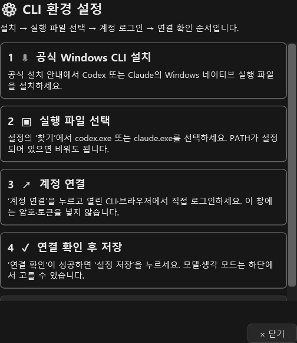
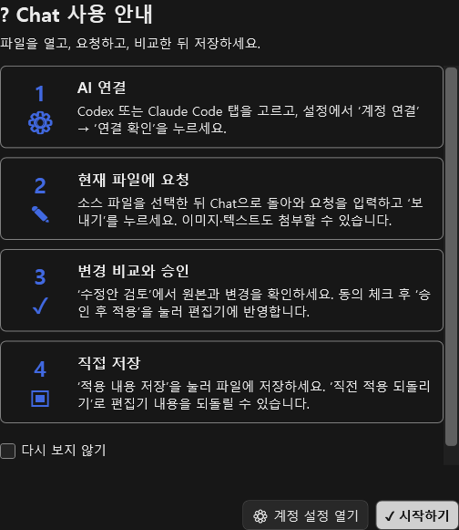
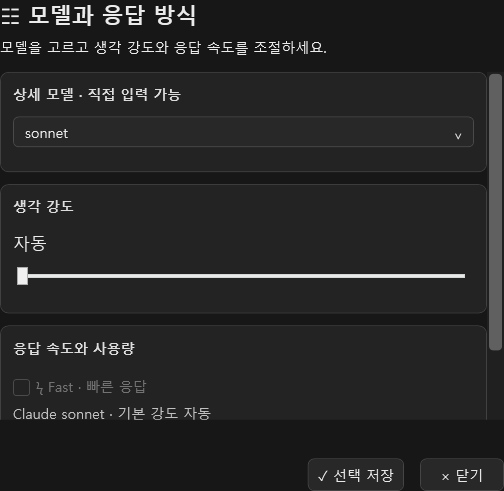
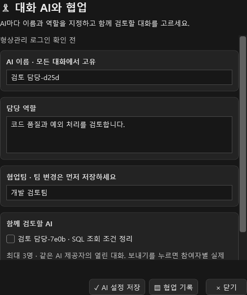

# AI Assistant 사용 안내

Claude·Codex와 대화를 이어 가고, 현재 파일의 수정안을 비교해 적용하는 방법입니다. [v0.7.0 설치 파일과 지원 조건](../releases/v0.7.0/README.md)을 확인하고 시작하세요. 현재 패키지는 VS2017 15.9 이상용입니다.

## 설치와 AI 연결

1. VS2017 15.9 이상과 사용할 AI의 Windows 네이티브 CLI `.exe`를 준비합니다. 이 프로젝트를 빌드하거나 VS 확장 개발 도구를 설치할 필요는 없습니다.
2. VSIX를 내려받고 Visual Studio를 닫은 뒤 실행합니다. 설치 후 Visual Studio를 다시 엽니다.
3. **도구 → AI Assistant**를 엽니다. 맨 위의 첫 탭은 **Claude**, 다음은 **Codex**입니다. 로고와 반투명 배경으로 현재 AI를 구분할 수 있습니다.
4. 오른쪽 위 메뉴를 펼치거나 창에서 **우클릭 → 설정**을 선택합니다. 중앙 설정 창에서 현재 AI의 CLI `.exe` 경로를 지정합니다. PATH에 있으면 비워둘 수 있습니다.
5. **계정 연결**로 공식 CLI·브라우저 인증을 진행한 뒤 **연결 확인**을 누릅니다. 이미 CLI에 로그인한 계정이 있다면 바로 연결 확인을 사용합니다.
6. 모델·공통 규칙·글자 크기를 조절하고 **설정 저장**을 누릅니다. 다른 AI는 해당 탭을 선택한 뒤 설정합니다.

설정의 CLI 환경 안내에서 설치·실행 파일 선택·로그인·연결 확인 순서를 볼 수 있습니다. `.cmd`나 `.bat` 대신 네이티브 `.exe`가 필요합니다. 확장은 AI 계정 암호·토큰을 저장하지 않습니다. 실제 인증과 모델 이용 권한·비용은 해당 CLI와 서비스 계정에 따릅니다.

공식 안내: [Codex CLI](https://developers.openai.com/codex/cli), [Claude Code 설치](https://code.claude.com/docs/en/setup), [Claude CLI 옵션](https://code.claude.com/docs/en/cli-reference).



## 처음 나타나는 사용 안내

처음 창을 열면 번호와 그림이 있는 안내에서 AI 연결 → 파일에 요청 → 변경 비교·승인 → 저장 순서를 확인합니다. **계정 설정 열기**는 연결 설정으로, **시작하기**는 대화 화면으로 이동합니다.



**다시 보지 않기**를 선택해 닫으면 다음 실행의 자동 안내를 생략합니다. 오른쪽 위 메뉴 또는 **우클릭 → 사용 안내**에서 언제든 다시 열 수 있습니다. 자동 표시를 다시 켜려면 그 화면에서 체크를 해제하고 닫으세요. 이 선택은 저장된 CLI 경로·모델·규칙을 보존합니다.

## 첫 요청과 키보드

1. 수정할 소스를 편집기에서 열거나 선택합니다. 새 문서는 먼저 파일로 저장합니다.
2. AI 창으로 돌아와 요청을 작성합니다. 마지막으로 선택한 소스 파일을 대상으로 합니다.
3. 필요하면 이미지·텍스트를 첨부하고 모델·모드를 고릅니다.
4. **Enter** 또는 보내기 버튼으로 요청합니다. 줄바꿈은 **Ctrl+Enter**입니다.
5. 응답을 읽고 같은 대화에서 후속 요청을 계속 보냅니다.

| 키 | 동작 |
|---|---|
| Enter | 요청 보내기 |
| Ctrl+Enter | 프롬프트 줄바꿈 |
| Ctrl+C | 선택한 텍스트 복사 |
| Ctrl+V | 일반 텍스트 붙여넣기 또는 이미지·파일 첨부 |
| Ctrl+S | 소스 편집기에서 파일 저장 |

```text
이 메서드에 null 처리를 추가해 주세요.
기존 메서드 이름과 API는 유지해 주세요.
```

모델 이름을 비워 두면 CLI 기본 모델을 사용합니다. **☷ 생각 강도**를 열면 선택한 모델이 지원하는 강도를 슬라이더로 조절합니다. 자동은 CLI 기본값이며 low·medium·high·xhigh·max·ultra 등의 항목은 실제 모델 지원 목록에 따라 달라집니다. Codex는 설치된 CLI 모델 캐시를 사용하고 캐시가 없거나 손상되면 기본·직접 입력 경로를 안내합니다. **ϟ Fast**는 지원 모델에서만 선택되며 응답 속도와 함께 사용량이 증가합니다. Claude Fast는 지원 Opus 모델·계정과 CLI 2.1.205 이상이 필요하고 상세 모델에는 더 높은 버전 조건이 있을 수 있습니다. 생각 강도는 정확도 점수가 아닙니다. 모델·모드의 이용 가능 여부는 계정과 CLI에 따릅니다. 실제 전달 인수는 [CLI 옵션](CLI_OPTIONS.md)을 참고하세요. **승인 요청**은 세 권한 해제, **내 대신 승인**은 형상관리·DB 허용, **전체 권한**은 배포까지 허용하는 확장 작업 프리셋입니다. 개별 작업의 계획·동의는 유지됩니다. 권한 메뉴에서는 소스 수정과 별도로 형상관리·DB 스키마·배포 작업을 허용할 수 있습니다. **권한 저장**은 세 가지 허용값을 다음 사용에도 보관하며, 체크만 바꾸면 현재 작업 창에 적용됩니다. 명령 실행에는 별도 계획 확인과 승인이 필요합니다.

사용자 요청은 오른쪽 둥근 말풍선에, AI 답변은 왼쪽 본문에 표시합니다. 위쪽에는 대화 시작 시각을 표시하고, 응답을 기다리는 동안 실제 경과 시간과 움직이는 상태 표시를 보여 줍니다. 요청을 취소하려면 중지 버튼을 누릅니다. 안내는 중앙에서 잠시 보인 뒤 사라지며, 오른쪽 위 메뉴의 최근 알림에서 다시 확인할 수 있습니다. 원본 파일은 승인·적용 전까지 유지됩니다.



## 이미지·문서·텍스트 첨부

탐색기에서 파일을 창으로 끌어 놓거나 **＋ 첨부**로 선택합니다. 탐색기에서 복사한 문서 파일이나 클립보드 이미지는 프롬프트의 **Ctrl+V**로 추가합니다. 별도 붙여넣기 버튼은 없으며 텍스트의 기본 편집 메뉴도 사용할 수 있습니다.

이미지는 프롬프트 위에 미리보기로 표시합니다. 마우스를 올리면 나타나는 **×**로 제거합니다. 키보드로 첨부 항목과 제거 동작에 접근할 수도 있습니다. 파일을 놓는 것만으로 전송되지는 않으며, 보내기를 누를 때 현재 목록을 함께 전달합니다.

| 항목 | 지원 범위 |
|---|---|
| 이미지 | PNG/JPEG, 각 2MB·최대 1,600만 픽셀 |
| 텍스트 | UTF-8 또는 BOM이 있는 Unicode, 각 100KB |
| 개수 | 최대 4개 |
| 문서 | DOCX/PPTX/XLSX·ODT/ODP/ODS·RTF·HTML, 원본 16MB·추출 본문 UTF-8 100KB |
| PC별 문서 | PDF·DOC/PPT/XLS, 해당 Windows IFilter가 필요하며 같은 크기 제한 적용 |
| 지원하지 않는 첨부 | 폴더·압축·실행 파일, 암호 문서, 텍스트가 없는 스캔 PDF |

문서는 본문을 추출해 전달합니다. 그림·서식·페이지 모양을 그대로 보내는 기능은 아닙니다. 추출 중에도 창을 사용할 수 있고 중지할 수 있습니다. 읽지 못한 파일이 있으면 해당 묶음을 부분 첨부하지 않으며 오류를 안내합니다. 스캔 PDF는 먼저 OCR로 텍스트를 넣고, 읽기 필터가 없으면 최신 Office 형식이나 텍스트로 저장해 첨부하세요.

첨부는 제거할 때까지 다음 요청에도 포함됩니다. 원본 파일을 고쳤다면 기존 항목을 제거하고 다시 첨부해야 새 내용이 반영됩니다. 대화를 재실행해 복원할 때 첨부 원본은 복원하지 않으므로 필요한 자료를 다시 추가하세요.

## 대화 AI 이름과 협업

1. 같은 AI 제공자 안에 검토용 대화를 만들고 **♙ AI 이름**에서 고유 이름과 담당 역할을 저장합니다. 대화 제목과 AI 이름은 별개입니다.
2. 함께 일할 AI는 동일한 협업팀 이름을 사용합니다. 팀을 바꿀 때는 참여자를 먼저 해제하고 새 팀을 저장한 뒤 다시 엽니다.
3. 주 담당 대화에서 같은 팀의 열린 대화를 최대 3개 선택해 저장합니다. 보내기 전 선택 인원과 역할을 확인합니다.
4. 요청을 보내면 동료 AI를 순서대로 실제 호출합니다. 동료 검토 결과를 받은 현재 AI가 최종 수정안을 만듭니다. 중지 버튼은 진행 중인 호출을 취소합니다.
5. 각 대화의 완료·실패·중지·읽지 않음을 확인하고 **협업 기록**을 열어 요청·회신·전달 상태를 봅니다. 최종 코드는 비교·승인 후 적용하고 별도로 저장합니다.

협업은 참여자 수만큼 AI 호출·사용량이 늘어납니다. 각 AI는 동일한 원본과 현재 첨부를 받으며, 동료 검토 공유 요청은 5,000자, 회신은 10,000자까지 전달하고 초과 부분의 생략을 표시합니다. 최종 AI에는 전체 원래 요청과 8,000자 이내의 역할·동료 결과를 전달합니다. 협업 중 원본이 달라지면 적용하지 않고 중단합니다. 참여 대화를 닫거나 팀을 바꾸었다면 다시 선택해야 합니다.

기본 이름은 로그인 확인된 GitHub 계정이나 명확히 선택할 수 있는 Git Credential Manager 저장 계정이 있으면 `계정::Codex-ID` 또는 `계정::Claude-ID` 형태입니다. 저장 계정은 서버 인증을 재확인한 상태와 구분해 표시합니다. Git 작성자 설정만으로 로그인했다고 판단하지 않으며, 직접 지정한 이름·역할은 자동 변경하지 않습니다. 계정을 확인할 수 없으면 고유 AI 기본 이름을 사용합니다.

이름·역할·팀과 실제 협업 상태는 공통 작업 폴더의 `collaboration.json`, 사람이 읽는 결과는 `collaboration-report.md`에 남습니다. 대화 Markdown에는 선택한 참여자 ID를 보관합니다. 토큰·암호·첨부 원본은 이 메타데이터에 저장하지 않습니다.



## 대화 목록·이름·닫기·불러오기

AI 탭 아래의 대화 목록을 선택해 대화를 전환합니다. 목록 오른쪽 세로 경계를 드래그하면 폭을 조절할 수 있습니다. 왼쪽 끝으로 끌어 접은 뒤 **☰**로 펼치면 마지막 유효 폭으로 복원됩니다. 경계에 키보드 포커스를 옮긴 뒤 좌우 방향키로도 조절할 수 있습니다. 폭·숨김 선택은 다음 실행에 복원되며 창이 좁을 때는 목록이 메시지 영역 위에 표시되어 입력란을 가리지 않습니다.

| 표시 | 의미 |
|---|---|
| ◌ 파란 진행 표시 | 해당 대화의 실제 요청 처리 중 |
| ● 파란 점 | 보지 않은 응답이 있음 |
| ✓ | 요청 완료 |
| ! 빨간 표시 | 요청 실패 |
| ■ 노란 표시 | 사용자가 요청 중지 |
| ! 노란 표시 | 이전 실행에서 요청이 중단됨 |
| ○ | 아직 요청하지 않은 대화 |

실패·중지 표시의 툴팁에서도 읽지 않음을 구분합니다. 대화를 직접 선택하거나 본문을 클릭·스크롤·키보드로 확인하면 현재 대화만 읽음 처리합니다. 다른 소스 탭이나 앱에서 작업하느라 보지 않은 응답의 점은 남아 있습니다. 완료는 AI 응답 수신 상태이며 코드 적용·저장은 별도로 승인해야 합니다. 상태와 읽지 않음은 Markdown에 저장하고, 재시작 후 계속 실행 중인 것처럼 표시하지 않습니다.

**새 대화**는 현재 기록을 지우지 않고 새 항목을 추가합니다. AI별 대화·작성 중 요청을 분리해 저장합니다.

첫 질문에서 제목을 자동으로 만듭니다. 직접 이름을 바꾸면 이후 질문으로 덮어쓰지 않습니다. 제목은 한 줄 최대120자이며, 화면 폭을 넘으면 줄임표로 표시하고 전체 제목을 툴팁으로 확인합니다.

항목의 **우클릭 → 닫기**는 다음 시작의 자동 복원 대상에서 제외합니다. 원본 Markdown 파일은 보관합니다. **대화 불러오기**로 같은 AI의 보관 파일을 선택하면 다시 열 수 있습니다. 다른 AI 파일은 해당 AI 탭에서 불러오세요.

기본 저장 위치:

```text
%LOCALAPPDATA%\VS2017AIAssistant\workspace\
  instructions.md
  conversations\claude\<대화 식별자>.md
  conversations\codex\<대화 식별자>.md
```

대화에는 front matter의 제목·날짜·AI·열림 상태와 실제 메시지·작성 중 요청이 들어갑니다. 저장 파일은 사용자가 읽을 수 있는 Markdown입니다. AI별 최대500개 파일(닫은 기록 포함), 파일당4MB와 각 대화의 최근100개 메시지를 보관합니다. 한도에 도달하면 오래된 Markdown을 별도 폴더로 옮겨 보관할 수 있습니다. 손상된 파일은 오류 안내와 함께 건너뛰고 유효한 기록을 계속 불러옵니다.

대화 원문과 소스 일부가 응답에 포함되었다면 로컬 기록에도 남을 수 있습니다. 첨부 원본·이미지 바이트·AI 인증 정보는 기록에 저장하지 않습니다. 저장 파일을 옮기거나 공유할 때는 내용을 확인하세요. 메시지 경계와 문자 수를 사용하는 자체 기록 형식이므로 임의로 구분자를 고치지 말고, 이름 변경·닫기는 화면 기능을 사용하세요.

## 공통 instruction과 설정

instruction은 모든 프로젝트에서 반복 사용할 규칙입니다. 응답 언어, 프레임워크, 유지할 API와 코딩 규칙을 적습니다. 최대8000자이며 창 크기에 맞춰 입력 영역이 늘어나고 긴 내용은 스크롤할 수 있습니다.

```text
응답은 한국어로 작성해 주세요.
C# 7.0과 .NET Framework 4.6.2에서 빌드할 수 있어야 합니다.
기존 메서드 이름과 매개변수를 유지해 주세요.
```

설정 저장 시 공통 규칙은 `workspace\instructions.md`에 Markdown으로 보관합니다. 요청할 때 디스크의 공통 규칙을 다시 읽으므로 다른 프로젝트나 외부 편집기에서 저장한 변경도 반영됩니다. AI별 경로·모델·글자 크기·안내 표시 등 기본 설정은 `%LOCALAPPDATA%\VS2017AIAssistant\settings.json`에 저장합니다. 이전 버전의 저장된 규칙도 새 Markdown 흐름으로 이어집니다.

설정 저장에 성공하면 창이 닫힙니다. 저장 전 **닫기·Esc·X**는 이번 설정 입력을 취소합니다. CLI에서 이미 마친 계정 로그인은 설정 취소와 별개입니다. 저장 실패는 팝업 안에 표시하며 이전 파일을 유지합니다.

## 수정안 확인·소스로 이동·저장

답변 아래 변경 카드에서 대상 파일과 추가·삭제 내용을 확인합니다. 파일 링크를 누르면 그 소스로 이동합니다. 변경 비교·원본·수정안으로 전체 결과를 읽고, 적용 동의에 체크한 뒤 **승인 후 적용**을 누릅니다. 이후 **적용 내용 저장** 또는 소스 편집기에서 **Ctrl+S**로 저장합니다.

적용은 편집기 버퍼를 바꾸며 자동 저장하지 않습니다. 다른 파일을 열더라도 요청 당시 대상 파일을 유지합니다. 요청 후 사용자가 편집했거나 디스크 원본이 달라지면 적용을 거부하므로 새 상태로 다시 요청하세요. 새 수정안에는 이전 승인을 재사용하지 않습니다.

**직전 적용 되돌리기**는 마지막 적용 전의 버퍼로 복구하며, 그때 있던 미저장 편집도 보존합니다. 복구 후 디스크에 반영하려면 다시 저장합니다. Visual Studio의 **Ctrl+Z**도 사용할 수 있습니다. 중지 버튼은 진행 중 요청을 취소하며 이미 적용한 내용을 되돌리는 동작은 아닙니다.

## DB 구조를 참고한 SQL 작성

1. 프로젝트 작업의 DB 탭에서 **SQL Server 스키마 읽기 허용**을 선택합니다.
2. 서버와 데이터베이스를 포함한 연결 문자열을 입력합니다. 예: `Server=localhost;Database=Sample;Integrated Security=true;`
3. **스키마 읽기**를 누르고 읽어 온 테이블·열 정의를 먼저 확인합니다.
4. SQL 작성 요청을 적은 뒤 **미리본 스키마를 AI 요청에 넣기**를 선택합니다.
5. 대상 SQL 파일을 열어 AI에게 보내고, 생성한 쿼리를 비교·승인·저장합니다.

연결 정보는 이 창 수명 동안만 사용하며 설정·대화에 저장하거나 AI에게 전달하지 않습니다. DB는 허용된 계정으로 테이블·열 메타데이터만 읽고 실제 행은 조회하지 않습니다. 최대512열·약12000자까지 참고하고 SQL 작성 요청은2000자까지 입력합니다. 범위를 넘는 스키마는 잘림을 표시합니다. 입력란에 넣어 전송한 스키마는 대화 기록에도 포함됩니다. 생성한 SQL을 DB에 실행하지 않습니다. 다른 엔진 연결과 SQL 실행은 현재 범위에 포함되지 않습니다.

## Git·SVN·TFVC와 배포

프로젝트 작업 창에서 작업 종류, 프로젝트 폴더와 CLI 실행 파일을 지정합니다. CLI 경로를 비우면 PATH의 `git.exe`, `svn.exe`, `tf.exe`를 사용합니다. 해당 저장소의 인증·작업 사본/워크스페이스는 각 CLI에서 먼저 준비합니다.

| 작업 | 입력과 동작 |
|---|---|
| Git fetch | 선택한 원격의 변경을 받음 |
| Git pull | 현재 브랜치를 fast-forward 방식으로 최신화 |
| Git checkout | 명시한 기존 브랜치로 전환 |
| Git commit | 메시지와 지정한 기존 추적 파일만 커밋 |
| Git push | 선택한 원격으로 현재 브랜치 반영 |
| SVN update | 현재 작업 사본 최신화 |
| SVN checkout | 저장소 URL에서 아직 없는 프로젝트 하위 폴더로 새 사본 받기 |
| SVN commit | 지정 파일과 메시지로 체크인 |
| TFVC get·checkout·checkin | 현재 워크스페이스의 최신 버전 받기·선택 파일 체크아웃·체크인 |
| 배포 | 지정한 네이티브 실행 파일과 인수를 프로젝트 폴더에서 실행 |

1. 형상관리 또는 배포 권한을 해당 작업에 맞게 선택합니다.
2. 필요한 브랜치·원격·메시지·파일을 입력합니다. 파일은 프로젝트 상대 경로로 한 줄에 하나씩 적습니다. 폴더 전체·와일드카드는 사용하지 않습니다.
3. **실행 계획 확인**을 눌러 폴더와 정확한 명령·인수를 읽습니다.
4. 실행 동의에 체크하고 **확인한 작업 실행**을 누릅니다. 입력을 바꾸면 다시 계획을 확인합니다.
5. 종료 코드와 결과를 확인합니다. 진행 중에는 **실행 중지**를 사용할 수 있습니다.

배포 인수는 한 줄이 인수 하나이며 따옴표로 다시 감싸지 않습니다. 커밋·체크인·push·배포는 실제 로컬/원격에 반영됩니다. 확장은 실패·취소를 성공으로 표시하지 않습니다. 시간 초과나 네트워크 중단은 서버 쪽 작업 완료 여부까지 되돌리지 않으므로 결과를 확인한 뒤 재시도합니다.

## 문제 해결

| 증상 | 확인할 내용 |
|---|---|
| 설치 대상이 없음 | VS2017 15.9 이상인지 확인. 현재 VSIX는 VS2019/2022용이 아님 |
| CLI를 찾지 못함 | 올바른 Windows 네이티브 .exe 또는 PATH 확인 |
| 모델·모드 요청 실패 | 해당 CLI 버전·모델 이용 권한과 이름 확인, 기본값으로 재시도 |
| Enter로 줄바꿈되지 않음 | 줄바꿈은 Ctrl+Enter, Enter는 보내기 |
| 이미지 제거 버튼이 안 보임 | 미리보기에 마우스를 올리거나 키보드로 항목에 이동 |
| 이전 대화가 안 나타남 | 현재 AI 탭과 대화 저장 위치, 닫힌 항목의 불러오기 확인 |
| 기록 저장 실패 | 로컬 파일 쓰기 권한·저장 한도 확인. 현재 대화는 그대로 두고 재시도 |
| 수정안 적용 실패 | 현재 소스와 외부 변경을 확인한 뒤 다시 요청 |
| DB 스키마를 못 읽음 | DB 권한 선택, 서버·DB·계정의 메타데이터 읽기 권한 확인 |
| 형상관리 명령 실패 | CLI 설치, 인증, 프로젝트 폴더, 추적 파일·브랜치 상태 확인 |
| Visual Studio 라이선스 안내 | AI 계정과 별개. [IDE 로그인 안내](BUILD_AND_LICENSE.md) 참고 |

저장소 전체를 받은 환경에서는 최상위 [VisualStudio_AIChat_ExtentionTest.exe](../VisualStudio_AIChat_ExtentionTest.exe)를 실행해 검사 항목을 선택하고 결과·로그를 확인할 수 있습니다. 실행 기록은 `artifacts/tl/<실행 ID>/launcher.log`와 `summary.txt`에도 남습니다. 기본 전체 검사13개는 실제 IDE·AI 계정을 사용하지 않으며, 해당 항목은 직접 선택합니다. VSIX를 설치해 AI Assistant를 사용하는 것과 테스트 실행에 필요한 개발 도구는 별개입니다.

문제 보고에는 IDE·확장·CLI 버전, 작업 순서와 오류 문구를 포함하세요. [개발 문서](DEVELOPMENT.md)와 [이번 검증 보고](../MarkdownReport/CodexOrig_TASK-016.md)에서 자동 검사·실계정/서버 검증 범위를 구분합니다.
