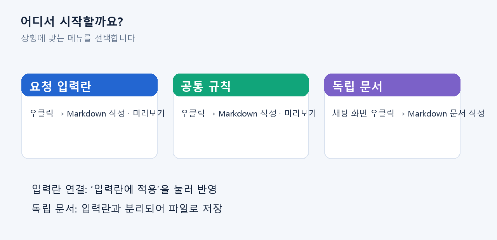
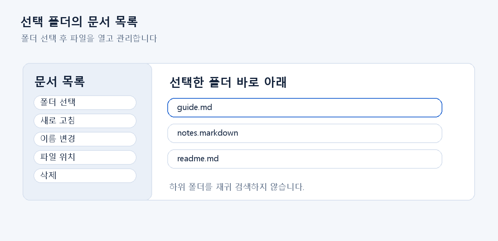
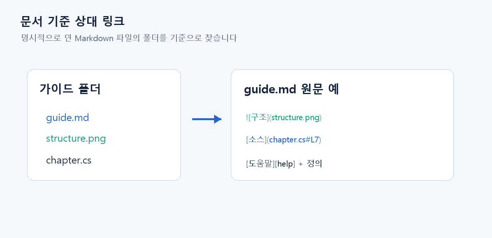

# Markdown 작성기 사용 설명서

> TASK-028 3차 감사 후속 사용자 안내 부록 · Markdown 작성기 R3-03 후보 기능 기준 · 2026-10-19  
> 기능 내용은 candidate6 소스 구현을 확인해 작성했습니다. 통합 회귀와 최종 설치 패키지 확인이 끝나기 전의 검토용 부록이므로, 고객 배포판에 포함하기 전에 최종 UI와 다시 대조해야 합니다. 아래 그림은 실제 화면 캡처가 아니라 메뉴 위치와 흐름을 설명하는 도식입니다.

## 1. 작성기를 여는 방법

요청 입력란이나 공통 규칙을 편집할 때는 해당 입력란에서 마우스 오른쪽 버튼을 누르고 **Markdown 작성 · 미리보기**를 선택합니다. 독립된 Markdown 파일을 만들거나 수정하려면 채팅 화면에서 마우스 오른쪽 버튼을 누르고 **Markdown 문서 작성**을 선택합니다.

입력란에 연결된 작성기에서는 **입력란에 적용**을 눌러야 편집한 원문이 요청 입력란 또는 규칙에 반영됩니다. 창을 닫는 것은 AI 요청 전송이나 규칙 저장을 뜻하지 않습니다. 독립 문서는 입력란과 별개로 작성하고 파일로 저장합니다.

## 2. 편집, 미리보기, 분할 보기

작성기 상단의 **편집**, **미리보기**, **분할** 탭으로 보기 방식을 고릅니다. 분할 보기에서는 가운데 경계를 끌어 편집 영역과 결과 영역의 폭을 조절할 수 있습니다. 원문을 고친 뒤 결과가 예상대로 바뀌는지 미리보기에서 확인합니다.

## 3. 편집 도구와 단축키

상단 도구로 굵게, 기울임, 링크, 코드, 체크 목록을 삽입할 수 있습니다. 실행 취소·다시 실행, 찾기, 자동 줄바꿈도 사용할 수 있습니다. Ctrl+휠로 표시 크기를 60~200% 범위에서 조절합니다.

| 작업 | 단축키 |
|---|---|
| 굵게 / 기울임 / 링크 | Ctrl+B / Ctrl+I / Ctrl+K |
| 체크 목록 만들기 / 완료 전환 | Ctrl+Shift+C / Ctrl+Enter |
| 찾기 / 다음 / 이전 | Ctrl+F / F3 / Shift+F3 |
| 실행 취소 / 다시 실행 | Ctrl+Z / Ctrl+Y |
| 자동 줄바꿈 | Alt+Z |
| 분할 보기 전환 | Ctrl+Shift+V |

이 단축키는 Markdown 작성기 안에서만 적용됩니다. 대화 입력란의 Enter 또는 Ctrl+Enter 동작과 구분해 사용하세요. 검색의 대/소문자, 단어 단위, 정규식 조건은 찾기 영역에서 선택할 수 있습니다.

## 4. 문서 목록과 폴더

**문서 목록**을 펼치고 **폴더 선택**을 눌러 Markdown 파일을 둘 로컬 폴더를 지정합니다. 목록에서 파일을 선택하거나 Enter를 눌러 열 수 있습니다. **새로 고침**은 현재 폴더의 목록을 다시 읽습니다.

목록은 선택한 폴더의 바로 아래에 있는 `.md` 및 `.markdown` 파일을 보여 줍니다. 하위 폴더까지 재귀적으로 검색하지 않습니다. **이름 변경**, **파일 위치**, **삭제**는 선택된 파일에 적용됩니다. 삭제는 확인 단계에서 **삭제 확인**을 선택해야 진행됩니다.

## 5. 저장과 변경 내용 보호

새 문서는 **새 문서**로 시작합니다. **열기**로 UTF-8 Markdown 파일을 열고, **저장** 또는 Ctrl+S로 현재 문서에 저장합니다. 저장 경로가 아직 없는 새 문서라면 저장 위치와 파일명을 선택합니다. **다른 이름으로 저장** 또는 Ctrl+Shift+S는 새 경로로 저장합니다.

수정 후 저장하지 않은 상태에서 새 문서·파일 열기·닫기 등으로 이동하려 하면 확인 행이 나타납니다. 현재 내용을 유지하려면 **취소**, 버리고 이동하려면 **버리고 계속**을 선택합니다. UTF-8 파일을 사용하며, 파일은 최대 128Ki 문자, 저장 파일은 최대 512KiB까지 지원합니다.

## 6. 참조 링크와 로컬 이미지

링크 도구 또는 Markdown 원문으로 링크와 이미지를 추가할 수 있습니다. 명시적으로 열어 둔 문서에서는 상대 링크와 상대 이미지가 그 문서가 있는 폴더를 기준으로 해석됩니다. 예를 들어 문서와 그림이 같은 폴더에 있으면 ``와 같이 쓸 수 있습니다. 참조 링크는 `[도움말][help]`와 `[help]: guide.md` 형태를 사용할 수 있습니다.

웹 링크는 사용자가 미리보기에서 직접 선택했을 때만 열립니다. 원격 이미지나 문서를 자동으로 가져오지 않습니다. 파일 링크는 로컬 안전 경로 검사를 거치므로 네트워크 경로, 연결 폴더, 임의 경로는 제한될 수 있습니다.

## 7. HTML 미리보기와 지원 범위

제목, 문단, 목록, 표, 인라인 강조, 코드와 링크 등 자주 쓰는 Markdown 구문을 확인할 수 있습니다. 일부 정적 HTML도 제한된 범위에서 표시합니다. 작성기는 모든 CommonMark 확장이나 임의 HTML을 지원하지 않습니다.

스크립트, 스타일시트, iframe, 개체 삽입과 원격 리소스 로딩은 실행하지 않습니다. HTML 미리보기는 문서 안내와 간단한 표를 확인하는 용도이며, 웹 페이지를 그대로 실행하는 브라우저가 아닙니다. SQL 및 일부 소스 코드 블록은 미리보기에서 구문 색상을 표시합니다.

## 그림 설명

모든 그림은 실제 제품 화면이 아니라 안내용 UI 도식입니다. 최종 고객 배포본을 만들 때 candidate 최종본의 실제 라벨, 메뉴 위치, 회귀 확인 결과를 대조한 뒤 캡처 이미지로 교체하거나 도식임을 유지해 주세요.

