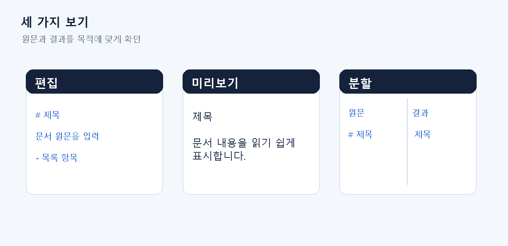
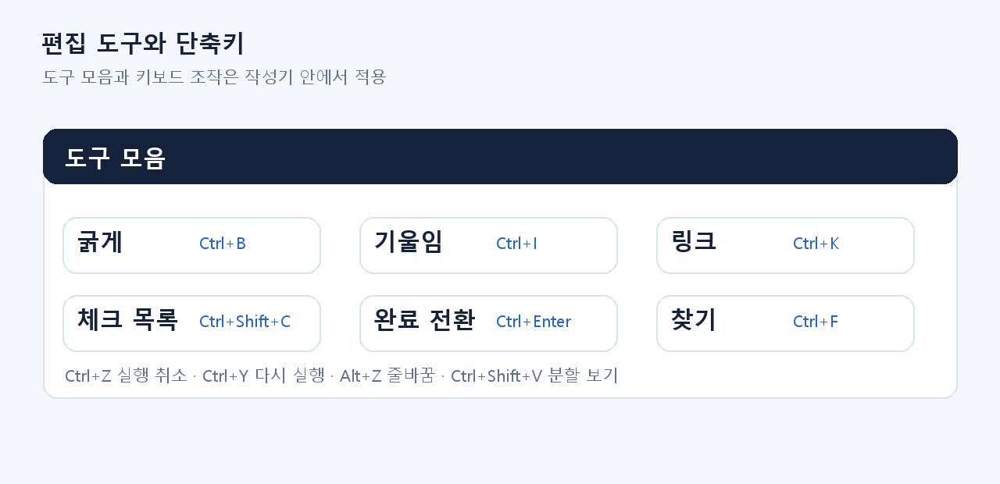
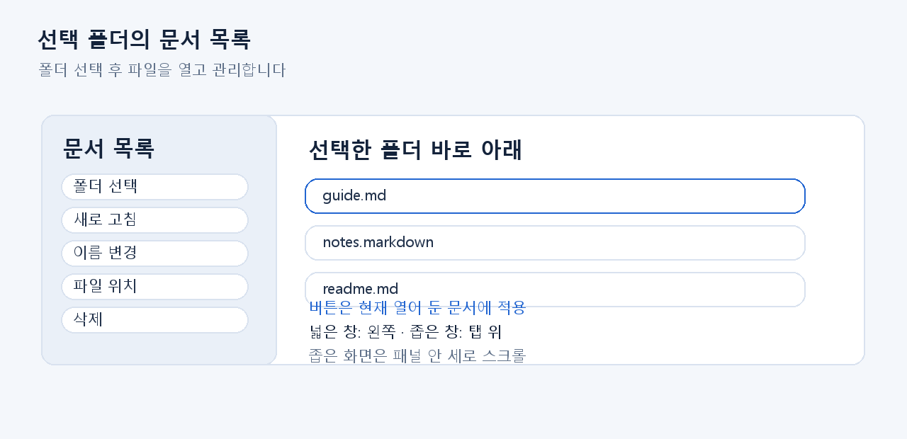
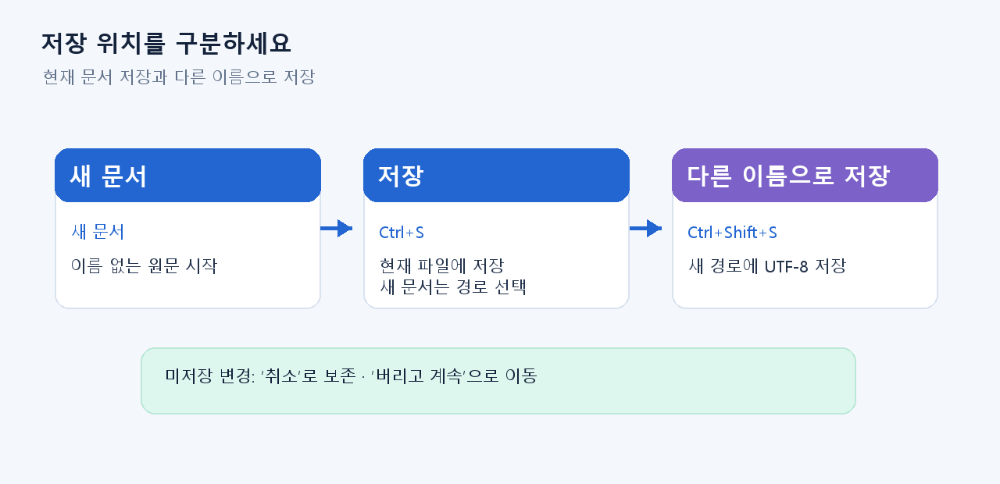
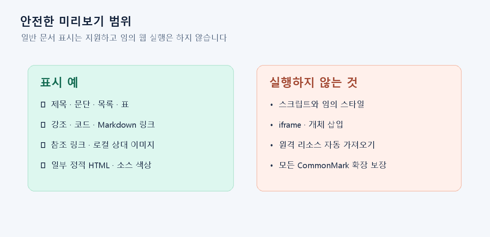
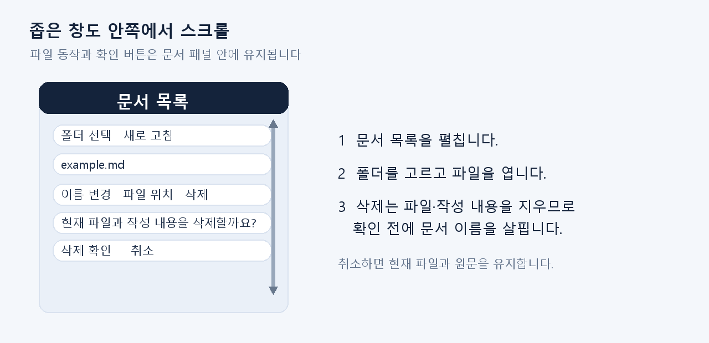

# Markdown 작성기 사용 설명서

> 3차 감사 후속 사용자 안내 개정 C7 · 2026-10-19  
> 기준 VS2017 Release DLL SHA-256 `9749270FFFA7053C2E4EC2FCCAF0D9DE2DEE09FA77FAD45228947CF3E064935F`. 세 SKU(2017·2019·2022)의 C7 실제 DLL은 문서 UI 검사에서 각각 117/117 통과했습니다. 2017 그림은 제품 WPF 구성요소를 별도 STA 검사에서 렌더한 결과입니다. 창 표시·실제 IDE 검사는 하지 않았으며, 세 IDE 통합 검사와 구분합니다. 최초 실행은 중첩 Section 안의 HTML 표를 찾지 못하는 검사 전제로 105/108에서 멈췄습니다. 재귀 검색을 적용한 검사기에서 세 SKU를 다시 확인했으며, 최초 실패와 원본 결과도 보존했습니다. 별도 후속 감사의 HTML 21/21도 C7에서 통과했습니다.

## 1. 작성기를 여는 방법

요청 입력란이나 공통 규칙을 편집할 때는 해당 입력란에서 마우스 오른쪽 버튼을 누르고 **Markdown 작성 · 미리보기**를 선택합니다. 독립된 Markdown 파일을 만들거나 수정하려면 채팅 화면에서 마우스 오른쪽 버튼을 누르고 **Markdown 문서 작성**을 선택합니다.

입력란에 연결된 작성기에서는 **입력란에 적용**을 눌러야 편집한 원문이 요청 입력란 또는 규칙에 반영됩니다. 창을 닫는 것은 AI 요청 전송이나 규칙 저장을 뜻하지 않습니다. 독립 문서는 입력란과 별개로 작성하고 파일로 저장합니다.

## 2. 편집, 미리보기, 분할 보기

작성기 상단의 **편집**, **미리보기**, **분할** 탭으로 보기 방식을 고릅니다. 분할 보기에서는 가운데 경계를 끌어 편집 영역과 결과 영역의 폭을 조절할 수 있습니다. 원문을 고친 뒤 결과가 예상대로 바뀌는지 미리보기에서 확인합니다.

## 3. 편집 도구와 단축키

상단 도구로 굵게, 기울임, 링크, 코드, 체크 목록을 삽입할 수 있습니다. 실행 취소·다시 실행, 찾기, 자동 줄바꿈도 사용할 수 있습니다. Ctrl+휠로 표시 크기를 60~200% 범위에서 조절합니다.

| 작업 | 단축키 |
|---|---|
| 굵게 / 기울임 / 링크 | Ctrl+B / Ctrl+I / Ctrl+K |
| 체크 목록 만들기 / 완료 전환 | Ctrl+Shift+C / Ctrl+Enter |
| 찾기 / 다음 / 이전 | Ctrl+F / F3 / Shift+F3 |
| 실행 취소 / 다시 실행 | Ctrl+Z / Ctrl+Y |
| 자동 줄바꿈 | Alt+Z |
| 분할 보기 전환 | Ctrl+Shift+V |

이 단축키는 Markdown 작성기 안에서만 적용됩니다. 대화 입력란의 Enter 또는 Ctrl+Enter 동작과 구분해 사용하세요. 검색의 대/소문자, 단어 단위, 정규식 조건은 찾기 영역에서 선택할 수 있습니다.

## 4. 문서 목록과 폴더

**문서 목록**은 처음에 접혀 있습니다. 펼친 다음 **폴더 선택**을 눌러 Markdown 파일을 둘 로컬 폴더를 지정합니다. 넓은 창에서는 편집 탭 왼쪽에 목록이 놓이고, 폭이 좁은 창에서는 탭 위에 놓입니다. 좁은 화면에서 패널 안의 아래 항목이 보이지 않으면 패널 안에서 세로로 스크롤하세요. 목록에서 파일을 두 번 클릭하거나 선택한 뒤 Enter를 눌러 열 수 있습니다. **새로 고침**은 현재 폴더의 목록을 다시 읽습니다.

목록은 선택한 폴더의 바로 아래에 있는 `.md` 및 `.markdown` 파일을 보여 줍니다. 하위 폴더까지 재귀적으로 검색하지 않습니다. **이름 변경**, **파일 위치**, **삭제**는 현재 열려 있는 파일에 적용됩니다. 삭제를 누르면 현재 파일과 저장하지 않은 내용을 함께 삭제하는 확인 문구가 나타납니다. 파일을 지우려면 **삭제 확인**, 그대로 유지하려면 **취소**를 누르세요. 다른 문서로 성공적으로 이동하면 이전 문서의 삭제 확인은 닫혀 새 문서에 적용되지 않습니다.

위 두 그림은 최종 Visual Studio 창을 캡처한 이미지가 아닙니다. candidate7의 제품 WPF 작성기 컨트롤을 별도 STA 검사 프로세스에서 렌더한 결과입니다. 어두운 모드, 넓은 화면 900×600과 좁은 화면 480×600의 삭제 확인 상태를 보여 줍니다. 파일 경로는 공개용 시험 폴더를 사용했습니다.

## 5. 저장과 변경 내용 보호

새 문서는 **새 문서**로 시작합니다. **열기**로 UTF-8 Markdown 파일을 열고, **저장** 또는 Ctrl+S로 현재 문서에 저장합니다. 저장 경로가 아직 없는 새 문서라면 저장 위치와 파일명을 선택합니다. **다른 이름으로 저장** 또는 Ctrl+Shift+S는 새 경로로 저장합니다.

수정 후 저장하지 않은 상태에서 새 문서·파일 열기·닫기 등으로 이동하려 하면 확인 행이 나타납니다. 현재 내용을 유지하려면 **취소**, 버리고 이동하려면 **버리고 계속**을 선택합니다. 삭제 확인은 저장 확인과 다릅니다. **삭제 확인**을 누르면 선택한 현재 파일과 작성 중인 내용이 함께 지워집니다. 삭제를 원하지 않으면 반드시 **취소**를 누르세요. UTF-8 파일을 사용하며, 파일은 최대 128Ki 문자, 저장 파일은 최대 512KiB까지 지원합니다.

## 6. 참조 링크와 로컬 이미지

링크 도구 또는 Markdown 원문으로 링크와 이미지를 추가할 수 있습니다. 명시적으로 열어 둔 문서에서는 상대 링크와 상대 이미지가 그 문서가 있는 폴더를 기준으로 해석됩니다. 예를 들어 문서와 그림이 같은 폴더에 있으면 ``와 같이 쓸 수 있습니다. 참조 링크는 `[도움말][help]`와 `[help]: guide.md` 형태를 사용할 수 있습니다.

웹 링크는 사용자가 미리보기에서 직접 선택했을 때만 열립니다. 원격 이미지나 문서를 자동으로 가져오지 않습니다. 파일 링크는 로컬 안전 경로 검사를 거치므로 네트워크 경로, 연결 폴더, 임의 경로는 제한될 수 있습니다.

## 7. HTML 미리보기와 지원 범위

제목, 문단, 목록, 표, 인라인 강조, 코드와 링크 등 자주 쓰는 Markdown 구문을 확인할 수 있습니다. 일부 정적 HTML도 제한된 범위에서 표시합니다. 작성기는 모든 CommonMark 확장이나 임의 HTML을 지원하지 않습니다.

스크립트, 스타일시트, iframe, 개체 삽입과 원격 리소스 로딩은 실행하지 않습니다. HTML 미리보기는 문서 안내와 간단한 표를 확인하는 용도이며, 웹 페이지를 그대로 실행하는 브라우저가 아닙니다. SQL 및 일부 소스 코드 블록은 미리보기에서 구문 색상을 표시합니다.

## 8. 작은 화면과 문제 해결

| 상황 | 확인 방법 |
|---|---|
| 문서 목록이 보이지 않음 | **문서 목록**을 펼치고 **폴더 선택**으로 폴더를 지정합니다. |
| 파일이 목록에 없음 | 선택 폴더 바로 아래의 `.md`·`.markdown`만 표시합니다. **새로 고침**으로 다시 읽습니다. |
| 좁은 창에서 아래 버튼이 안 보임 | 문서 패널 위에 마우스를 두고 안쪽을 세로로 스크롤합니다. 가로 스크롤은 사용하지 않습니다. |
| 삭제 확인이 잘못 열림 | **취소**를 누릅니다. 파일과 작성 내용은 그대로 유지됩니다. |
| 파일을 열거나 저장하지 못함 | 상태 안내를 확인하고 로컬 경로·UTF-8 형식·크기·폴더 쓰기 권한을 확인합니다. 작업에 실패하면 기존 문서를 유지한 채 다시 시도합니다. |
| 링크가 열리지 않음 | 링크의 로컬 경로와 파일 위치를 확인합니다. 네트워크 경로·연결 폴더는 제한될 수 있습니다. |

## 그림 설명

01~07, 10번은 안내용 도식입니다. 08~09번은 candidate7 제품 DLL에서 렌더한 컨트롤 화면이며, 창 표시·IDE 실제 캡처는 아닙니다. 보정된 문서 UI 검사는 세 SKU에서 각각 117/117 통과했고 HTML 21/21 후속 감사도 통과했습니다. 최초 105/108 실패 기록과 보정 전 렌더는 감사 흔적으로 보존했습니다. 세 IDE 통합 확인이 끝난 뒤 고객 배포본으로 확정하세요.

