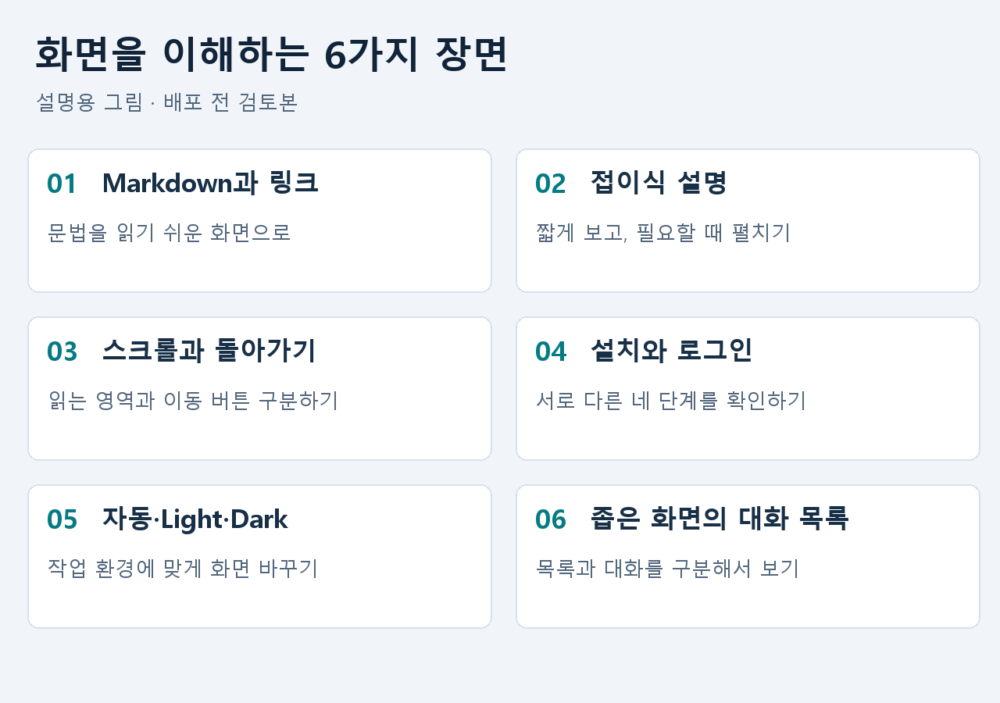
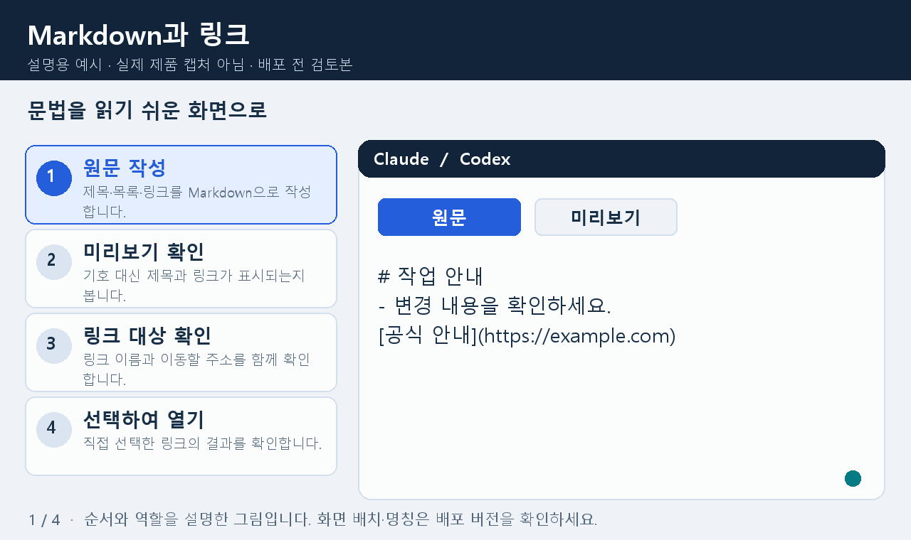
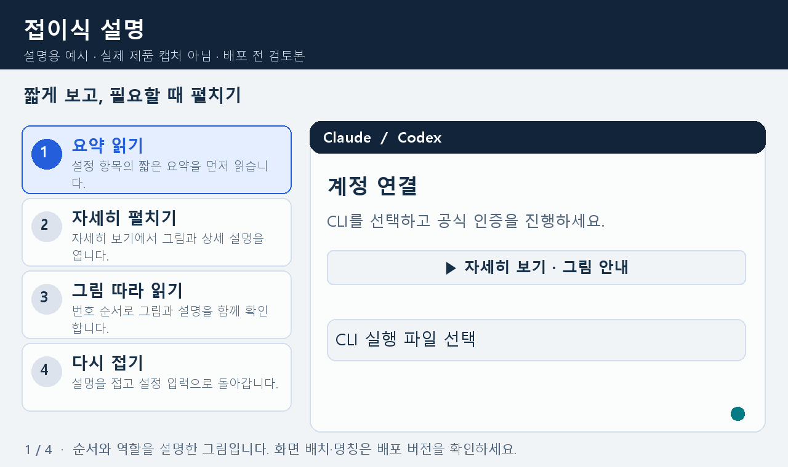
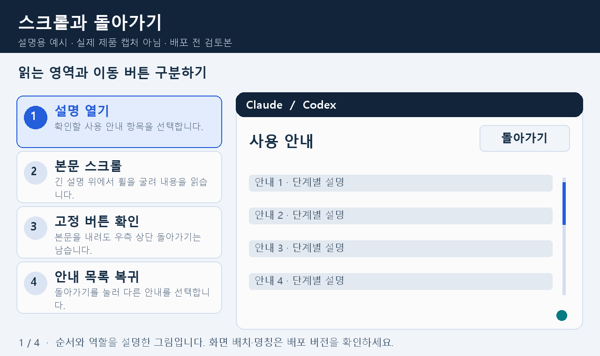
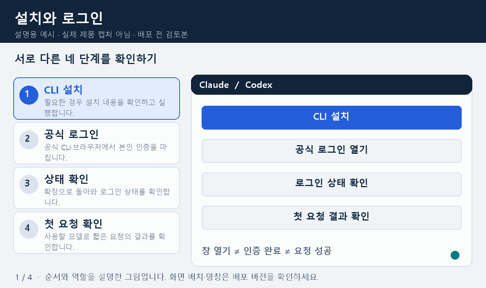
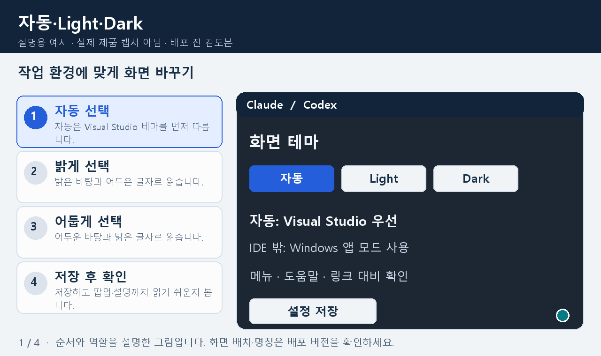
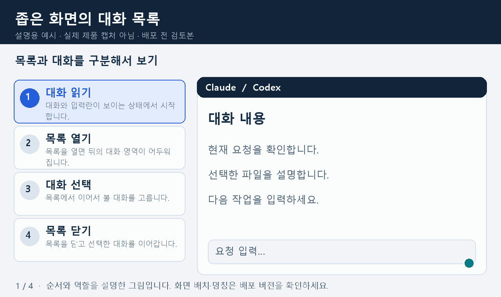

# 화면 이해 가이드

Visual Studio AI Assistant

**배포 전 검토본 · 2026-10-19**

화면의 역할과 사용 순서를 그림으로 확인하세요. 모든 그림은 설명용 예시이며 실제 제품을 촬영한 화면이 아닙니다. 새 화면의 배치와 기능 반영 여부는 함께 제공되는 배포 버전에서 확인해야 합니다.

이 자료는 기존 설치·시작 설명서의 보완안입니다. CLI 설치 명령과 배치 파일 옵션은 기존 HowToInstallCLI.md를 함께 확인하세요. 기존 설명서와 설치 파일의 동작을 바꾸지 않습니다.

Markdown과 PDF는 같은 원문의 안내·단계·캡션을 사용합니다. Markdown에서는 GIF를, PDF에서는 같은 순서의 4단계 정지 그림을 보여 줍니다. 동봉 gallery.html에서도 재생·정지를 선택할 수 있습니다.

<!-- page -->

## 01. 필요한 안내부터 찾으세요

기능 이름보다 하려는 일을 먼저 고르세요. 새 화면에 대한 아래 안내는 배포 전 검토용입니다.

| 하려는 일 | 볼 안내 |
|---|---|
| 문법 기호 대신 읽기 쉬운 답변 보기 | 02. Markdown과 링크 |
| 긴 설정 설명을 필요한 만큼 읽기 | 03. 접이식 설명 |
| 설명을 읽고 이전 목록으로 돌아가기 | 04. 스크롤과 돌아가기 |
| CLI 준비와 계정 인증 구분하기 | 05. 설치와 로그인 |
| 밝기와 글자 대비 조절하기 | 06. 자동·Light·Dark |
| 작은 창에서 다른 대화 고르기 | 07. 좁은 화면의 대화 목록 |
| 그림·연결 문제 확인하기 | 08. 문제 확인 |
| 전달 전에 설명과 화면을 맞춰 보기 | 09. 확인 목록과 공식 안내 |

**버튼은 역할이 다릅니다.** PDF 설명서는 읽는 동작, CLI 설치는 확인 후 도구를 설치하는 동작, 공식 로그인 열기는 인증을 시작하는 동작입니다. 색상 외에도 버튼 이름과 아이콘을 확인하세요.

**성공 표시도 구분하세요.** 설치 성공은 CLI 준비, 로그인 정보 확인은 인증 상태, 첫 요청 성공은 해당 모델의 실제 응답 결과를 뜻합니다.

<!-- page -->

## 02. Markdown과 링크

제목·목록·링크를 읽기 쉬운 형태로 확인하는 순서입니다. 공통 규칙이나 문서를 편집할 때 원문과 미리보기를 나누어 확인하세요.

1. **원문 작성** - 제목·목록·링크를 Markdown으로 작성합니다.
2. **미리보기 확인** - 기호 대신 제목과 링크가 표시되는지 봅니다.
3. **링크 대상 확인** - 링크 이름과 이동할 주소를 함께 확인합니다.
4. **선택하여 열기** - 직접 선택한 링크의 결과를 확인합니다.

웹 링크와 소스 파일 링크는 목적지가 다릅니다. 파일 링크는 올바른 파일·위치가 열리는지 확인하세요. 그림의 example.com은 설명을 위한 예시 주소입니다.

<!-- page -->

## 03. 접이식 설명

설정은 짧은 요약으로 시작하고, 필요한 항목만 펼쳐 그림과 상세 설명을 읽는 방식으로 안내합니다.

1. **요약 읽기** - 설정 항목의 짧은 요약을 먼저 읽습니다.
2. **자세히 펼치기** - 자세히 보기에서 그림과 상세 설명을 엽니다.
3. **그림 따라 읽기** - 번호 순서로 그림과 설명을 함께 확인합니다.
4. **다시 접기** - 설명을 접고 설정 입력으로 돌아갑니다.

설명을 펼치거나 접는 동작과 설정 저장은 별개입니다. 값을 바꿨다면 설정 저장을 선택하세요. 애니메이션을 보지 않아도 단계별 문장으로 순서를 확인할 수 있습니다.

<!-- page -->

## 04. 스크롤과 돌아가기

긴 본문을 읽는 동작과 이전 안내로 돌아가는 동작을 구분합니다. 돌아가기 버튼의 위치는 화면 개선안의 기준입니다.

1. **설명 열기** - 확인할 사용 안내 항목을 선택합니다.
2. **본문 스크롤** - 긴 설명 위에서 휠을 굴려 내용을 읽습니다.
3. **고정 버튼 확인** - 본문을 내려도 우측 상단 돌아가기는 남습니다.
4. **안내 목록 복귀** - 돌아가기를 눌러 다른 안내를 선택합니다.

마우스를 올려 나타난 상세 화면은 포인터를 그 안에 두고 스크롤하세요. 내용이 잘리거나 뒤의 대화만 움직이면 화면 크기와 발생 위치를 함께 알려 주세요.

<!-- page -->

## 05. 설치와 로그인

CLI 준비, 계정 인증, 상태 확인, 실제 응답은 각각 확인할 단계입니다. 아래 흐름에서 설치가 이미 끝났다면 공식 로그인 단계부터 진행하세요.

1. **CLI 설치** - 필요한 경우 설치 내용을 확인하고 실행합니다.
2. **공식 로그인** - 공식 CLI·브라우저에서 본인 인증을 마칩니다.
3. **상태 확인** - 확장으로 돌아와 로그인 상태를 확인합니다.
4. **첫 요청 확인** - 사용할 모델로 짧은 요청의 결과를 확인합니다.

Codex는 `codex login`과 `codex login status`, Claude는 `claude auth login`과 `claude auth status`로 인증 절차와 상태를 확인할 수 있습니다. 창이 열린 사실만으로 로그인 성공을 판단하지 않습니다. [OpenAI 공식 CLI 안내](https://learn.chatgpt.com/docs/cli/reference), [Claude 공식 CLI 안내](https://code.claude.com/docs/en/cli-reference).

비밀번호는 공식 인증 화면에서 입력하세요. 실제 모델 이용 권한·구독·과금은 사용하는 계정과 조직 정책에 따라 확인해야 합니다.

<!-- page -->

## 06. 자동·Light·Dark

자동은 Visual Studio 테마를 우선 따르는 화면 개선안입니다. IDE 밖에서는 Windows 앱 모드를 기준으로 삼습니다. 직접 선택한 Light·Dark는 자동보다 우선합니다.

1. **자동 선택** - 자동은 Visual Studio 테마를 먼저 따릅니다.
2. **밝게 선택** - 밝은 바탕과 어두운 글자로 읽습니다.
3. **어둡게 선택** - 어두운 바탕과 밝은 글자로 읽습니다.
4. **저장 후 확인** - 저장하고 팝업·설명까지 읽기 쉬운지 봅니다.

설정의 화면 표시에서 선택하고 저장하세요. 메뉴·도움말·링크·선택 표시가 배경과 구분되는지 함께 확인합니다. 이 그림은 Visual Studio나 Windows 전체 설정을 변경하는 절차가 아닙니다.

<!-- page -->

## 07. 좁은 화면의 대화 목록

작은 창에서는 대화 목록이 본문 위에 나타날 수 있습니다. 목록이 열렸음을 알 수 있도록 뒤의 대화가 어두워지는 화면 개선안입니다.

1. **대화 읽기** - 대화와 입력란이 보이는 상태에서 시작합니다.
2. **목록 열기** - 목록을 열면 뒤의 대화 영역이 어두워집니다.
3. **대화 선택** - 목록에서 이어서 볼 대화를 고릅니다.
4. **목록 닫기** - 목록을 닫고 선택한 대화를 이어갑니다.

화면 너비에 따라 목록이 옆에 보이거나 본문 위에 보일 수 있습니다. 대화 삭제와 목록 닫기는 서로 다른 동작입니다. 선택 후 목록이 남아 있으면 목록 토글로 닫으세요.

<!-- page -->

## 08. 문제 확인

현상을 먼저 구분하면 설치를 반복하거나 같은 설정을 여러 번 바꾸는 일을 줄일 수 있습니다.

| 현상 | 확인할 내용 |
|---|---|
| CLI가 설치됐는데 찾지 못함 | IDE를 다시 열고 실행 파일 경로를 확인하세요. 필요하면 .exe 파일을 직접 선택하세요. |
| 로그인 창만 열리고 연결되지 않음 | 공식 인증을 마쳤는지 확인한 뒤 로그인 상태 확인을 실행하세요. |
| 로그인 정보가 있는데 요청 실패 | 실제 모델·계정 권한·네트워크·조직 정책과 요청 오류를 확인하세요. |
| 제목·링크의 기호가 그대로 보임 | 원문 편집 영역인지 미리보기 영역인지 먼저 확인하세요. |
| 로컬 문서의 그림이 안 보임 | 문서와 그림 폴더를 함께 보관하고 상대 경로가 맞는지 확인하세요. |
| GIF가 움직이지 않음 | PDF는 정지 그림입니다. gallery.html에서 재생을 선택하세요. 정지 그림으로도 순서를 읽을 수 있습니다. |
| 휠을 굴려도 설명이 잘림 | 포인터를 설명 안에 두고 확인하세요. 계속되면 창 크기와 해당 화면 이름을 알려 주세요. |
| Light에서 메뉴 글자가 안 보임 | 메뉴·팝업까지 발생하는지 기록하고, 읽기 쉬운 테마를 선택해 확인하세요. |

문제 전달 시 계정 비밀번호·API 키·인증 코드·개인 경로가 보이는 원본 화면을 보내지 마세요. 필요한 영역만 가리고 기능 이름과 현상을 알려 주세요.

<!-- page -->

## 09. 확인 목록과 공식 안내

**사용 순서 확인**

- CLI 설치 결과와 계정 로그인 결과를 각각 확인했습니다.
- 사용할 AI와 실행 파일을 확인하고 짧은 첫 요청의 결과를 확인했습니다.
- 긴 설명은 펼쳐 읽고, 본문 스크롤과 돌아가기 버튼을 구분했습니다.
- Markdown 링크의 이름·대상과 이동 결과를 확인했습니다.
- 필요한 테마를 저장하고 메뉴와 도움말의 가독성도 확인했습니다.

**자료 전달 확인**

- Markdown·images 폴더·gallery.html을 같은 폴더 구성으로 보관합니다.
- PDF의 단계와 GIF의 순서가 같습니다. PDF 안에서 GIF가 재생되는 방식은 아닙니다.
- 새 화면에 대한 이 검토본은 최종 배포 화면과 대조한 뒤 고객 자료에 반영해야 합니다.

**공식 인증 안내 · 2026-10-19 확인**

[OpenAI 인증 안내](https://learn.chatgpt.com/docs/auth), [Codex CLI 명령 안내](https://learn.chatgpt.com/docs/cli/reference), [Claude 인증 안내](https://code.claude.com/docs/en/authentication), [Claude CLI 명령 안내](https://code.claude.com/docs/en/cli-reference).

조직 계정이나 다른 인증 방식을 사용한다면 공식 CLI와 조직에서 허용한 절차를 따르세요. 이 보완안은 배포 버전의 실제 화면·로그인·모델 이용 가능 여부를 보증하는 검사 결과가 아닙니다.
